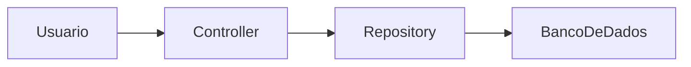

# Website

This website is built using [Docusaurus](https://docusaurus.io/), a modern static website generator.

### Assuntos e diagramas

O menu **Assuntos** abre `/docs/tags/`, com busca por nome e descrição das tags.
A busca ignora diferenças entre maiúsculas, minúsculas e acentos.
Selecione uma tag para consultar as aulas relacionadas.

As tags são cadastradas em `docs/tags.yml` e referenciadas pela chave no
frontmatter das aulas. Novas tags devem ser cadastradas nesse catálogo;
o build rejeita tags não cadastradas. As chaves existentes foram mantidas
para preservar as referências e rotas das aulas.

Para adicionar um diagrama, use um bloco com a linguagem `mermaid`:

````md

````

O tema Mermaid acompanha o modo claro ou escuro do site.

### Installation

```
$ yarn
```

### Local Development

```
$ yarn start
```

This command starts a local development server and opens up a browser window. Most changes are reflected live without having to restart the server.

### Build

```
$ yarn build
```

This command generates static content into the `build` directory and can be served using any static contents hosting service.

### Deployment

Using SSH:

```
$ USE_SSH=true yarn deploy
```

Not using SSH:

```
$ GIT_USER=<Your GitHub username> yarn deploy
```

If you are using GitHub pages for hosting, this command is a convenient way to build the website and push to the `gh-pages` branch.
