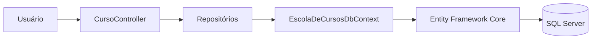
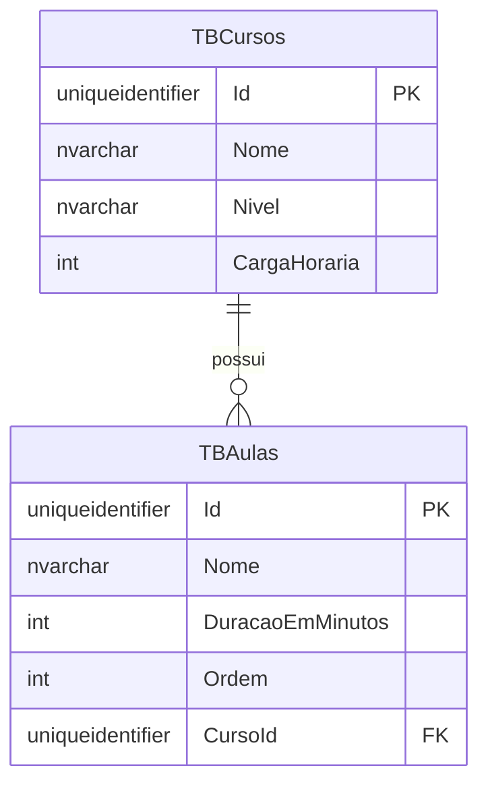
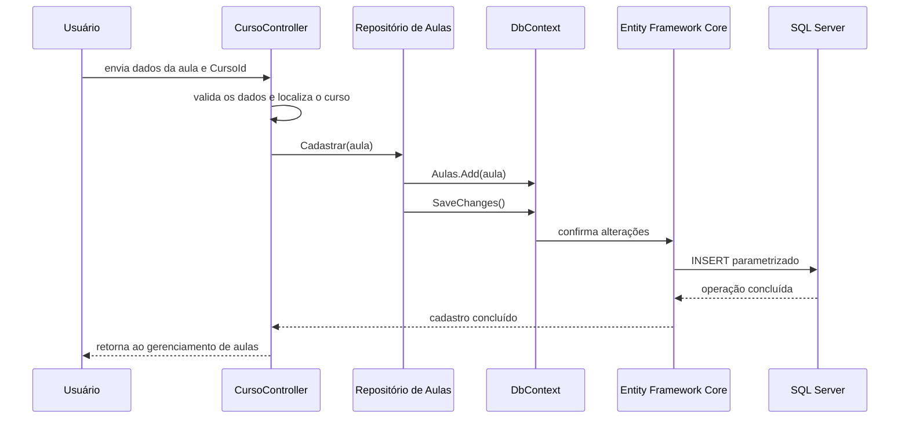

## Módulo de Cursos e Aulas com Entity Framework Core

Na Escola de Cursos, um curso é formado por aulas.

O módulo permite cadastrar e editar cursos, além de gerenciar as aulas de cada curso.

Nesta aula, vamos acompanhar a evolução desse módulo:

- primeiro, entendendo as funcionalidades e as entidades;
- depois, persistindo Cursos e Aulas com Entity Framework Core;
- por fim, carregando as aulas relacionadas com `Include`.

O fluxo principal da aplicação pode ser resumido assim:



## Apresentação do módulo de Cursos e Aulas

O módulo organiza dois tipos de informação:

- **Curso:** possui nome, nível e carga horária;
- **Aula:** possui nome, duração, ordem e pertence a um curso.

Na aplicação, o usuário pode:

- consultar a lista de cursos;
- cadastrar, editar e excluir um curso;
- abrir a tela de gerenciamento de aulas de um curso;
- adicionar, editar e remover aulas;
- ordenar as aulas por sua posição dentro do curso.

As telas utilizam ViewModels para transportar os dados entre formulário e Controller. O Controller valida as entradas e solicita as operações aos repositórios.

Assim, cada parte mantém uma responsabilidade:

- a View apresenta os dados e formulários;
- o Controller coordena a requisição;
- o repositório realiza as operações de persistência;
- o Entity Framework Core comunica as entidades com o banco.

## O relacionamento entre Curso e Aula

Um curso pode possuir várias aulas.

Cada aula pertence a um único curso.

Essa relação é chamada de **um para muitos**:



`TBAulas.CursoId` é a chave estrangeira que aponta para `TBCursos.Id`.

No código C#, essa relação aparece nos dois lados:

```csharp
public class Curso
{
    public List<Aula> Aulas { get; set; } = [];
}

public class Aula
{
    public Guid CursoId { get; set; }
    public Curso Curso { get; set; } = null!;
}
```

`Curso.Aulas` representa a coleção das aulas do curso.

`Aula.CursoId` guarda a chave estrangeira, e `Aula.Curso` representa a navegação para o curso relacionado.

> A chave estrangeira guarda o identificador usado pelo banco. A propriedade de navegação permite trabalhar com o objeto relacionado no código C#.

## Restrições do relacionamento

O banco impede que uma aula seja salva sem um curso correspondente.

Além disso, a configuração cria índices únicos para:

- nome da aula dentro do mesmo curso;
- posição (`Ordem`) dentro do mesmo curso.

Isso permite, por exemplo, que cursos diferentes tenham uma aula chamada `Introdução`, mas impede que o mesmo curso tenha duas aulas com o mesmo nome ou com a mesma ordem.

O relacionamento também utiliza `DeleteBehavior.Restrict`.

Isso significa que a exclusão de um curso com aulas relacionadas não é feita em cascata pelo banco. O Controller verifica se o curso possui aulas antes de solicitar sua exclusão.

## Registrando as entidades no DbContext

O `DbContext` representa a sessão de trabalho do Entity Framework Core com o banco.

No módulo, `EscolaDeCursosDbContext` expõe conjuntos para as entidades:

```csharp
public DbSet<Curso> Cursos => Set<Curso>();
public DbSet<Aula> Aulas => Set<Aula>();
```

As configurações das entidades também são aplicadas ao modelo:

```csharp
protected override void OnModelCreating(ModelBuilder modelBuilder)
{
    modelBuilder.ApplyConfiguration(new CursoConfiguration());
    modelBuilder.ApplyConfiguration(new AulaConfiguration());
}
```

O `DbSet<T>` permite consultar e alterar entidades daquele tipo.

As classes `CursoConfiguration` e `AulaConfiguration` concentram as regras de mapeamento para as tabelas.

## Mapeando a entidade Curso

A configuração de Curso escolhe a tabela `TBCursos`, define a chave primária e determina como o nível será armazenado:

```csharp
public sealed class CursoConfiguration : IEntityTypeConfiguration<Curso>
{
    public void Configure(EntityTypeBuilder<Curso> builder)
    {
        builder.ToTable("TBCursos");

        builder.HasKey(c => c.Id);
        builder.Property(c => c.Id).ValueGeneratedNever();

        builder.Property(c => c.Nome)
            .HasMaxLength(100)
            .IsRequired();

        builder.Property(c => c.Nivel)
            .HasConversion<string>()
            .IsRequired();

        builder.Property(c => c.CargaHoraria)
            .IsRequired();
    }
}
```

O identificador é criado pela aplicação, por isso o mapeamento informa `ValueGeneratedNever()`.

`HasConversion<string>()` indica que o valor do enum `NivelCurso` será persistido como texto.

## Mapeando a entidade Aula

A configuração de Aula define a tabela, suas colunas e as restrições de unicidade:

```csharp
public sealed class AulaConfiguration : IEntityTypeConfiguration<Aula>
{
    public void Configure(EntityTypeBuilder<Aula> builder)
    {
        builder.ToTable("TBAulas");

        builder.HasKey(a => a.Id);
        builder.Property(a => a.Id).ValueGeneratedNever();

        builder.Property(a => a.Nome)
            .HasMaxLength(100)
            .IsRequired();

        builder.Property(a => a.DuracaoEmMinutos).IsRequired();
        builder.Property(a => a.Ordem).IsRequired();
        builder.Property(a => a.CursoId).IsRequired();

        builder.HasIndex(a => new { a.CursoId, a.Nome })
            .IsUnique();

        builder.HasIndex(a => new { a.CursoId, a.Ordem })
            .IsUnique();
    }
}
```

O relacionamento entre as entidades é configurado em `CursoConfiguration`:

```csharp
builder.HasMany(c => c.Aulas)
    .WithOne(a => a.Curso)
    .HasForeignKey(a => a.CursoId)
    .HasConstraintName("FK_TBAulas_TBCurso")
    .OnDelete(DeleteBehavior.Restrict);
```

Leia essa configuração do lado do Curso:

1. um Curso (`HasMany`) possui muitas Aulas;
2. cada Aula (`WithOne`) possui um Curso;
3. `CursoId` é a chave estrangeira;
4. a exclusão do curso relacionado é restrita enquanto houver aulas.

## Persistindo Cursos e Aulas

Os repositórios recebem `EscolaDeCursosDbContext` por injeção de dependência.

Para cadastrar uma entidade, o padrão é adicionar ao conjunto e salvar as alterações:

```csharp
public void Cadastrar(Curso entidade)
{
    dbContext.Cursos.Add(entidade);
    dbContext.SaveChanges();
}
```

O repositório de Aulas utiliza o mesmo fluxo:

```csharp
public void Cadastrar(Aula entidade)
{
    dbContext.Aulas.Add(entidade);
    dbContext.SaveChanges();
}
```

`Add` informa ao contexto que a entidade deve ser inserida.

`SaveChanges()` confirma a operação no banco.

Para editar uma entidade já persistida, o repositório a consulta, altera seus dados e salva:

```csharp
Curso? cursoSelecionado = SelecionarPorId(idSelecionado);

if (cursoSelecionado == null)
    return false;

cursoSelecionado.Atualizar(entidadeAtualizada);
dbContext.SaveChanges();
```

Como a entidade foi consultada pelo mesmo contexto, o EF Core acompanha suas alterações. Ao salvar, ele gera o comando necessário.

Para excluir, o repositório consulta a entidade, chama `Remove` e depois `SaveChanges()`.

## Registrando o DbContext e os repositórios

O contexto é configurado para utilizar o provedor do SQL Server e a conexão `SqlServerDocker`:

```csharp
services.AddDbContext<EscolaDeCursosDbContext>(options =>
{
    string? connectionString =
        configuration.GetConnectionString("SqlServerDocker");

    if (string.IsNullOrWhiteSpace(connectionString))
        throw new InvalidOperationException(
            "A Connection String `SqlServerDocker` não foi encontrada"
        );

    options.UseSqlServer(connectionString);
});
```

Depois, as interfaces dos repositórios são ligadas às implementações que usam ORM:

```csharp
services.AddScoped<IRepositorioCurso, RepositorioCursoEmOrm>();
services.AddScoped<IRepositorioAula, RepositorioAulaEmOrm>();
```

Quando uma requisição precisa de um Controller, o container fornece os repositórios e o contexto configurado.

O fluxo de cadastro de uma aula fica assim:



## O que é Include?

Uma consulta como esta carrega os cursos:

```csharp
return dbContext.Cursos
    .SingleOrDefault(c => c.Id == idSelecionado);
```

Mas, por padrão, não devemos assumir que a coleção `curso.Aulas` também foi carregada.

Quando precisamos do curso junto com suas aulas, utilizamos `Include`:

```csharp
return dbContext.Cursos
    .Include(c => c.Aulas)
    .SingleOrDefault(c => c.Id == idSelecionado);
```

`Include(c => c.Aulas)` informa que a consulta também deve carregar os dados da navegação `Aulas`.

Essa técnica é chamada de **carregamento antecipado** (*eager loading*): os dados relacionados são solicitados junto com a consulta principal.

## Usando Include para gerenciar aulas

O método `SelecionarPorId` de `RepositorioCursoEmOrm` utiliza `Include`:

```csharp
public Curso? SelecionarPorId(Guid idSelecionado)
{
    return dbContext.Cursos
        .Include(c => c.Aulas)
        .SingleOrDefault(c => c.Id == idSelecionado);
}
```

O Controller usa esse método ao abrir o gerenciamento de aulas:

```csharp
Curso? curso = repositorioCurso.SelecionarPorId(id);

if (curso == null)
    return RedirectToAction(nameof(Listar));

List<ListarAulaViewModel> aulasVm = curso.Aulas
    .Select(a => new ListarAulaViewModel(
        a.Id,
        a.Nome,
        a.DuracaoEmMinutos,
        a.Ordem
    ))
    .ToList();
```

O `Include` permite que a coleção usada pelo Controller esteja carregada.

Sem ele, o Controller não deve contar que `curso.Aulas` terá os registros relacionados.

## Include e JOIN

O Entity Framework Core transforma consultas LINQ em comandos para o provedor configurado.

Para este tipo de consulta, o EF Core normalmente combina os dados do Curso e das Aulas usando SQL, frequentemente com um `JOIN`.

O código C# expressa quais dados relacionados são necessários; não precisamos escrever manualmente a consulta SQL para esse carregamento.

O SQL gerado pode variar conforme o provedor e as configurações da consulta. Por isso, trate `Include` como uma instrução de carregamento do relacionamento, e não como uma garantia de que sempre haverá exatamente um `JOIN` específico.

Compare:

```csharp
// Consulta apenas o Curso
dbContext.Cursos
    .SingleOrDefault(c => c.Id == idSelecionado);
```

```csharp
// Consulta o Curso e carrega sua coleção de Aulas
dbContext.Cursos
    .Include(c => c.Aulas)
    .SingleOrDefault(c => c.Id == idSelecionado);
```

O `Include` deve ser usado quando a funcionalidade realmente precisa dos dados relacionados.

Carregar relacionamentos sem necessidade pode transferir dados a mais e tornar a consulta mais pesada.

## Consultando aulas de um curso

Também é possível consultar diretamente as aulas filtrando pela chave estrangeira:

```csharp
public List<Aula> SelecionarPorCursoId(Guid cursoId)
{
    return dbContext.Aulas
        .Where(a => a.CursoId == cursoId)
        .OrderBy(a => a.Ordem)
        .ToList();
}
```

Essa consulta retorna as aulas daquele curso na ordem definida.

Ela é diferente de carregar um Curso com `Include`: aqui o resultado principal é uma lista de `Aula`; no `Include`, o resultado principal é um `Curso` com sua coleção de aulas carregada.

## Migration das tabelas

Uma migration registra alterações no modelo do banco.

Para este módulo, a migration cria:

- `TBCursos`;
- `TBAulas`;
- a chave estrangeira de `TBAulas.CursoId` para `TBCursos.Id`;
- os índices únicos de nome e ordem por curso.

Depois que as configurações forem adicionadas ao `DbContext`, gere uma migration:

```bash
dotnet ef migrations add Add_TBCursos_TBAulas \
  --project WebApp/EscolaDeCursos.WebApp.csproj \
  --output-dir Migrations
```

Para aplicar as alterações ao banco:

```bash
dotnet ef database update \
  --project WebApp/EscolaDeCursos.WebApp.csproj
```

Se a migration já existir no projeto, não a gere novamente. Nesse caso, aplique as migrations pendentes com `database update`.

## Verificando as funcionalidades

Depois de configurar a conexão e aplicar as migrations, execute a aplicação e confira o fluxo do módulo:

1. Cadastre um curso com nome, nível e carga horária válidos.
2. Abra o gerenciamento de aulas desse curso.
3. Cadastre aulas com nome, duração e ordem.
4. Confirme que a listagem apresenta as aulas na ordem correta.
5. Edite e remova uma aula.
6. Tente repetir o nome ou a ordem de uma aula no mesmo curso.
7. Tente excluir um curso que ainda possui aulas.
8. Depois de remover suas aulas, confirme que o curso pode ser excluído.

As verificações de nome e ordem feitas pela aplicação ajudam a apresentar um fluxo adequado ao usuário.

Os índices únicos e a chave estrangeira também protegem a consistência dos dados no banco.

## Conclusão

O módulo de Cursos e Aulas utiliza entidades relacionadas e mantém as operações de banco em repositórios.

Nesta aula, vimos que:

- um Curso pode possuir várias Aulas;
- `CursoId` relaciona cada Aula ao seu Curso;
- o `DbContext` expõe os conjuntos `Cursos` e `Aulas`;
- as configurações mapeiam entidades, tabelas, índices e chave estrangeira;
- os repositórios usam `Add`, `Remove` e `SaveChanges()` para persistir alterações;
- `Include(c => c.Aulas)` carrega aulas relacionadas ao consultar um curso;
- o EF Core traduz as consultas para operações compatíveis com o banco configurado.

Com essa estrutura, o Controller trabalha com objetos do domínio e o Entity Framework Core cuida da comunicação entre esses objetos e as tabelas.
