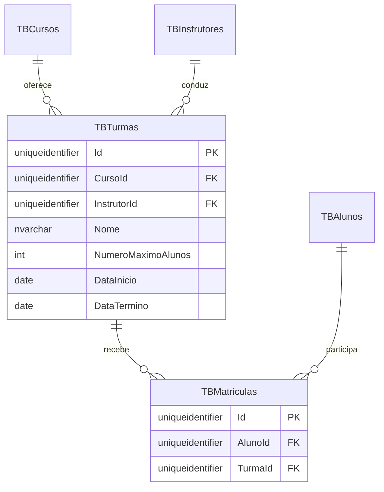
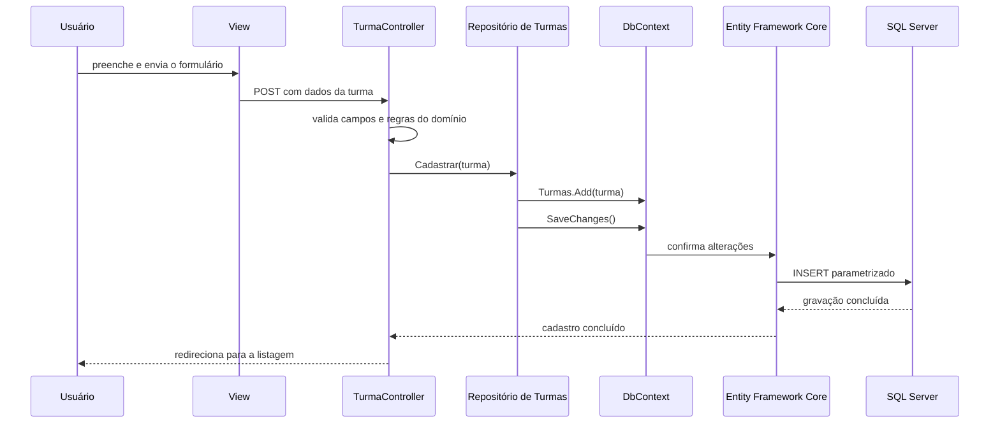
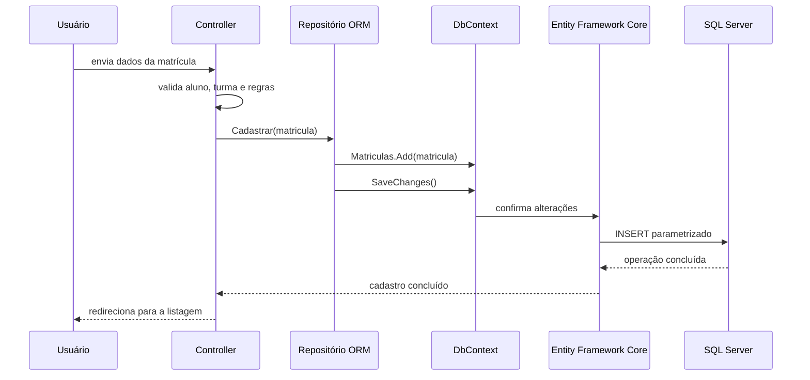
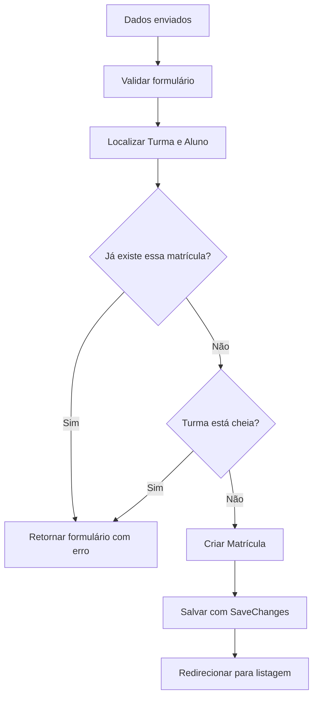

## Módulo de Turmas e Matrículas com Entity Framework Core

Uma escola precisa organizar as ofertas de seus cursos e acompanhar quais alunos participam de cada turma.

Para isso, o módulo acrescenta duas funcionalidades:

- gerenciamento de Turmas;
- gerenciamento de Matrículas.

Na primeira implementação, os repositórios de Turmas e Matrículas utilizavam arquivos JSON.

Na evolução estudada nesta aula, o módulo passa a utilizar Entity Framework Core para persistir as entidades em tabelas do SQL Server.

Também veremos como carregar as entidades relacionadas com `Include` e como a aplicação aplica migrations pendentes ao iniciar em ambiente de desenvolvimento.

## O que é uma Turma?

Uma Turma representa uma oferta de um Curso em um período específico, conduzida por um Instrutor.

Ela possui:

- nome;
- curso;
- instrutor;
- número máximo de alunos;
- data de início;
- data de término;
- lista de matrículas.

Uma turma exige um nome entre 2 e 100 caracteres.

O limite de alunos deve ficar entre 1 e 100.

As datas precisam ser informadas, e a data de término deve ser posterior à data de início.

## O que é uma Matrícula?

Uma Matrícula associa um Aluno a uma Turma.

Em vez de representar essa associação como um campo de texto, o domínio mantém referências aos objetos relacionados:

```csharp
public class Matricula : EntidadeBase<Matricula>
{
    public Guid AlunoId { get; set; }
    public Aluno Aluno { get; set; } = null!;
    public Guid TurmaId { get; set; }
    public Turma Turma { get; set; } = null!;
}
```

Uma matrícula aponta para um Aluno e uma Turma.

Um Aluno pode possuir matrículas em diferentes turmas, e uma Turma pode possuir matrículas de vários alunos.

O relacionamento também é representado no banco pelas tabelas e chaves estrangeiras:



Cada objeto `Matricula` conecta um aluno a uma turma.

`CursoId`, `InstrutorId`, `AlunoId` e `TurmaId` são chaves estrangeiras no modelo relacional.

Cada matrícula liga um aluno a uma turma. Um índice único composto por `TurmaId` e `AlunoId` impede que o mesmo aluno seja matriculado duas vezes na mesma turma.

## Conhecendo as telas do módulo

As páginas de Turmas e Matrículas seguem o padrão visual da aplicação.

As telas de listagem apresentam os registros em cartões e oferecem ações para cadastrar, editar ou excluir.

Na listagem de Turmas, cada cartão mostra:

- nome da turma;
- curso;
- instrutor;
- datas de início e término;
- quantidade de matrículas em relação ao limite de alunos.

Na listagem de Matrículas, cada cartão mostra o aluno, seu número de matrícula e a turma associada.

Os formulários usam listas de seleção para que o usuário escolha um Curso e um Instrutor ao cadastrar uma Turma, ou uma Turma e um Aluno ao cadastrar uma Matrícula.

## Como o Controller coordena uma requisição?

O `TurmaController` recebe os repositórios necessários por injeção de dependência.

Para cadastrar uma turma, ele:

1. verifica os dados recebidos pelo formulário;
2. localiza o Curso e o Instrutor selecionados;
3. cria a entidade `Turma`;
4. executa as validações do domínio;
5. solicita o cadastro ao repositório;
6. redireciona para a listagem.

O fluxo de cadastro pode ser representado assim:



## Configurando o modelo no DbContext

O `EscolaDeCursosDbContext` representa a sessão de trabalho do Entity Framework Core com o banco.

Ele expõe `DbSet` para Turmas e Matrículas e aplica as configurações de cada entidade:

```csharp
public DbSet<Turma> Turmas => Set<Turma>();
public DbSet<Matricula> Matriculas => Set<Matricula>();

protected override void OnModelCreating(ModelBuilder modelBuilder)
{
    modelBuilder.ApplyConfiguration(new TurmaConfiguration());
    modelBuilder.ApplyConfiguration(new MatriculaConfiguration());
}
```

Um `DbSet<T>` permite consultar e persistir entidades daquele tipo.

As classes de configuração mantêm o mapeamento entre as entidades C# e as tabelas separado das regras do domínio.

## Mapeando a entidade Turma

`TurmaConfiguration` mapeia a entidade para `TBTurmas`:

```csharp
builder.ToTable("TBTurmas");

builder.HasKey(t => t.Id);
builder.Property(t => t.Id).ValueGeneratedNever();

builder.Property(t => t.Nome)
    .HasMaxLength(100)
    .IsRequired();

builder.Property(t => t.DataInicio)
    .HasColumnType("date")
    .IsRequired();

builder.Property(t => t.DataTermino)
    .HasColumnType("date")
    .IsRequired();
```

O `Id` é gerado pela aplicação. Por isso, `ValueGeneratedNever()` informa que o banco não deve gerar esse valor.

O mapeamento também define os relacionamentos com Curso e Instrutor:

```csharp
builder.HasOne(t => t.Curso)
    .WithMany(c => c.Turmas)
    .HasForeignKey(t => t.CursoId)
    .OnDelete(DeleteBehavior.Restrict);

builder.HasOne(t => t.Instrutor)
    .WithMany(i => i.Turmas)
    .HasForeignKey(t => t.InstrutorId)
    .OnDelete(DeleteBehavior.Restrict);
```

Cada Turma possui um Curso e um Instrutor.

Um Curso e um Instrutor podem estar associados a várias Turmas.

`DeleteBehavior.Restrict` impede a exclusão de um Curso ou Instrutor enquanto houver Turmas relacionadas.

## Mapeando a entidade Matrícula

`MatriculaConfiguration` mapeia a entidade para `TBMatriculas` e define a relação com Aluno:

```csharp
builder.ToTable("TBMatriculas");

builder.HasKey(m => m.Id);
builder.Property(m => m.Id).ValueGeneratedNever();

builder.HasOne(m => m.Aluno)
    .WithMany()
    .HasForeignKey(m => m.AlunoId)
    .OnDelete(DeleteBehavior.Restrict);
```

A relação com Turma é configurada pelo lado de `Turma`:

```csharp
builder.HasMany(t => t.Matriculas)
    .WithOne(m => m.Turma)
    .HasForeignKey(m => m.TurmaId)
    .OnDelete(DeleteBehavior.Restrict);
```

O índice composto protege contra matrículas duplicadas:

```csharp
builder.HasIndex(m => new { m.TurmaId, m.AlunoId })
    .IsUnique();
```

Assim, o mesmo aluno pode participar de turmas diferentes, mas não pode aparecer duas vezes na mesma turma.

## Registrando o DbContext e os repositórios

O `DbContext` usa o provedor do SQL Server e a string de conexão configurada para a aplicação:

```csharp
services.AddDbContext<EscolaDeCursosDbContext>(options =>
{
    string? connectionString =
        configuration.GetConnectionString("SqlServerDocker");

    if (string.IsNullOrWhiteSpace(connectionString))
        throw new InvalidOperationException(
            "A string de conexão SqlServerDocker não foi encontrada"
        );

    options.UseSqlServer(connectionString);
});
```

As implementações de ORM são registradas para as interfaces usadas pelos Controllers:

```csharp
services.AddScoped<IRepositorioTurma, RepositorioTurmaEmOrm>();
services.AddScoped<IRepositorioMatricula, RepositorioMatriculaEmOrm>();
```

Com isso, os Controllers continuam dependendo das interfaces. Eles não precisam conhecer o `DbContext` nem executar SQL diretamente.

## Persistindo Turmas e Matrículas

Os repositórios recebem o `EscolaDeCursosDbContext` por injeção de dependência.

Para cadastrar, adicionam a entidade ao conjunto correspondente e salvam:

```csharp
public void Cadastrar(Turma entidade)
{
    dbContext.Turmas.Add(entidade);
    dbContext.SaveChanges();
}
```

O repositório de Matrículas segue o mesmo padrão:

```csharp
public void Cadastrar(Matricula entidade)
{
    dbContext.Matriculas.Add(entidade);
    dbContext.SaveChanges();
}
```

`Add` marca a entidade para inserção.

`SaveChanges()` confirma as alterações no banco.

Para editar, o repositório consulta a entidade, aplica os novos dados e salva. Como o contexto acompanha a entidade consultada, o EF Core identifica as alterações.

Para excluir, o repositório consulta a entidade, chama `Remove` e executa `SaveChanges()`.

O fluxo da requisição fica assim:



## Carregando relacionamentos com Include

O repositório de Matrículas precisa devolver o Aluno e a Turma relacionados para que o Controller monte os dados da tela.

Para isso, a consulta por identificador usa `Include`:

```csharp
return dbContext.Matriculas
    .Include(m => m.Aluno)
    .Include(m => m.Turma)
    .SingleOrDefault(m => m.Id == idSelecionado);
```

Na listagem, a consulta carrega as mesmas navegações:

```csharp
return dbContext.Matriculas
    .Include(m => m.Aluno)
    .Include(m => m.Turma)
    .ToList();
```

`Include` solicita o carregamento dos dados relacionados. Esse padrão é chamado de **carregamento antecipado** (*eager loading*).

O repositório de Turmas também carrega vários relacionamentos:

```csharp
return dbContext.Turmas
    .Include(t => t.Curso)
        .ThenInclude(c => c.Aulas)
    .Include(t => t.Instrutor)
    .Include(t => t.Matriculas)
        .ThenInclude(m => m.Aluno)
    .SingleOrDefault(t => t.Id == idSelecionado);
```

Leia a consulta seguindo as navegações:

- `Include(t => t.Curso)` carrega o Curso da Turma;
- `ThenInclude(c => c.Aulas)` carrega as Aulas desse Curso;
- `Include(t => t.Instrutor)` carrega o Instrutor;
- `Include(t => t.Matriculas)` carrega as Matrículas;
- `ThenInclude(m => m.Aluno)` carrega o Aluno de cada Matrícula.

O Entity Framework Core traduz a consulta LINQ para operações SQL. Com o provedor relacional, essas inclusões normalmente são realizadas com `JOIN` ou consultas relacionadas, conforme a configuração da consulta.

O objetivo do `Include` é declarar quais objetos relacionados a aplicação precisa receber. Não significa que devemos escrever o `JOIN` manualmente, nem que todas as consultas devam carregar todos os relacionamentos.

> Carregue somente os relacionamentos necessários para a funcionalidade. Incluir coleções grandes sem necessidade pode aumentar os dados consultados.

Para entender como as alterações do modelo chegam ao SQL Server e como a aplicação aplica migrations pendentes, consulte [Migrations Automáticas com DbContext](/banco-de-dados-sql/migrations-automaticas-dbcontext).

## Regras para cadastrar uma Matrícula

O formulário recebe os identificadores selecionados de Turma e Aluno.

O Controller localiza as entidades e verifica se a associação pode ser criada.

As regras impedem:

- selecionar uma Turma ou um Aluno inexistente;
- matricular o mesmo Aluno mais de uma vez na mesma Turma;
- ultrapassar o número máximo de alunos da Turma.

O fluxo principal é:



Durante a edição, a regra de duplicidade ignora a matrícula que está sendo alterada.

Se o aluno continuar na mesma turma, a contagem de matrículas também considera essa edição para não rejeitar o próprio registro como uma vaga adicional.

## Protegendo as relações ao excluir

Uma Turma não pode ser excluída enquanto possuir Matrículas.

O Controller verifica se existem matrículas relacionadas antes de solicitar a exclusão.

Além disso, o mapeamento utiliza `DeleteBehavior.Restrict` nas relações com Curso, Instrutor e Matrícula. O banco rejeita uma exclusão que deixaria referências inválidas.

Assim, a regra de negócio orienta o fluxo da aplicação, enquanto as chaves estrangeiras protegem a integridade dos dados no banco.

## Testando o módulo

Para verificar o comportamento, teste o fluxo completo:

1. Cadastre um Curso e um Instrutor, caso ainda não existam.
2. Cadastre uma Turma com datas válidas e um limite de alunos.
3. Confira se a turma aparece com o Curso, o Instrutor e as datas corretas.
4. Cadastre uma Matrícula escolhendo um Aluno e uma Turma.
5. Confira se a matrícula aparece associada aos dados selecionados.
6. Tente cadastrar novamente o mesmo Aluno na mesma Turma.
7. Tente ultrapassar o limite de alunos da Turma.
8. Tente excluir uma Turma que ainda possui Matrículas.
9. Exclua uma Matrícula e confirme que a quantidade exibida na Turma foi atualizada.

## Conclusão

O módulo conecta Cursos, Instrutores, Turmas, Alunos e Matrículas por meio de relações entre entidades no Entity Framework Core.

Nesta implementação:

- Turmas e Matrículas são mapeadas para `TBTurmas` e `TBMatriculas`;
- os Controllers validam e coordenam as operações;
- os repositórios usam `DbContext` para consultar e salvar entidades;
- `Include` e `ThenInclude` carregam os dados relacionados necessários.

As relações no modelo C# e as chaves estrangeiras no banco ajudam a manter os dados consistentes durante as operações do módulo.
