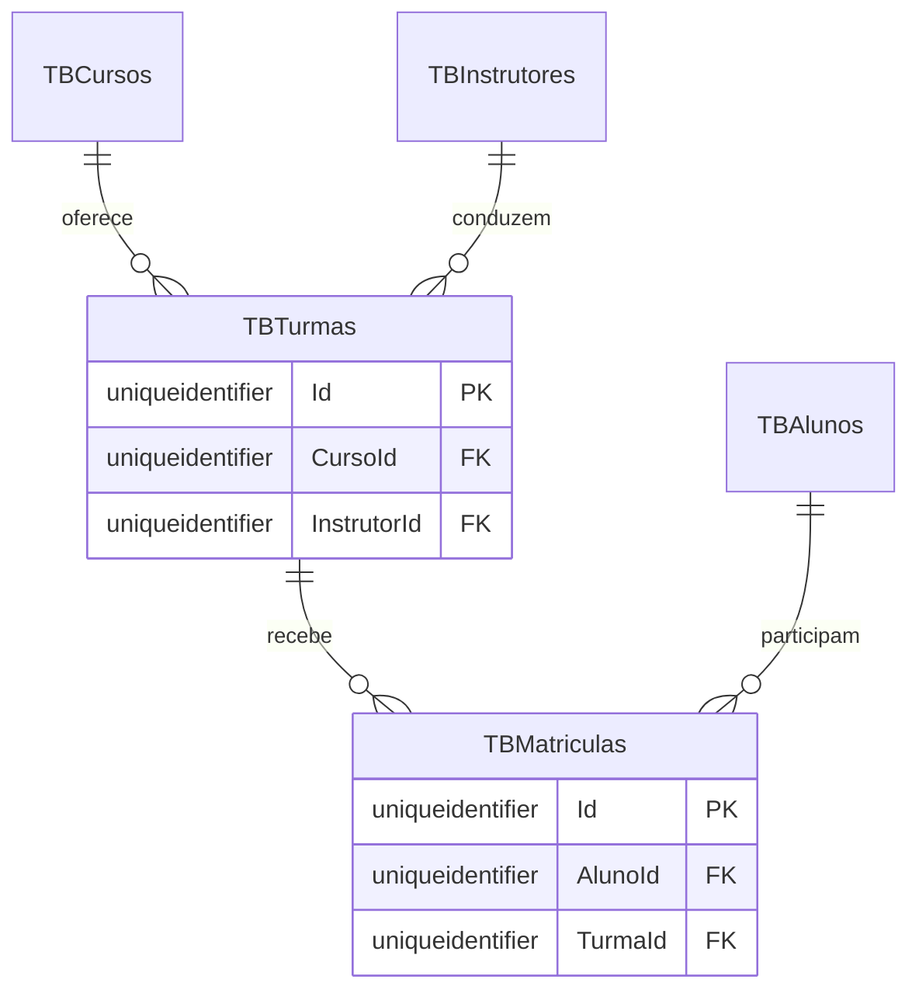
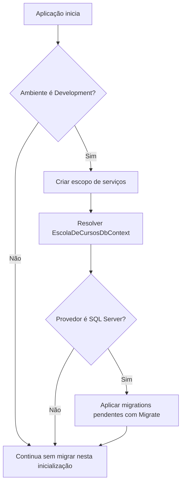

## Migrations Automáticas com DbContext

Quando adicionamos uma entidade ou alteramos seu mapeamento, o modelo C# pode deixar de corresponder às tabelas existentes no banco.

O Entity Framework Core organiza essas alterações por meio de **migrations**.

Nesta aula, vamos acompanhar como criar uma migration para Turmas e Matrículas e como a aplicação utiliza o `DbContext` para aplicar migrations pendentes durante a inicialização em desenvolvimento.

## O que é uma migration?

Uma migration é um conjunto versionado de operações para alterar a estrutura do banco.

Ela descreve as mudanças necessárias para que o esquema do SQL Server acompanhe o modelo configurado no código.

No módulo de Turmas e Matrículas, as configurações definem:

- a tabela `TBTurmas`, relacionada a Cursos e Instrutores;
- a tabela `TBMatriculas`, relacionada a Alunos e Turmas;
- chaves estrangeiras com exclusão restrita;
- um índice único para o par `TurmaId` e `AlunoId`.

O relacionamento pode ser visualizado assim:



Essas relações são descritas no modelo e nas configurações aplicadas pelo `EscolaDeCursosDbContext`.

## Gerando uma migration

Depois de atualizar as entidades, o `DbContext` e as configurações, precisamos criar uma migration para registrar a alteração.

No projeto da Escola de Cursos, o comando é:

```bash
dotnet ef migrations add Add_TBTurmas_TBMatriculas \
  --project WebApp/EscolaDeCursos.WebApp.csproj \
  --output-dir Migrations
```

O nome `Add_TBTurmas_TBMatriculas` resume a alteração que será registrada.

O comando compara o modelo atual com o snapshot da última migration e gera arquivos, normalmente:

- um arquivo principal com as operações `Up` e `Down`;
- um arquivo `.Designer.cs` com metadados da migration;
- a atualização do `EscolaDeCursosDbContextModelSnapshot`.

O método `Up` descreve como aplicar a mudança.

O método `Down` descreve como revertê-la.

> Gerar uma migration não altera o banco. O comando cria os arquivos que descrevem a mudança; a aplicação da migration é uma etapa separada.

Antes de aplicar uma migration, revise os arquivos gerados e confirme que as operações correspondem à alteração desejada.

## O que significa aplicar uma migration?

Aplicar uma migration executa suas operações no banco de dados.

Também registra que aquela versão foi aplicada, para que o Entity Framework Core possa identificar migrations pendentes em execuções futuras.

Uma forma manual de aplicar as migrations pendentes é:

```bash
dotnet ef database update \
  --project WebApp/EscolaDeCursos.WebApp.csproj
```

No projeto estudado, a aplicação também consegue executar essa etapa durante a inicialização em desenvolvimento.

## Aplicando migrations com o DbContext

O `DbContext` oferece acesso ao banco e às operações de migration por meio de `Database`.

No `Program.cs`, a aplicação cria um escopo, resolve `EscolaDeCursosDbContext` e chama `Migrate()`:

```csharp
if (app.Environment.IsDevelopment())
{
    using var scope = app.Services.CreateScope();

    var dbContext = scope.ServiceProvider
        .GetRequiredService<EscolaDeCursosDbContext>();

    if (dbContext.Database.IsSqlServer())
        dbContext.Database.Migrate();
}
```

Vamos observar o que cada parte faz.

### Limitando a execução ao desenvolvimento

```csharp
if (app.Environment.IsDevelopment())
```

Esse teste faz a aplicação automática ocorrer apenas quando o ambiente atual é `Development`.

O comportamento é intencional. Alterações de esquema em produção precisam de um processo controlado de revisão e implantação.

### Criando um escopo de serviços

```csharp
using var scope = app.Services.CreateScope();
```

O `DbContext` é registrado com um tempo de vida por escopo.

O escopo permite resolver essa dependência durante a inicialização e garante que ela seja descartada ao final do bloco.

### Resolvendo o DbContext

```csharp
var dbContext = scope.ServiceProvider
    .GetRequiredService<EscolaDeCursosDbContext>();
```

O container fornece o contexto que foi registrado com o provedor e a string de conexão da aplicação.

Se o contexto não tiver sido registrado, `GetRequiredService` lança uma exceção e a aplicação não continua silenciosamente sem aplicar a configuração esperada.

### Conferindo o provedor e aplicando as mudanças

```csharp
if (dbContext.Database.IsSqlServer())
    dbContext.Database.Migrate();
```

`IsSqlServer()` verifica se o contexto utiliza o provedor do SQL Server.

`Migrate()` aplica as migrations existentes que ainda não foram aplicadas ao banco.

O fluxo completo fica assim:



## Migrate não gera migrations

É importante separar duas operações com nomes parecidos:

| Operação | O que faz |
| --- | --- |
| `dotnet ef migrations add NomeDaMigration` | gera arquivos de migration a partir das mudanças no modelo |
| `dbContext.Database.Migrate()` | aplica no banco as migrations que já existem e estão pendentes |

Portanto, alterar uma classe C# não cria automaticamente uma migration.

Uma pessoa desenvolvedora ainda precisa gerar a migration e revisar o resultado.

Depois disso, o projeto pode aplicar automaticamente essa migration durante a inicialização em desenvolvimento.

## O que acontece na inicialização?

Quando a aplicação inicia em `Development`, o EF Core:

1. resolve o `EscolaDeCursosDbContext` configurado;
2. identifica o provedor SQL Server;
3. verifica quais migrations foram aplicadas;
4. executa as migrations pendentes;
5. registra a atualização no banco;
6. permite que a aplicação continue a inicialização.

No caso de Turmas e Matrículas, a migration cria `TBTurmas` e `TBMatriculas` e configura suas chaves e índices.

O banco precisa estar acessível e a string de conexão precisa apontar para o banco correto.

Se a conexão falhar durante essa etapa, a aplicação pode falhar ao iniciar.

## Cuidados ao aplicar migrations automaticamente

Aplicar migrations no início simplifica a configuração local e evita que cada pessoa precise executar manualmente o comando de atualização antes de testar a aplicação.

Mesmo assim, é importante considerar alguns cuidados:

- revise as migrations antes de aplicá-las;
- mantenha uma cópia de segurança dos dados importantes;
- não habilite a execução automática em produção sem avaliar o processo de implantação;
- em produção, prefira uma etapa de implantação controlada, como um script ou pacote de migration revisado;
- não use `EnsureCreated()` junto com migrations para o mesmo banco, pois essa API não mantém o histórico de migrations.

O código do projeto limita a chamada de `Migrate()` ao ambiente de desenvolvimento.

Essa condição reduz o risco de uma inicialização de produção alterar o banco sem revisão.

## Problemas comuns

### A aplicação não encontra o DbContext

Confira se:

- `EscolaDeCursosDbContext` está registrado com `AddDbContext`;
- as opções utilizam o provedor SQL Server;
- o contexto possui as entidades e configurações necessárias.

### A aplicação não consegue conectar ao SQL Server

Confira se:

- o SQL Server está em execução;
- o nome da conexão corresponde ao utilizado no código;
- o banco configurado existe ou pode ser criado pelo processo utilizado;
- usuário, senha, servidor e porta estão corretos.

### As tabelas não foram criadas

Confirme se:

- a migration foi gerada;
- a migration foi incluída no projeto;
- `Migrate()` foi executado no ambiente `Development`;
- o contexto está utilizando o banco que você está verificando.

Lembre-se: a chamada de `Migrate()` não consegue aplicar uma migration que ainda não foi criada.

## Conclusão

As migrations permitem versionar as alterações da estrutura do banco.

No módulo de Turmas e Matrículas:

- as configurações descrevem as tabelas e seus relacionamentos;
- `dotnet ef migrations add` gera os arquivos de alteração;
- `Database.Migrate()` aplica as migrations pendentes;
- o `Program.cs` executa essa aplicação automática apenas em desenvolvimento.

Assim, a estrutura do SQL Server pode acompanhar a evolução do modelo sem confundir a geração da migration com sua aplicação.
