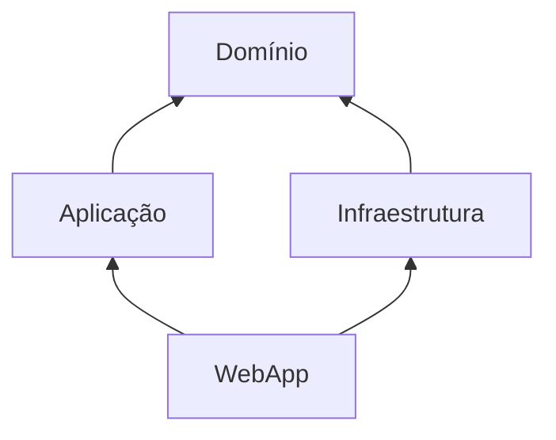
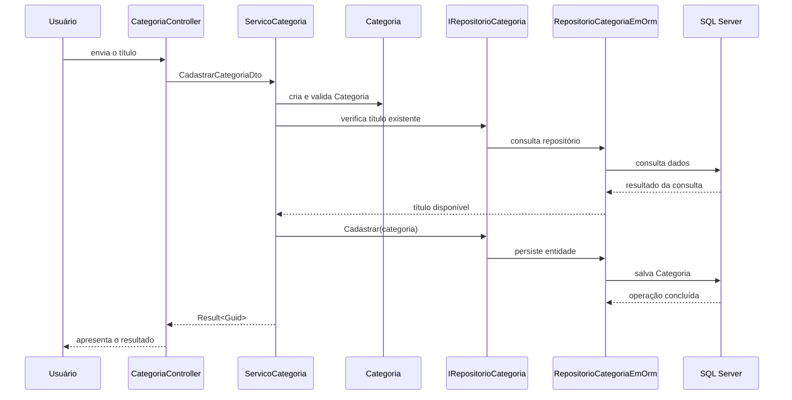

## Introdução à Clean Architecture e Camada de Aplicação

Conforme uma aplicação cresce, separar arquivos em pastas ajuda, mas não resolve todos os problemas.

Também precisamos definir quais partes podem conhecer as outras e onde cada responsabilidade deve ficar.

Nesta aula, vamos organizar a solução do e-Agenda em projetos separados e conhecer a função da Camada de Aplicação por meio do serviço de Categorias.

## O problema de manter tudo em um único projeto

Uma aplicação Web reúne responsabilidades diferentes:

- receber requisições HTTP e responder ao usuário;
- executar casos de uso da aplicação;
- aplicar regras do domínio;
- acessar banco de dados e outros recursos externos.

Se todas essas responsabilidades dependerem diretamente umas das outras, uma alteração em uma parte pode afetar muitas outras.

Por exemplo, um Controller que valida regras de negócio e executa consultas do Entity Framework Core fica responsável por interface, regras e persistência ao mesmo tempo.

Separar as camadas ajuda a deixar mais claro onde cada decisão deve acontecer.

## O que é Clean Architecture?

Clean Architecture é uma forma de organizar o software em camadas com responsabilidades e dependências explícitas.

Uma ideia importante é que as regras centrais da aplicação não devem depender dos detalhes externos, como uma tela ou um banco específico.

No e-Agenda, a solução da versão estudada contém estes projetos:

```text
eAgenda.slnx
└── src/
    ├── Dominio/
    │   └── eAgenda.Dominio.csproj
    ├── Aplicacao/
    │   └── eAgenda.Aplicacao.csproj
    ├── Infraestrutura/
    │   └── eAgenda.Infraestrutura.csproj
    └── WebApp/
        └── eAgenda.WebApp.csproj
```

O arquivo `eAgenda.slnx` agrupa os projetos para que possam ser abertos e compilados como uma solução.

Ele não é uma camada da aplicação. É o arquivo que organiza os projetos de desenvolvimento.

## Responsabilidades das camadas

Cada projeto concentra um tipo de responsabilidade.

### Domínio

O projeto `Dominio` contém conceitos e regras centrais do negócio.

Na funcionalidade de Categorias, por exemplo, ele contém:

- a entidade `Categoria`;
- a validação do título;
- a interface `IRepositorioCategoria`;
- os contratos genéricos de entidade e repositório.

O domínio declara o contrato do repositório, mas não precisa saber se os dados serão guardados no SQL Server, em arquivos ou em outro armazenamento.

### Aplicação

O projeto `Aplicacao` coordena os casos de uso.

Um **caso de uso** representa uma ação que a aplicação oferece, como cadastrar ou listar Categorias.

O serviço de aplicação recebe os dados necessários, chama as regras do domínio e utiliza interfaces para solicitar operações externas.

### Infraestrutura

O projeto `Infraestrutura` implementa detalhes técnicos externos.

Na versão estudada, ele contém o acesso ao SQL Server com Entity Framework Core e a implementação `RepositorioCategoriaEmOrm` da interface definida no Domínio.

Assim, a interface expressa o que o domínio precisa; a Infraestrutura fornece uma forma concreta de atender a esse contrato.

### WebApp

O projeto `WebApp` é a camada de entrada HTTP e apresentação.

Ele contém Controllers, Views, ViewModels e o `Program.cs`, que configura e inicia a aplicação.

O Controller recebe a requisição e delega o caso de uso ao serviço da Aplicação.

## Como as dependências conectam os projetos?

As referências de projeto indicam quem pode utilizar os tipos de quem.

Na solução do e-Agenda, a estrutura é:



As setas representam referências de projeto: a Aplicação e a Infraestrutura conhecem o Domínio; a WebApp conhece a Aplicação e a Infraestrutura para configurar e executar os serviços.

Observe que o projeto de Domínio não referencia a WebApp nem o Entity Framework Core.

Essa independência mantém as regras centrais menos presas aos detalhes técnicos.

> Separar projetos ajuda a organizar as dependências, mas não garante uma boa arquitetura por si só. Também é preciso manter cada responsabilidade na camada adequada.

## Criando a solução e os projetos

Uma solução permite agrupar projetos relacionados sem misturar seus arquivos de código.

Os comandos a seguir criam uma estrutura equivalente à organização da solução estudada:

```bash
dotnet new sln --name eAgenda --format slnx

mkdir src

dotnet new classlib --name eAgenda.Dominio --output src/Dominio
dotnet new classlib --name eAgenda.Aplicacao --output src/Aplicacao
dotnet new classlib --name eAgenda.Infraestrutura --output src/Infraestrutura
dotnet new mvc --name eAgenda.WebApp --output src/WebApp

dotnet sln eAgenda.slnx add src/Dominio/eAgenda.Dominio.csproj
dotnet sln eAgenda.slnx add src/Aplicacao/eAgenda.Aplicacao.csproj
dotnet sln eAgenda.slnx add src/Infraestrutura/eAgenda.Infraestrutura.csproj
dotnet sln eAgenda.slnx add src/WebApp/eAgenda.WebApp.csproj
```

Os projetos de Domínio, Aplicação e Infraestrutura são bibliotecas.

O projeto `WebApp` é uma aplicação ASP.NET Core MVC executável.

Depois de criar e adicionar os projetos à solução, configuramos as referências entre eles.

```bash
dotnet add src/Aplicacao/eAgenda.Aplicacao.csproj reference \
  src/Dominio/eAgenda.Dominio.csproj

dotnet add src/Infraestrutura/eAgenda.Infraestrutura.csproj reference \
  src/Dominio/eAgenda.Dominio.csproj

dotnet add src/WebApp/eAgenda.WebApp.csproj reference \
  src/Aplicacao/eAgenda.Aplicacao.csproj

dotnet add src/WebApp/eAgenda.WebApp.csproj reference \
  src/Infraestrutura/eAgenda.Infraestrutura.csproj
```

As mesmas referências podem ser observadas nos arquivos `.csproj`.

Por exemplo, `eAgenda.Aplicacao.csproj` referencia o Domínio:

```xml
<ItemGroup>
  <ProjectReference Include="../Dominio/eAgenda.Dominio.csproj" />
</ItemGroup>
```

Já `eAgenda.WebApp.csproj` referencia Aplicação e Infraestrutura:

```xml
<ItemGroup>
  <ProjectReference Include="../Aplicacao/eAgenda.Aplicacao.csproj" />
  <ProjectReference Include="../Infraestrutura/eAgenda.Infraestrutura.csproj" />
</ItemGroup>
```

Essas referências correspondem às dependências mostradas no diagrama.

## O que pertence à Camada de Aplicação?

Vamos acompanhar o cadastro de uma Categoria.

O Controller não precisa executar todas as etapas do caso de uso. Ele transforma os dados da requisição em um contrato da Aplicação e chama `ServicoCategoria`.

Os contratos usados pelo serviço são definidos em `CategoriaContracts.cs`:

```csharp
public record CategoriaDto(Guid Id, string Titulo);

public record CadastrarCategoriaDto(string Titulo);
```

Um **DTO** (*Data Transfer Object*) é um objeto simples usado para transportar dados entre partes da aplicação.

`CadastrarCategoriaDto` contém os dados necessários para cadastrar.

`CategoriaDto` representa os dados devolvidos na listagem.

O serviço coordena a operação:

```csharp
public sealed class ServicoCategoria(IRepositorioCategoria repositorioCategoria)
{
    public Result<Guid> Cadastrar(CadastrarCategoriaDto dto)
    {
        Categoria categoria = new Categoria(dto.Titulo);

        List<string> erros = categoria.Validar();

        if (repositorioCategoria.ExisteCategoriaPorTitulo(categoria.Titulo))
            erros.Add("Já existe uma categoria cadastrada com o título informado");

        if (erros.Count > 0)
            return Result.Fail(erros[0]);

        repositorioCategoria.Cadastrar(categoria);

        return Result.Ok(categoria.Id);
    }
}
```

Observe a sequência:

1. O serviço cria uma entidade `Categoria` com os dados recebidos.
2. A entidade verifica as regras de domínio do título.
3. O serviço consulta o repositório para verificar se já existe uma categoria com o mesmo título.
4. Se houver erro, o serviço retorna um resultado de falha.
5. Se os dados forem válidos, solicita o cadastro ao repositório.
6. Ao concluir, retorna o identificador da Categoria criada.

`Result<Guid>` representa o sucesso ou a falha da operação e, no caso de sucesso, carrega o identificador gerado.

O serviço não conhece `DbContext` nem executa comandos SQL.

Ele depende de `IRepositorioCategoria`, uma interface do Domínio. A implementação concreta fica na Infraestrutura.

## O fluxo entre Controller, Aplicação, Domínio e Infraestrutura

O fluxo do cadastro pode ser representado assim:



O Controller cuida do protocolo HTTP e da resposta da tela.

O serviço coordena o caso de uso.

O Domínio contém a entidade e os contratos necessários.

A Infraestrutura executa a consulta e a persistência no SQL Server.

## Transformando os dados para a listagem

O serviço também consulta Categorias e transforma as entidades em DTOs:

```csharp
public List<CategoriaDto> SelecionarTodos()
{
    List<Categoria> categorias = repositorioCategoria.SelecionarTodos();

    return categorias
        .Select(c => new CategoriaDto(c.Id, c.Titulo))
        .ToList();
}
```

Essa transformação evita que a camada de apresentação precise receber diretamente as entidades do domínio para montar a listagem.

Na versão estudada, o serviço implementa cadastro e listagem.

As operações de edição e exclusão ainda não estão implementadas nesse caso de uso.

## Registrando o serviço por injeção de dependência

O projeto de Aplicação oferece um método para registrar seus serviços:

```csharp
public static class InjecaoDependencia
{
    public static void AdicionarCamadaAplicacao(this IServiceCollection services)
    {
        services.AddScoped<ServicoCategoria>();
    }
}
```

`AddScoped` registra uma instância do serviço por escopo da requisição.

No `Program.cs`, a WebApp chama os métodos de configuração das camadas:

```csharp
builder.Services.AdicionarCamadaInfraestrutura(builder.Configuration);
builder.Services.AdicionarCamadaAplicacao();
builder.Services.AddControllersWithViews();
```

Esse ponto de inicialização funciona como composição da aplicação: conecta implementações concretas e contratos para que o container possa fornecê-los aos Controllers e serviços.

## Benefícios da separação

A divisão em projetos e responsabilidades facilita:

- localizar regras de negócio sem procurar dentro de Controllers;
- testar casos de uso sem depender diretamente de uma tela;
- substituir detalhes de persistência por trás de interfaces;
- entender quais projetos dependem de quais outros;
- evoluir uma camada sem colocar todas as responsabilidades no mesmo lugar.

Esses benefícios dependem de respeitar os limites definidos.

Se um serviço de Aplicação começar a conhecer diretamente o SQL Server, por exemplo, a separação perde parte de sua utilidade.

## Conclusão

Na solução do e-Agenda, quatro projetos separam Domínio, Aplicação, Infraestrutura e WebApp.

O projeto de Aplicação coordena casos de uso por meio de serviços e DTOs.

O exemplo de `ServicoCategoria` mostra a validação da entidade, a verificação de duplicidade e o uso do contrato de repositório sem depender diretamente do Entity Framework Core.

Essa organização é um primeiro passo para manter claras as responsabilidades e dependências da aplicação.
