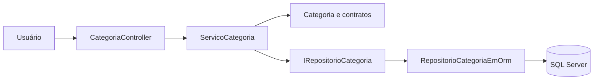
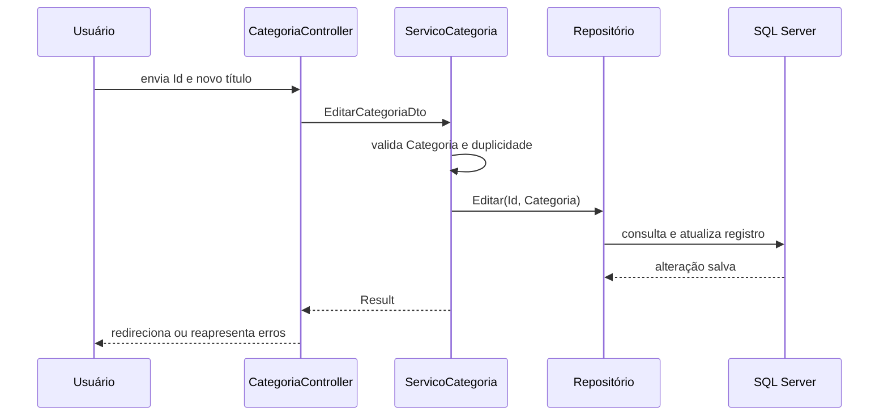
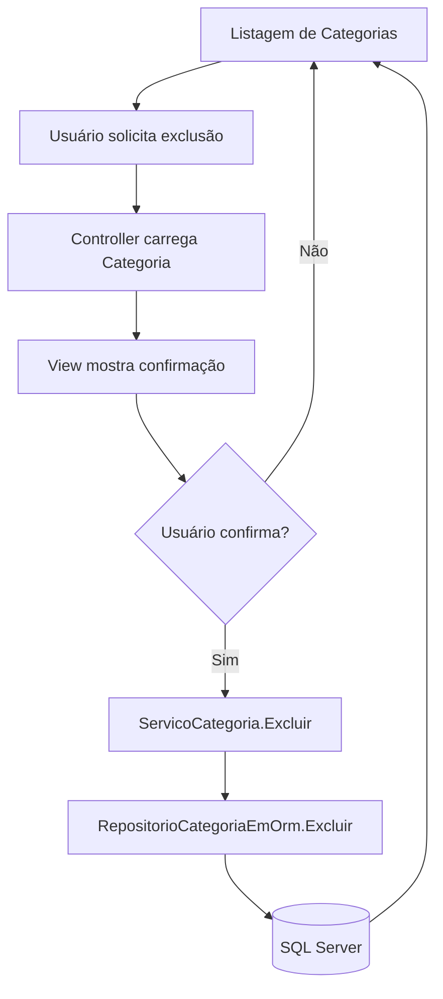

## Edição e Exclusão de Categorias com Clean Architecture

Na aula anterior, em [Introdução à Clean Architecture e Camada de Aplicação](/arquitetura-de-software/clean-architecture-camada-de-aplicacao), organizamos o e-Agenda em projetos de Domínio, Aplicação, Infraestrutura e WebApp.

Também vimos que a Camada de Aplicação coordena os casos de uso sem acessar diretamente o Entity Framework Core.

Agora vamos continuar essa estrutura e implementar dois casos de uso do módulo de Categorias:

- editar uma Categoria existente;
- excluir uma Categoria após uma confirmação.

Durante os fluxos, vamos observar como Controller, serviço, entidade e repositório colaboram.

## Relembrando o papel das camadas

Cada camada continua com uma responsabilidade específica:

- **Domínio:** mantém a entidade `Categoria`, suas regras e o contrato `IRepositorioCategoria`;
- **Aplicação:** coordena os casos de uso e devolve resultados;
- **Infraestrutura:** consulta e persiste Categorias com Entity Framework Core;
- **WebApp:** recebe as requisições, prepara ViewModels e apresenta Views.

O fluxo geral permanece:



O serviço depende da interface `IRepositorioCategoria`, não da implementação `RepositorioCategoriaEmOrm`.

Isso permite que a Aplicação coordene o caso de uso sem conhecer os detalhes do banco.

## Edição: carregar a Categoria para o formulário

O fluxo de edição começa quando o usuário solicita a edição de uma Categoria.

O Controller recebe o identificador e pede à Aplicação os dados da Categoria:

```csharp
[HttpGet]
public ActionResult Editar(Guid id)
{
    Result<CategoriaDto> resultado = servicoCategoria.SelecionarPorId(id);

    if (resultado.IsFailed)
        return RedirectToAction(nameof(Listar));

    CategoriaDto dto = resultado.Value;

    EditarCategoriaViewModel viewModel = new(dto.Id, dto.Titulo);

    return View(viewModel);
}
```

O método `SelecionarPorId` consulta o repositório.

Se não encontrar a Categoria, retorna um resultado de falha.

O Controller redireciona para a listagem em vez de tentar abrir um formulário sem dados.

Quando encontra o registro, transforma o DTO em `EditarCategoriaViewModel` e envia esse modelo para a View.

## Enviando as alterações

O formulário envia o identificador e o novo título ao Controller:

```csharp
[HttpPost]
public ActionResult Editar(EditarCategoriaViewModel viewModel)
{
    EditarCategoriaDto dto = new(
        viewModel.Id,
        viewModel.Titulo ?? string.Empty
    );

    Result resultado = servicoCategoria.Editar(dto);

    if (resultado.IsFailed)
    {
        foreach (IError erro in resultado.Errors)
        {
            string campo = erro.Metadata["Campo"].ToString() ?? string.Empty;
            ModelState.AddModelError(campo, erro.Message);
        }

        return View(viewModel);
    }

    return RedirectToAction(nameof(Listar));
}
```

O Controller converte o ViewModel em `EditarCategoriaDto`.

Esse passo mantém separados os dados próprios da tela e o contrato de entrada do caso de uso.

Se o serviço retornar falhas, o Controller associa cada mensagem ao campo indicado nos metadados do erro e devolve o formulário.

`ModelState.AddModelError` registra o erro para que a View possa exibi-lo junto ao campo correspondente.

Se a operação for concluída, o usuário volta para a listagem.

## Validando as regras durante a edição

O serviço cria uma Categoria com os dados atualizados e aplica as regras da entidade:

```csharp
public Result Editar(EditarCategoriaDto dto)
{
    Categoria categoriaAtualizada = new(dto.Titulo);

    List<ErroValidacao> erros = categoriaAtualizada.Validar();

    if (repositorioCategoria.ExisteCategoriaPorTitulo(
        categoriaAtualizada.Titulo,
        dto.Id
    ))
    {
        erros.Add(new ErroValidacao
        {
            Campo = nameof(categoriaAtualizada.Titulo),
            Mensagem = "Já existe uma categoria cadastrada com o título informado"
        });
    }

    if (erros.Count > 0)
    {
        List<Error> errosResultado = erros
            .Select(e => new Error(e.Mensagem)
                .WithMetadata("Campo", e.Campo))
            .ToList();

        return Result.Fail(errosResultado);
    }

    repositorioCategoria.Editar(dto.Id, categoriaAtualizada);

    return Result.Ok();
}
```

O identificador atual é passado à consulta de duplicidade.

Assim, o repositório ignora a própria Categoria e verifica se outra Categoria já usa o título:

```csharp
public bool ExisteCategoriaPorTitulo(string tituloCategoria, Guid? idIgnorado = null)
{
    return dbContext.Categorias.Any(c =>
        c.Id != idIgnorado &&
        c.Titulo.ToLower() == tituloCategoria.ToLower()
    );
}
```

O domínio representa cada falha com um campo e uma mensagem:

```csharp
public class ErroValidacao
{
    public required string Campo { get; set; }
    public required string Mensagem { get; set; }
}
```

O serviço converte esses erros para `Result` e mantém o nome do campo nos metadados.

O Controller usa essa informação para mostrar, por exemplo, uma duplicidade no campo `Titulo`, sem misturá-la a um erro genérico da página.

## Salvando a edição no repositório

O repositório localiza a Categoria existente, atualiza a entidade acompanhada pelo `DbContext` e salva as alterações:

```csharp
public bool Editar(Guid idSelecionado, Categoria entidadeAtualizada)
{
    Categoria? categoria = SelecionarPorId(idSelecionado);

    if (categoria == null)
        return false;

    categoria.Atualizar(entidadeAtualizada);
    dbContext.SaveChanges();

    return true;
}
```

O método `Categoria.Atualizar` copia os dados permitidos:

```csharp
public override void Atualizar(Categoria entidadeAtualizada)
{
    Titulo = entidadeAtualizada.Titulo;
}
```

O identificador não é substituído.

Como o `DbContext` está acompanhando a Categoria carregada, `SaveChanges()` persiste a alteração.

> O repositório devolve `false` se não encontrar o identificador. Na versão estudada, o serviço de edição não verifica esse retorno e conclui com `Result.Ok()`. Em uma evolução do código, o serviço pode converter esse caso em um resultado de falha, como já ocorre no caso de exclusão.

## Exclusão: confirmar antes de remover

Excluir um registro não deve acontecer apenas porque o usuário clicou em um link.

Por isso, a primeira requisição abre uma tela de confirmação.

O Controller busca a Categoria e monta um ViewModel com o identificador e o título:

```csharp
[HttpGet]
public ActionResult Excluir(Guid id)
{
    Result<CategoriaDto> resultado = servicoCategoria.SelecionarPorId(id);

    if (resultado.IsFailed)
        return RedirectToAction(nameof(Listar));

    CategoriaDto dto = resultado.Value;
    ExcluirCategoriaViewModel viewModel = new(dto.Id, dto.Titulo);

    return View(viewModel);
}
```

O título é exibido como somente leitura.

O formulário pede uma confirmação explícita antes de enviar o identificador:

```html
<div class="alert alert-danger" role="alert">
    Deseja realmente excluir esta categoria?
</div>

<input asp-for="Titulo" type="text" readonly>

<button type="submit">Confirmar</button>
```

O atributo `readonly` impede a edição do título nessa tela.

O valor usado para identificar o registro é o `Id` do ViewModel.

## Removendo a Categoria no banco

Após a confirmação, o Controller chama o serviço:

```csharp
[HttpPost]
public ActionResult Excluir(ExcluirCategoriaViewModel viewModel)
{
    servicoCategoria.Excluir(viewModel.Id);

    return RedirectToAction(nameof(Listar));
}
```

O serviço delega a exclusão ao repositório e verifica se o registro existia:

```csharp
public Result Excluir(Guid id)
{
    bool conseguiuExcluir = repositorioCategoria.Excluir(id);

    if (!conseguiuExcluir)
        return Result.Fail("Não foi possível encontrar a categoria informada.");

    return Result.Ok();
}
```

O repositório busca a entidade antes de removê-la:

```csharp
public bool Excluir(Guid idSelecionado)
{
    Categoria? categoria = SelecionarPorId(idSelecionado);

    if (categoria == null)
        return false;

    dbContext.Categorias.Remove(categoria);
    dbContext.SaveChanges();

    return true;
}
```

Essa sequência evita chamar `Remove` para uma entidade inexistente.

O Entity Framework Core envia a exclusão ao SQL Server quando `SaveChanges()` é executado.

> Na versão estudada, o Controller não verifica o `Result` devolvido pelo serviço de exclusão. Mesmo quando o serviço indica que a Categoria não foi encontrada, o Controller redireciona para a listagem. O resultado poderia ser tratado para apresentar uma mensagem ao usuário.

## Visualizando os fluxos

Na edição, o identificador é usado para localizar o registro e o novo título passa por validação antes de ser salvo:



Na exclusão, a confirmação visual acontece antes da requisição que remove o registro:



## O que mudou sem alterar as responsabilidades?

Os novos casos de uso ampliam o serviço de Categorias, mas mantêm a distribuição de responsabilidades:

- o Controller traduz requisições e resultados para respostas MVC;
- o serviço coordena validação, consulta e persistência;
- a entidade aplica as regras do título;
- a interface do repositório continua no Domínio;
- o repositório ORM implementa consulta, edição e exclusão;
- as Views apresentam formulários e confirmação.

Essa separação permite que cada parte tenha um motivo mais claro para mudar.

## Testando os casos de uso

Faça um teste manual com uma Categoria de demonstração:

1. Abra a listagem de Categorias.
2. Selecione **Editar** e altere o título.
3. Tente usar um título já cadastrado e observe o erro associado ao campo.
4. Salve um título válido e confirme a alteração na listagem.
5. Selecione **Excluir** e confira se a tela mostra o título correto.
6. Volte sem confirmar e verifique que a Categoria continua na listagem.
7. Abra novamente a confirmação e conclua a exclusão.

## Conclusão

Os fluxos de edição e exclusão continuam atravessando as mesmas camadas apresentadas na aula anterior.

Na edição, o serviço valida os dados e o repositório atualiza a entidade persistida.

Na exclusão, a aplicação pede confirmação, localiza a entidade e solicita sua remoção.

Os resultados e erros retornam da Aplicação para o Controller, que decide como responder à requisição MVC.
