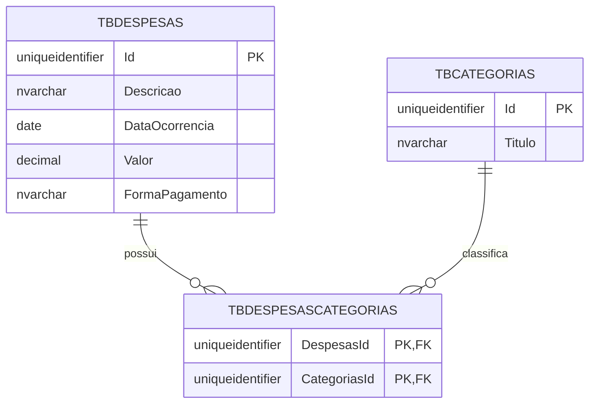
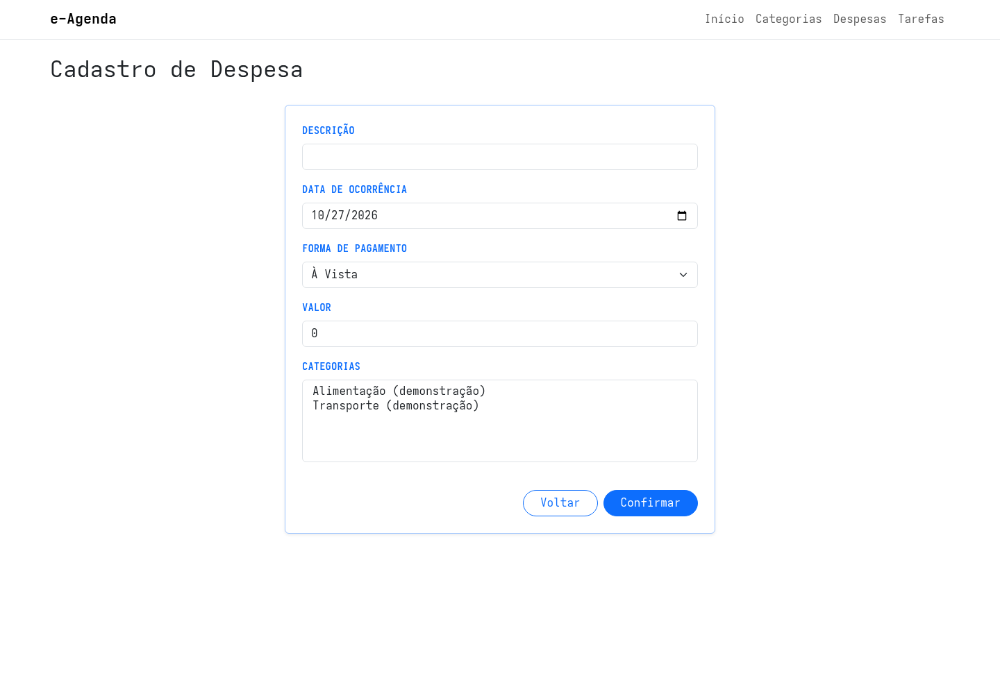
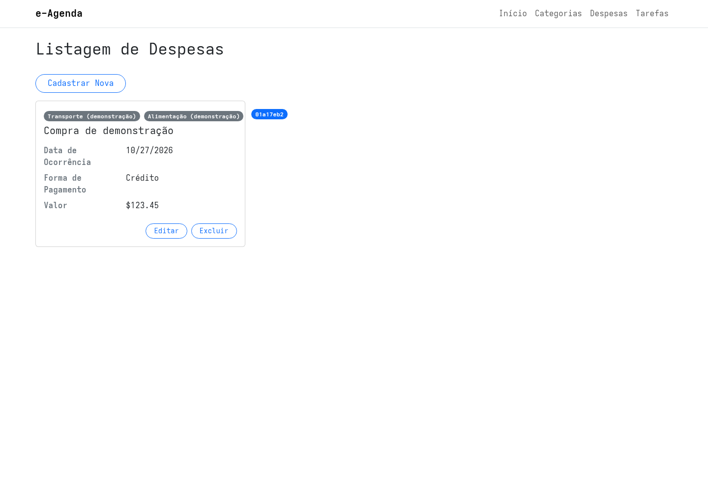
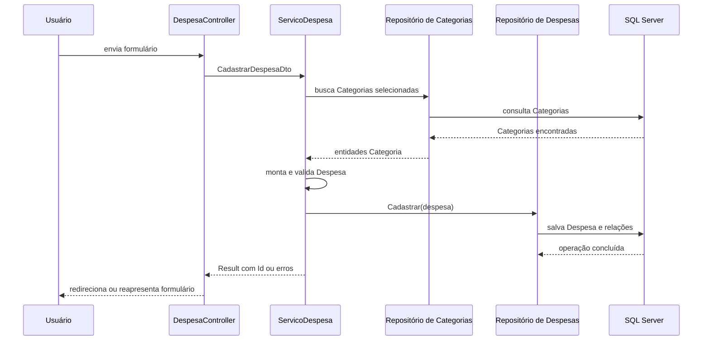

## Módulo de Despesas do e-Agenda

Uma pessoa pode registrar despesas com descrições, datas, valores e formas de pagamento diferentes.

Também pode classificar uma despesa em uma ou mais Categorias.

Nesta aula, vamos acompanhar a implementação inicial do módulo de Despesas no e-Agenda e observar como ele atravessa as camadas de Domínio, Aplicação, Infraestrutura e WebApp.

> **Atenção:** nesta versão, o módulo tem cadastro e listagem. Edição e exclusão ainda não estão implementadas para Despesas.

## O que uma Despesa representa?

A entidade `Despesa` reúne os dados principais de um gasto:

- descrição;
- data de ocorrência;
- valor;
- forma de pagamento;
- uma ou mais Categorias.

No domínio, a forma de pagamento é representada pelo enum `FormaPagamento`:

```csharp
public enum FormaPagamento
{
    AVista,
    Credito,
    Debito
}
```

O enum limita as opções reconhecidas pelo código a pagamento à vista, crédito ou débito.

## Regras de validação da Despesa

Antes de persistir os dados, a entidade verifica as regras do domínio:

```csharp
public override List<ErroValidacao> Validar()
{
    List<ErroValidacao> erros = [];

    if (string.IsNullOrWhiteSpace(Descricao) ||
        Descricao.Length < 2 || Descricao.Length > 100)
    {
        erros.Add(new ErroValidacao
        {
            Campo = nameof(Descricao),
            Mensagem = "O campo \"Descrição\" deve conter entre 2 e 100 caracteres."
        });
    }

    if (DataOcorrencia == DateOnly.MinValue)
    {
        erros.Add(new ErroValidacao
        {
            Campo = nameof(DataOcorrencia),
            Mensagem = "O campo \"Data de Ocorrência\" deve conter uma data válida."
        });
    }

    if (Valor <= 0)
    {
        erros.Add(new ErroValidacao
        {
            Campo = nameof(Valor),
            Mensagem = "O campo \"Valor\" deve conter um valor maior que 0."
        });
    }

    if (Categorias.Count == 0)
    {
        erros.Add(new ErroValidacao
        {
            Campo = nameof(Categorias),
            Mensagem = "O campo \"Categorias\" deve conter pelo menos um valor."
        });
    }

    return erros;
}
```

As regras exigem:

- descrição preenchida, com 2 a 100 caracteres;
- uma data diferente do valor mínimo de `DateOnly`;
- valor maior que zero;
- pelo menos uma Categoria associada.

Cada `ErroValidacao` informa o nome do campo e uma mensagem.

Com isso, a camada de Aplicação consegue devolver erros que a WebApp associa aos campos do formulário.

## Relacionamento entre Despesas e Categorias

Uma Despesa pode estar classificada em várias Categorias.

Uma Categoria também pode classificar várias Despesas.

Esse relacionamento é muitos para muitos:



O EF Core usa a tabela de junção `TBDespesasCategorias` para relacionar os registros.

No modelo C#, a relação aparece como coleções nos dois lados:

```csharp
public sealed class Despesa : EntidadeBase<Despesa>
{
    public List<Categoria> Categorias { get; set; } = [];
}

public sealed class Categoria : EntidadeBase<Categoria>
{
    public List<Despesa> Despesas { get; set; } = [];
}
```

O diagrama mostra como uma tabela de junção transforma o relacionamento muitos para muitos em duas relações um para muitos.

## Mapeando a Despesa para o banco

`DespesaConfiguration` mapeia a entidade para a tabela `TBDespesas`:

```csharp
builder.ToTable("TBDespesas");

builder.HasKey(d => d.Id);
builder.Property(d => d.Id).ValueGeneratedNever();

builder.Property(d => d.Descricao)
    .HasMaxLength(100)
    .IsRequired();

builder.Property(d => d.DataOcorrencia)
    .HasColumnType("date")
    .IsRequired();

builder.Property(d => d.Valor)
    .HasColumnType("decimal(18, 2)")
    .IsRequired();

builder.Property(d => d.FormaPagamento)
    .HasConversion<string>()
    .IsRequired();

builder.HasMany(d => d.Categorias)
    .WithMany(c => c.Despesas)
    .UsingEntity("TBDespesasCategorias");
```

O identificador é criado pela aplicação.

Por isso, `ValueGeneratedNever()` indica que o banco não deve gerar o `Id`.

`HasConversion<string>()` faz com que a forma de pagamento seja armazenada como texto.

O `DbContext` expõe o conjunto de Despesas e aplica essa configuração:

```csharp
public DbSet<Despesa> Despesas => Set<Despesa>();

protected override void OnModelCreating(ModelBuilder modelBuilder)
{
    modelBuilder.ApplyConfiguration(new DespesaConfiguration());
}
```

A migration `Add_TBDespesas` registra as tabelas e as relações necessárias ao modelo.

## Reutilizando operações comuns de repositório

Categorias e Despesas precisam de operações semelhantes, como cadastrar, editar, excluir e consultar por identificador.

Na Infraestrutura, a classe genérica `RepositorioBaseEmOrm<T>` concentra essas operações comuns.

O repositório de Despesas herda dessa classe:

```csharp
public class RepositorioDespesaEmOrm(EAgendaDbContext dbContext) :
    RepositorioBaseEmOrm<Despesa>(dbContext), IRepositorioDespesa
{
    // Consultas específicas de Despesa ficam aqui.
}
```

`RepositorioBaseEmOrm<T>` usa o tipo `T` para executar operações sobre o `DbSet<T>` correspondente.

Isso evita repetir a implementação básica em cada repositório.

As consultas de Despesas precisam carregar suas Categorias relacionadas, por isso o repositório especializa os métodos de busca:

```csharp
public override List<Despesa> SelecionarTodos()
{
    return registros
        .OrderByDescending(d => d.DataOcorrencia)
        .ThenBy(d => d.Descricao)
        .Include(d => d.Categorias)
        .ToList();
}
```

Os resultados são ordenados da data mais recente para a mais antiga.

Em caso de empate, são ordenados pela descrição.

`Include(d => d.Categorias)` solicita também as Categorias de cada Despesa.

## Preparando os dados na Camada de Aplicação

O formulário envia os identificadores das Categorias escolhidas.

Por isso, o contrato de cadastro recebe os dados escalares e uma lista de identificadores:

```csharp
public record CadastrarDespesaDto(
    string Descricao,
    DateOnly DataOcorrencia,
    decimal Valor,
    FormaPagamento FormaPagamento,
    List<Guid> CategoriasIds
);
```

O serviço remove identificadores vazios e duplicados:

```csharp
List<Guid> idsDistintos = dto.CategoriasIds
    .Where(id => id != Guid.Empty)
    .Distinct()
    .ToList();

if (idsDistintos.Count == 0)
{
    IError erro = new Error("Selecione ao menos uma categoria válida.")
        .WithMetadata("Campo", nameof(dto.CategoriasIds));

    return Result.Fail(erro);
}
```

Depois, consulta as Categorias existentes e seleciona aquelas cujos identificadores foram enviados:

```csharp
List<Categoria> categoriasSelecionadas = repositorioCategoria
    .SelecionarTodos()
    .Where(c => idsDistintos.Contains(c.Id))
    .ToList();
```

O serviço monta a entidade com esses objetos relacionados:

```csharp
Despesa despesa = new Despesa(
    dto.Descricao,
    dto.DataOcorrencia,
    dto.Valor,
    dto.FormaPagamento,
    categoriasSelecionadas
);
```

Em seguida, valida a entidade e converte cada erro de domínio em um erro do `Result` com o nome do campo nos metadados.

Se houver erros, o cadastro não é enviado ao repositório.

Se os dados estiverem válidos, o serviço chama `Cadastrar` e retorna o identificador da nova Despesa.

## Recebendo a requisição na WebApp

O `DespesaController` disponibiliza ações de listagem e cadastro.

Ao abrir o formulário, o Controller:

1. consulta as Categorias cadastradas;
2. transforma os dados para `CategoriaDespesaDto`;
3. prepara um ViewModel com data atual, forma de pagamento padrão e lista vazia de Categorias selecionadas;
4. envia o ViewModel para a View.

No envio do formulário, converte o ViewModel em `CadastrarDespesaDto` e chama `ServicoDespesa.Cadastrar`.

Se o serviço retornar erros, o Controller os associa aos campos com `ModelState.AddModelError`.

Como a View precisa preencher novamente o seletor, o Controller também carrega a lista de Categorias disponíveis antes de devolver o formulário.

## Escolhendo Categorias no formulário

O formulário apresenta campos para descrição, data, forma de pagamento, valor e Categorias.

O seletor de Categorias permite escolher vários itens:

```html
<select asp-for="CategoriasIds" class="form-select" multiple size="5">
    @foreach (CategoriaDespesaDto categoria in Model.CategoriasDisponiveis)
    {
        <option value="@categoria.Id">@categoria.Titulo</option>
    }
</select>
```

O atributo `multiple` permite enviar mais de um identificador.

As opções são carregadas a partir das Categorias existentes, e não de uma lista fixa escrita na View.



## Listando as Despesas

O serviço transforma as entidades retornadas pelo repositório em `DespesaDto`:

```csharp
return repositorioDespesa
    .SelecionarTodos()
    .Select(d => new DespesaDto(
        d.Id,
        d.Descricao,
        d.DataOcorrencia,
        d.Valor,
        d.FormaPagamento,
        d.Categorias
            .Select(c => new CategoriaDespesaDto(c.Id, c.Titulo))
            .ToList()
    ))
    .ToList();
```

O Controller envia a lista de DTOs para a View.

A tela exibe a descrição, a data, o valor, a forma de pagamento e os nomes das Categorias associadas.

Se ainda não houver registros, a View informa que nenhuma Despesa foi cadastrada.



## Fluxo do cadastro

O fluxo completo conecta a seleção das Categorias à validação e persistência:



Observe que a WebApp não persiste diretamente os dados.

O serviço coordena o caso de uso, e o repositório ORM realiza a operação no banco.

## Limites da implementação nesta versão

O módulo está em construção.

Nesta versão, estão implementados:

- entidade e regras de validação de Despesa;
- relacionamento muitos para muitos com Categorias;
- mapeamento e migration do SQL Server;
- repositório ORM e consultas ordenadas com Categorias incluídas;
- cadastro e listagem na Camada de Aplicação e na WebApp.

Os métodos `Editar`, `Excluir` e `SelecionarPorId` de `ServicoDespesa` ainda são esboços.

O Controller e as Views também não oferecem as telas de edição e exclusão para Despesas.

Por isso, os botões de editar e excluir que aparecem na View de listagem ainda não representam fluxos funcionais nessa versão.

## Conclusão

O módulo de Despesas mostra como uma funcionalidade percorre as camadas do e-Agenda.

O Domínio define a entidade, suas validações e a relação com Categorias.

A Aplicação prepara os objetos relacionados, valida os dados e coordena o cadastro e a listagem.

A Infraestrutura mapeia as tabelas e executa as operações com Entity Framework Core.

A WebApp apresenta o formulário de cadastro e a listagem.

Como a implementação ainda é parcial, edição e exclusão ficam para uma evolução posterior.
