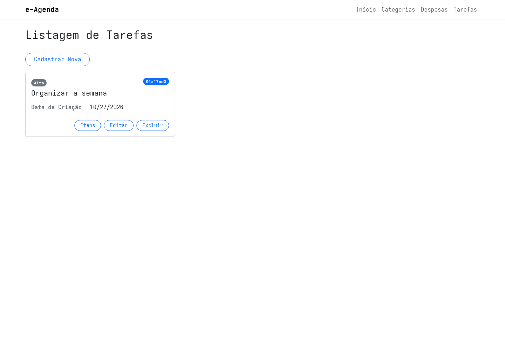
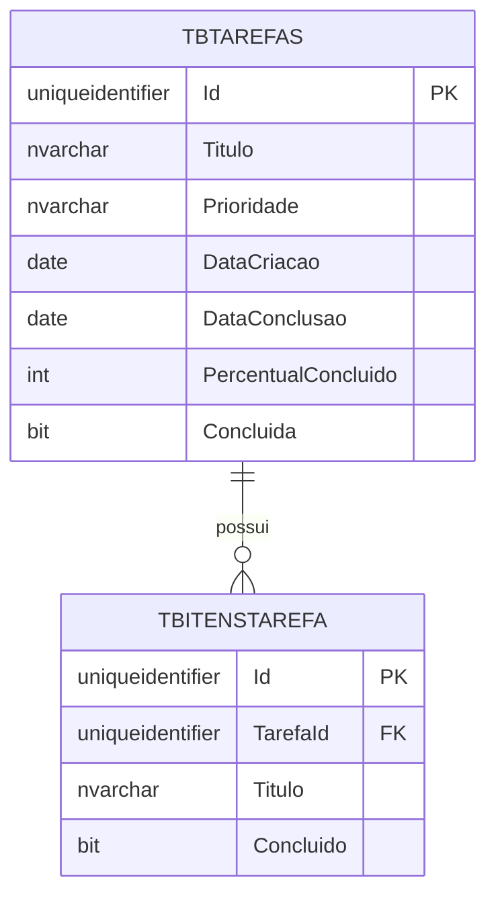
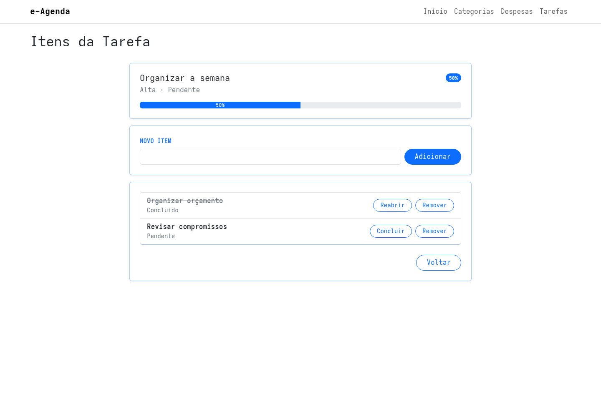
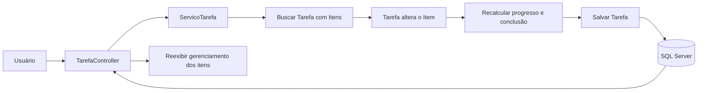

## Edição de Despesas e Módulos de Tarefas e Itens

Na aula anterior, implementamos o cadastro e a listagem de Despesas.

Agora, vamos completar esses fluxos com edição e exclusão.

Também vamos acompanhar a criação do módulo de Tarefas, que permite organizar uma tarefa em itens menores e acompanhar seu progresso.

As funcionalidades continuam distribuídas pelas camadas do e-Agenda:

- o Domínio contém entidades e regras;
- a Aplicação coordena os casos de uso;
- a Infraestrutura consulta e persiste os dados;
- a Apresentação recebe as requisições e exibe as telas.

## Editando uma Despesa

Uma edição começa com uma consulta pelo identificador.

O Controller pede a Despesa ao serviço e prepara o formulário com os dados atuais:

```csharp
[HttpGet]
public ActionResult Editar(Guid id)
{
    Result<DespesaDto> resultado = servicoDespesa.SelecionarPorId(id);

    if (resultado.IsFailed)
    {
        TempData["MensagemErro"] = resultado.Errors.First().Message;
        return RedirectToAction(nameof(Listar));
    }

    DespesaDto dto = resultado.Value;

    EditarDespesaViewModel viewModel = new(
        id,
        dto.Descricao,
        dto.DataOcorrencia,
        dto.Valor,
        dto.FormaPagamento,
        dto.Categorias.Select(c => c.Id).ToList()
    );

    // A ViewModel também recebe as Categorias disponíveis.
    return View(viewModel);
}
```

O ViewModel recebe os identificadores das Categorias já relacionadas.

O Controller também carrega as Categorias disponíveis para preencher o seletor múltiplo da View.


### Validando e salvando as alterações

No envio do formulário, o Controller monta um `EditarDespesaDto` e chama o serviço:

```csharp
EditarDespesaDto dto = new(
    viewModel.Id,
    viewModel.Descricao,
    viewModel.DataOcorrencia,
    viewModel.Valor,
    viewModel.FormaPagamento,
    viewModel.CategoriasIds
);

Result resultado = servicoDespesa.Editar(dto);
```

O serviço:

1. remove identificadores de Categoria vazios e duplicados;
2. carrega as Categorias selecionadas;
3. cria uma entidade `Despesa` com os novos dados;
4. executa as validações do Domínio;
5. solicita a edição ao repositório;
6. devolve sucesso ou falha.

Se a validação falhar, o serviço associa o nome do campo aos erros.

O Controller coloca essas mensagens no `ModelState` e reapresenta o formulário com as Categorias disponíveis.

Se o registro não for encontrado para edição, o serviço devolve uma falha, que o Controller armazena em `TempData["MensagemErro"]` antes de voltar à listagem.

O repositório genérico carrega a Despesa, atualiza os dados da entidade acompanhada pelo `DbContext` e chama `SaveChanges()`.

## Excluindo uma Despesa

O primeiro acesso à exclusão apenas mostra uma tela de confirmação.

O Controller carrega os dados da Despesa e os envia a um ViewModel de exclusão.

A View apresenta os campos como somente leitura e pede confirmação:

```html
<div class="alert alert-danger" role="alert">
    Deseja realmente excluir esta despesa?
</div>

<input asp-for="Descricao" readonly>
<input asp-for="Valor" readonly>

<button type="submit">Confirmar</button>
```


Quando o formulário é confirmado, o Controller chama `ServicoDespesa.Excluir`.

O serviço verifica o retorno do repositório:

```csharp
public Result Excluir(Guid id)
{
    bool conseguiuExcluir = repositorioDespesa.Excluir(id);

    if (!conseguiuExcluir)
        return Result.Fail("Não foi possível excluir a despesa.");

    return Result.Ok();
}
```

Se a operação falhar, o Controller guarda a mensagem em `TempData` e redireciona para a listagem.

A View de listagem exibe essa notificação de erro após o redirecionamento.

## Criando uma Tarefa

Uma Tarefa representa um objetivo que pode ser acompanhado por meio de itens menores.

Ela possui:

- título;
- prioridade;
- data de criação;
- data de conclusão opcional;
- percentual concluído;
- indicação de conclusão;
- lista de itens.

O domínio oferece três níveis de prioridade:

```csharp
public enum PrioridadeTarefa
{
    Baixa,
    Normal,
    Alta
}
```

O título deve conter de 2 a 100 caracteres.

A prioridade precisa corresponder a um valor definido no enum.

A data de criação recebe a data atual quando a Tarefa é criada.

O serviço valida a entidade antes de pedir seu cadastro ao repositório.



## O que é um Item de Tarefa?

Um `ItemTarefa` representa uma etapa menor de uma Tarefa.

Por exemplo, uma tarefa chamada `Organizar mudança` pode conter itens como `Separar caixas` e `Agendar transporte`.

Cada item possui título, estado de conclusão e referência à Tarefa:

```csharp
public sealed class ItemTarefa : EntidadeBase<ItemTarefa>
{
    public Guid TarefaId { get; set; }
    public Tarefa Tarefa { get; set; } = null!;
    public string Titulo { get; set; } = string.Empty;
    public bool Concluido { get; set; }
}
```

O título do item também deve conter de 2 a 100 caracteres.

O item precisa estar associado a uma Tarefa válida.

## Tarefa como responsável pelo progresso

A entidade `Tarefa` mantém a coleção de itens e oferece operações para alterá-la:

```csharp
public void AdicionarItem(ItemTarefa item)
{
    Itens.Add(item);
    RecalcularConclusao();
}

public bool AlterarConclusaoItem(Guid itemId, bool concluido)
{
    ItemTarefa? item = Itens.FirstOrDefault(i => i.Id == itemId);

    if (item == null)
        return false;

    if (concluido)
        item.Concluir();
    else
        item.RemoverConclusao();

    RecalcularConclusao();
    return true;
}
```

O cálculo considera quantos itens estão concluídos:

```csharp
public void RecalcularConclusao()
{
    if (Itens.Count == 0)
    {
        PercentualConcluido = 0;
        Concluida = false;
        DataConclusao = null;
        return;
    }

    int itensConcluidos = Itens.Count(i => i.Concluido);

    PercentualConcluido = (int)Math.Round(
        (decimal)itensConcluidos / Itens.Count * 100
    );

    Concluida = PercentualConcluido == 100;
    DataConclusao = Concluida
        ? DataConclusao ?? DateOnly.FromDateTime(DateTime.Today)
        : null;
}
```

Por exemplo, se dois de quatro itens estiverem concluídos, o percentual será 50%.

Quando todos os itens forem concluídos, a Tarefa recebe uma data de conclusão.

Se um item for reaberto ou removido e o percentual deixar de ser 100%, a data de conclusão volta a `null`.

Uma Tarefa sem itens começa com 0% e não é considerada concluída.

## Relacionamento entre Tarefa e Itens

Uma Tarefa pode possuir vários Itens.

Cada Item pertence a uma única Tarefa.



`TarefaId` é a chave estrangeira que liga cada item à sua Tarefa.

As configurações do EF Core mapeiam as entidades para `TBTarefas` e `TBItensTarefa`.

A migration inicial cria `TBTarefas`.

Uma migration seguinte acrescenta os campos de conclusão e cria `TBItensTarefa` com a chave estrangeira.

## Consultando Tarefas com seus Itens

O repositório ORM carrega os itens quando consulta uma Tarefa:

```csharp
return registros
    .Include(t => t.Itens)
    .SingleOrDefault(t => t.Id == idSelecionado);
```

Na listagem, também inclui os itens e ordena as Tarefas por:

1. prioridade, da maior para a menor;
2. data de criação, da mais recente para a mais antiga;
3. título, em ordem alfabética.

Os itens de cada Tarefa são ordenados pelo título.

O `Include` permite que a Aplicação transforme o agregado e seus itens em DTOs sem executar uma consulta separada para cada item.

## Gerenciando os itens pela interface

Na tela de gerenciamento, a pessoa usuária pode:

- adicionar um item pelo título;
- concluir um item pendente;
- reabrir um item concluído;
- remover um item.

Após cada operação, o Controller chama o serviço e retorna à tela de gerenciamento da mesma Tarefa.



O serviço localiza a Tarefa e delega as alterações da coleção à entidade:

```csharp
public Result RemoverItem(RemoverItemTarefaDto dto)
{
    Tarefa? tarefa = repositorioTarefa.SelecionarPorId(dto.TarefaId);

    if (tarefa == null)
        return Result.Fail("Tarefa não encontrada.");

    bool itemEncontrado = tarefa.RemoverItem(dto.ItemId);

    if (!itemEncontrado)
        return Result.Fail("Item de Tarefa não encontrado.");

    repositorioTarefa.Editar(tarefa.Id, tarefa);

    return Result.Ok();
}
```

O serviço também registra erros de operação em `TempData["MensagemErro"]`.

A View apresenta a notificação no próximo carregamento da tela.

## Fluxo de conclusão de um item

Ao concluir ou reabrir um item, o fluxo é:



O cálculo de progresso permanece no Domínio.

O Controller não decide sozinho se a Tarefa está concluída.

## Alterar e excluir uma Tarefa

O módulo também possui telas para cadastrar, editar e excluir Tarefas.

O serviço valida a Tarefa antes da edição e verifica se o repositório encontrou o identificador.

Na exclusão, a tela apresenta os dados da Tarefa antes da confirmação.

O relacionamento com itens é configurado com `DeleteBehavior.ClientCascade`, e o repositório carrega as Tarefas com seus itens antes das operações.

> **Atenção ao fluxo de edição desta versão:** `ServicoTarefa.Editar` cria uma nova Tarefa apenas com título e prioridade. O método `Tarefa.Atualizar` também copia a lista de itens e os campos de progresso dessa nova instância. Como resultado, a edição pode substituir a lista existente por uma coleção vazia e reiniciar data e progresso. Ao testar, confira se os itens permanecem; uma evolução deve preservar no agregado os dados que não fazem parte do formulário.

## Mudança de nome do projeto de apresentação

Nesta versão, a pasta do projeto Web foi renomeada de `WebApp` para `Apresentacao`.

O projeto continua responsável pelos Controllers, ViewModels, Views e inicialização HTTP.

Essa alteração de organização não cria uma nova camada de negócio.

## Testando os fluxos

Faça um teste com dados de demonstração:

1. Edite uma Despesa e altere sua descrição ou Categorias.
2. Confira a alteração na listagem.
3. Abra a exclusão e verifique os dados antes de confirmar.
4. Cadastre uma Tarefa com prioridade Alta.
5. Abra **Itens** e adicione três itens.
6. Conclua um item e observe a mudança no percentual.
7. Reabra o item e confirme que o progresso diminuiu.
8. Remova um item e confira o recálculo.
9. Teste a edição da Tarefa e confira o comportamento dos itens existentes.

## Conclusão

A `v4` completa a edição e exclusão de Despesas e introduz o módulo de Tarefas com itens gerenciáveis.

O Domínio concentra as regras e o cálculo de progresso.

A Aplicação coordena os casos de uso.

A Infraestrutura mapeia e consulta Tarefas e Itens com Entity Framework Core.

A camada de Apresentação conduz os fluxos de tela e mostra notificações quando uma operação falha.
