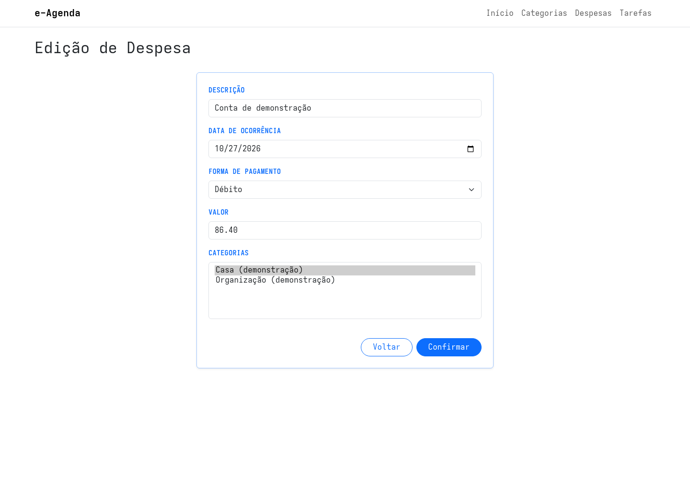
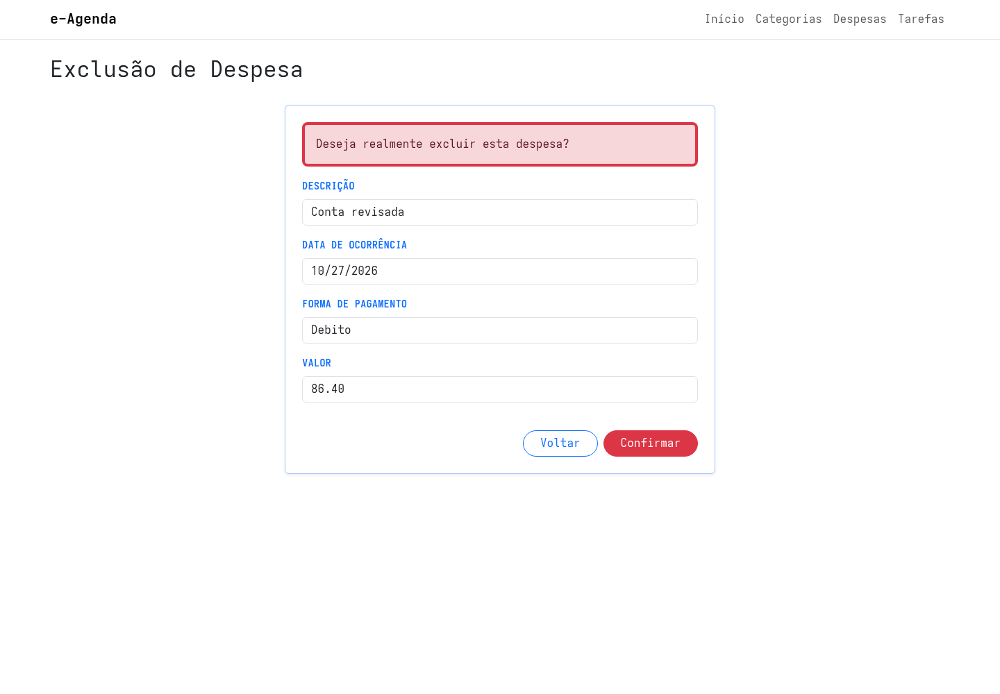

## Edição e Exclusão de Despesas do e-Agenda

Na aula anterior, implementamos o cadastro e a listagem de Despesas.

Nesta aula, vamos completar esse módulo com edição e exclusão, mantendo as responsabilidades separadas entre Controller, Aplicação e repositório.

## Editando uma Despesa

Uma edição começa com uma consulta pelo identificador.

O Controller pede a Despesa ao serviço e prepara o formulário com os dados atuais:

```csharp
[HttpGet]
public ActionResult Editar(Guid id)
{
    Result<DespesaDto> resultado = servicoDespesa.SelecionarPorId(id);

    if (resultado.IsFailed)
    {
        TempData["MensagemErro"] = resultado.Errors.First().Message;
        return RedirectToAction(nameof(Listar));
    }

    DespesaDto dto = resultado.Value;

    EditarDespesaViewModel viewModel = new(
        id,
        dto.Descricao,
        dto.DataOcorrencia,
        dto.Valor,
        dto.FormaPagamento,
        dto.Categorias.Select(c => c.Id).ToList()
    );

    // A ViewModel também recebe as Categorias disponíveis.
    return View(viewModel);
}
```

O ViewModel recebe os identificadores das Categorias já relacionadas.

O Controller também carrega as Categorias disponíveis para preencher o seletor múltiplo da View.



### Validando e salvando as alterações

No envio do formulário, o Controller monta um `EditarDespesaDto` e chama o serviço:

```csharp
EditarDespesaDto dto = new(
    viewModel.Id,
    viewModel.Descricao,
    viewModel.DataOcorrencia,
    viewModel.Valor,
    viewModel.FormaPagamento,
    viewModel.CategoriasIds
);

Result resultado = servicoDespesa.Editar(dto);
```

O serviço:

1. remove identificadores de Categoria vazios e duplicados;
2. carrega as Categorias selecionadas;
3. cria uma entidade `Despesa` com os novos dados;
4. executa as validações do Domínio;
5. solicita a edição ao repositório;
6. devolve sucesso ou falha.

Se a validação falhar, o serviço associa o nome do campo aos erros.

O Controller coloca essas mensagens no `ModelState` e reapresenta o formulário com as Categorias disponíveis.

Se o registro não for encontrado para edição, o serviço devolve uma falha, que o Controller armazena em `TempData["MensagemErro"]` antes de voltar à listagem.

O repositório genérico carrega a Despesa, atualiza os dados da entidade acompanhada pelo `DbContext` e chama `SaveChanges()`.

## Excluindo uma Despesa

O primeiro acesso à exclusão apenas mostra uma tela de confirmação.

O Controller carrega os dados da Despesa e os envia a um ViewModel de exclusão.

A View apresenta os campos como somente leitura e pede confirmação:

```html
<div class="alert alert-danger" role="alert">
    Deseja realmente excluir esta despesa?
</div>

<input asp-for="Descricao" readonly>
<input asp-for="Valor" readonly>

<button type="submit">Confirmar</button>
```



Quando o formulário é confirmado, o Controller chama `ServicoDespesa.Excluir`.

O serviço verifica o retorno do repositório:

```csharp
public Result Excluir(Guid id)
{
    bool conseguiuExcluir = repositorioDespesa.Excluir(id);

    if (!conseguiuExcluir)
        return Result.Fail("Não foi possível excluir a despesa.");

    return Result.Ok();
}
```

Se a operação falhar, o Controller guarda a mensagem em `TempData` e redireciona para a listagem.

A View de listagem exibe essa notificação de erro após o redirecionamento.

## Testando a edição e a exclusão

1. Abra a listagem de Despesas.
2. Edite uma Despesa e altere sua descrição ou Categorias.
3. Confira a alteração na listagem.
4. Abra a tela de exclusão e verifique os dados antes de confirmar.
5. Confirme a exclusão e confira a listagem novamente.

## Conclusão

A edição e a exclusão completam os fluxos principais do módulo de Despesas.

O Controller prepara os ViewModels e traduz os resultados para respostas MVC.

O serviço valida e coordena cada caso de uso.

O repositório atualiza ou remove o registro no banco e devolve o resultado da operação.
