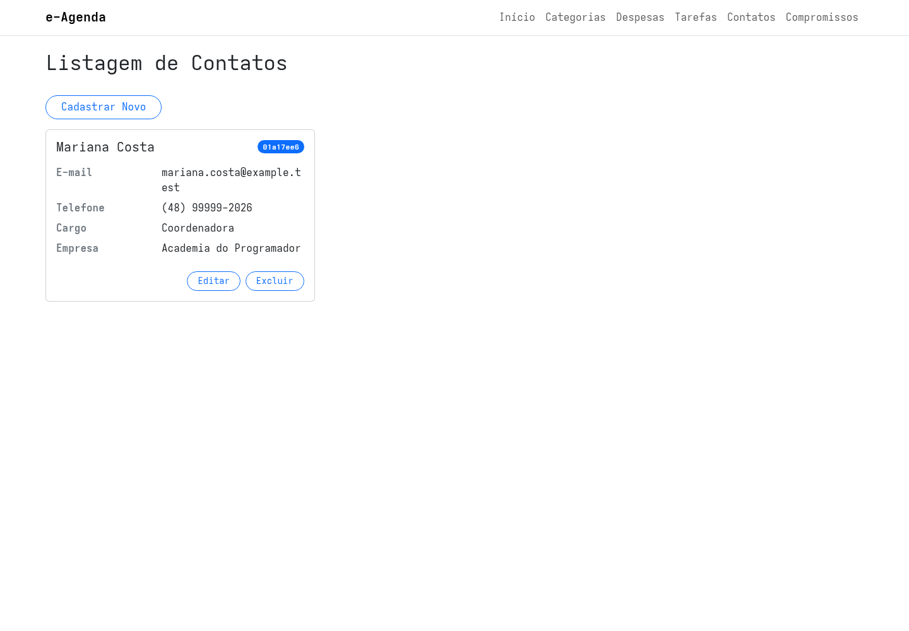
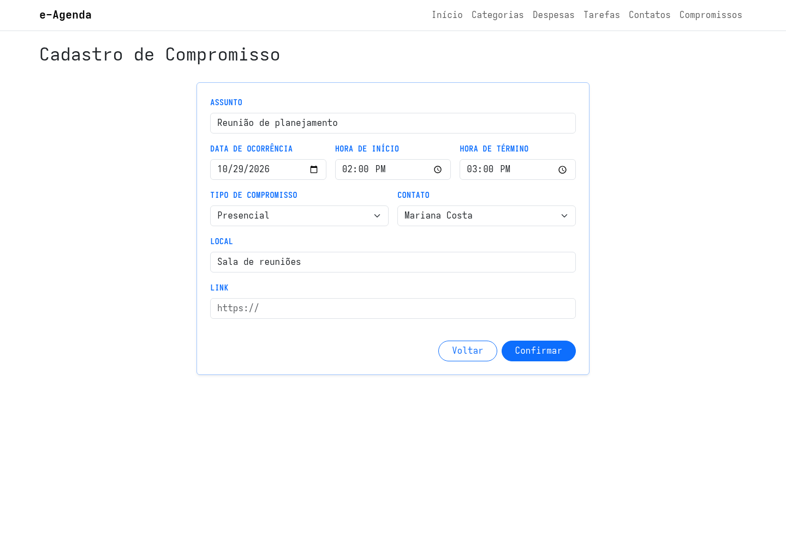
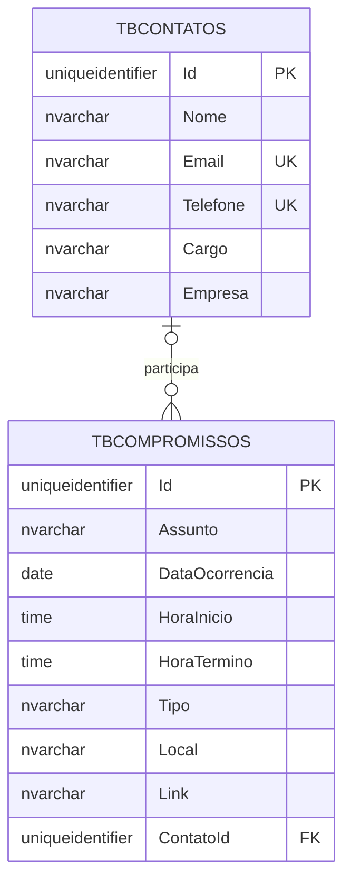
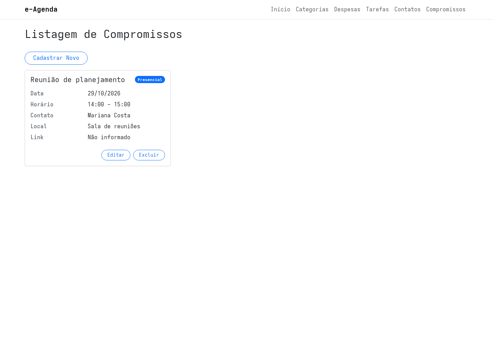
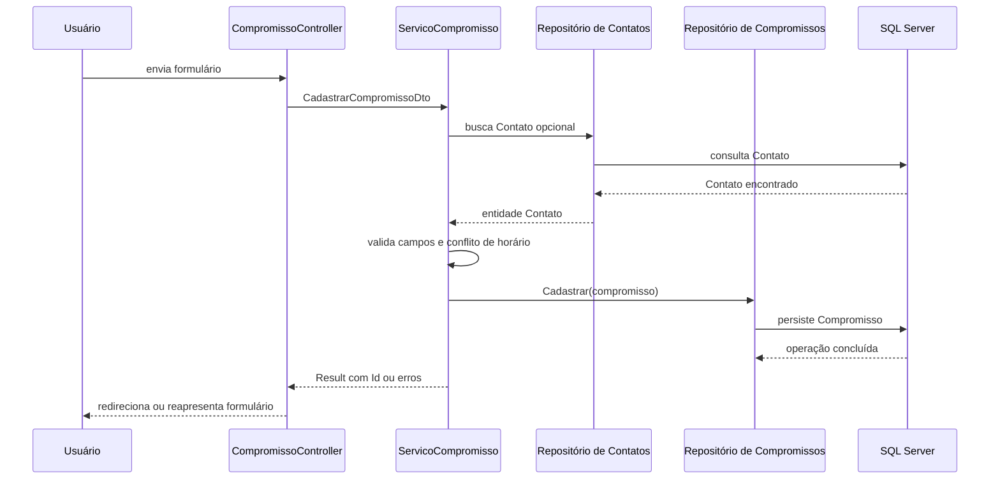

## Módulo de Contatos e Compromissos do e-Agenda

O e-Agenda pode armazenar pessoas importantes e organizar compromissos associados a elas.

Nesta aula, vamos acompanhar a implementação dos módulos de Contatos e Compromissos, desde as regras do Domínio até as telas da aplicação.

Os dois módulos seguem as camadas já utilizadas no projeto:

- o Domínio define entidades e regras;
- a Aplicação coordena os casos de uso;
- a Infraestrutura consulta e persiste os dados;
- a Apresentação conduz as requisições e exibe as telas.

## O que representa um Contato?

Um Contato reúne informações para identificar e encontrar uma pessoa:

- nome;
- e-mail;
- telefone;
- cargo opcional;
- empresa opcional.

O nome deve ter entre 2 e 100 caracteres.

O e-mail precisa seguir um formato básico de endereço de e-mail.

O telefone deve seguir um destes formatos:

- `(XX) XXXX-XXXX`;
- `(XX) XXXXX-XXXX`.

Cargo e empresa são opcionais e podem ter até 100 caracteres.

Essas regras ficam na entidade `Contato`:

```csharp
if (string.IsNullOrWhiteSpace(Nome) || Nome.Length < 2 || Nome.Length > 100)
    erros.Add(new(nameof(Nome), "O campo Nome deve conter entre 2 e 100 caracteres."));

if (!Regex.IsMatch(Email, @"^[^@\s]+@[^@\s]+\.[^@\s]+$"))
    erros.Add(new(nameof(Email), "O e-mail deve conter um endereço válido."));

if (!Regex.IsMatch(Telefone, @"^\(\d{2}\) \d{4,5}-\d{4}$"))
    erros.Add(new(nameof(Telefone), "Informe o telefone no formato esperado."));
```

Cada erro contém o nome do campo e uma mensagem.

Assim, a Camada de Aplicação consegue devolver os erros para a tela correta.

## Evitando Contatos duplicados

Além das regras de formato, o serviço verifica se já existe um Contato com o mesmo nome ou e-mail.

Na edição, o identificador do próprio Contato é ignorado na busca.

Isso permite salvar o registro sem acusar duplicidade contra ele mesmo.

O repositório usa a interface `IRepositorioContato`, definida no Domínio.

A implementação ORM faz as consultas sobre o `DbSet<Contato>`.

## Persistindo os Contatos

O EF Core mapeia a entidade para a tabela `TBContatos`.

Nome, e-mail e telefone são obrigatórios.

Cargo e empresa podem ficar vazios.

O banco também possui índices únicos para e-mail e telefone:

```csharp
builder.ToTable("TBContatos");

builder.Property(c => c.Nome)
    .HasMaxLength(100)
    .IsRequired();

builder.Property(c => c.Email)
    .HasMaxLength(255)
    .IsRequired();

builder.Property(c => c.Telefone)
    .HasMaxLength(20)
    .IsRequired();

builder.HasIndex(c => c.Email).IsUnique();
builder.HasIndex(c => c.Telefone).IsUnique();
```

A migration cria `TBContatos` e esses índices.

O repositório herda as operações comuns de `RepositorioBaseEmOrm<Contato>`.

Também implementa as verificações de nome e e-mail e ordena a listagem pelo nome.

> A aplicação verifica duplicidade de nome e e-mail. O banco também impõe unicidade para telefone; essa regra protege a persistência mesmo que a duplicidade não seja verificada previamente pelo serviço.

## Cadastrando e mantendo Contatos

O módulo oferece telas para:

- cadastrar um Contato;
- listar os Contatos;
- editar seus dados;
- confirmar sua exclusão.

O formulário separa os campos obrigatórios dos campos opcionais.

Na edição, o Controller carrega o Contato por identificador e preenche o ViewModel.

Na exclusão, uma tela de confirmação apresenta os dados antes de remover o registro.



O Controller transforma os ViewModels em DTOs da Aplicação.

O serviço valida as regras do Domínio e chama o repositório.

Se houver falha, os erros são associados aos campos com `ModelState.AddModelError`.

Se um Contato não puder ser removido, a mensagem é armazenada em `TempData["MensagemErro"]` e apresentada na listagem.

## O que representa um Compromisso?

Um Compromisso registra uma atividade em um dia e horário:

- assunto;
- data de ocorrência;
- hora de início;
- hora de término;
- tipo presencial ou remoto;
- local opcional;
- link opcional;
- Contato opcional.

O tipo é representado pelo enum:

```csharp
public enum TipoCompromisso
{
    Presencial,
    Remoto
}
```

Um Compromisso pode existir sem Contato associado.

Quando há um Contato, o Compromisso mantém uma referência para ele.

## Validando data, horário e tipo

O assunto deve conter entre 2 e 100 caracteres.

A data, a hora de início e a hora de término precisam ser informadas.

A hora de término deve ser posterior à hora de início.

Além disso:

- um Compromisso presencial precisa informar o local;
- um Compromisso remoto precisa informar o link;
- o local pode ter até 255 caracteres;
- o link pode ter até 500 caracteres.

Essas regras ficam no método `Compromisso.Validar()`.

O formulário usa controles específicos para data, horário, tipo, Contato e link.



O campo Contato permite escolher `Sem contato` ou um dos Contatos cadastrados.

O Controller carrega essa lista para preencher o seletor tanto no cadastro quanto na edição.

## Impedindo horários sobrepostos

O serviço de Compromissos verifica se existe outro Compromisso no mesmo dia com horário sobreposto.

O teste de interseção usa:

```csharp
dto.HoraInicio < compromissoExistente.HoraTermino &&
dto.HoraTermino > compromissoExistente.HoraInicio
```

Se as condições forem verdadeiras, os intervalos se cruzam.

Por exemplo, um Compromisso das 10h às 11h conflita com outro das 10h30 às 11h30.

Um Compromisso que começa exatamente às 11h não conflita com o intervalo que termina às 11h.

Na edição, o serviço ignora o próprio registro durante a busca de conflitos.

> Nesta versão, a verificação considera todos os Compromissos do mesmo dia. Ela não separa conflitos por Contato.

## Relacionamento entre Contato e Compromisso

Um Contato pode estar associado a vários Compromissos.

Cada Compromisso pode estar associado a zero ou um Contato.



`ContatoId` é uma chave estrangeira opcional na tabela `TBCompromissos`.

O relacionamento usa `DeleteBehavior.NoAction`.

Isso significa que o banco não exclui Compromissos em cascata quando um Contato é removido. Se houver Compromissos ligados ao Contato, a exclusão pode ser rejeitada pela chave estrangeira.

A migration cria `TBCompromissos`, sua chave estrangeira e um índice para `ContatoId`.

## Consultando Compromissos e seus Contatos

O repositório inclui o Contato nas consultas:

```csharp
return registros
    .Include(c => c.Contato)
    .OrderBy(c => c.DataOcorrencia)
    .ThenBy(c => c.HoraInicio)
    .ToList();
```

Com isso, a listagem pode mostrar o nome do Contato associado.

Os Compromissos aparecem primeiro por data e, no mesmo dia, por hora de início.



## Como o serviço associa o Contato

O DTO de cadastro recebe um identificador opcional:

```csharp
public record CadastrarCompromissoDto(
    string Assunto,
    DateOnly DataOcorrencia,
    TimeSpan HoraInicio,
    TimeSpan HoraTermino,
    TipoCompromisso Tipo,
    string? Local,
    string? Link,
    Guid? ContatoId
);
```

Se `ContatoId` tiver valor, o serviço busca o Contato no repositório.

Em seguida, monta a entidade Compromisso com os dados e o objeto relacionado.

Depois valida o Compromisso, verifica conflitos de horário e solicita o cadastro ao repositório.

O mesmo fluxo é utilizado na edição, com a diferença de que a busca de conflitos ignora o Compromisso que está sendo editado.

## Fluxo do cadastro de Compromisso



O Controller não consulta o banco diretamente.

Ele converte os dados da tela em DTOs e delega o caso de uso à Aplicação.

## Testando os módulos

1. Cadastre um Contato com e-mail e telefone válidos.
2. Tente cadastrar outro Contato com o mesmo e-mail e observe a validação.
3. Cadastre um Compromisso presencial associado ao Contato.
4. Cadastre um Compromisso remoto e informe um link.
5. Tente cadastrar um horário que se sobreponha a outro Compromisso na mesma data.
6. Edite um Contato e um Compromisso.
7. Abra as telas de exclusão e confirme os dados antes de remover.

## Conclusão

Os módulos de Contatos e Compromissos ampliam o e-Agenda com cadastro e gerenciamento de dados relacionados.

O Domínio valida os campos e mantém as regras dos horários.

A Aplicação coordena os casos de uso e associa o Contato opcional.

A Infraestrutura mapeia as entidades, suas chaves e índices no SQL Server.

A Apresentação permite gerenciar os registros e visualizar os Compromissos em ordem cronológica.
