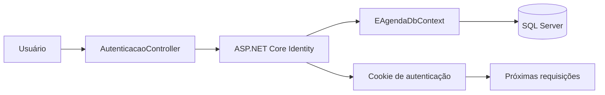
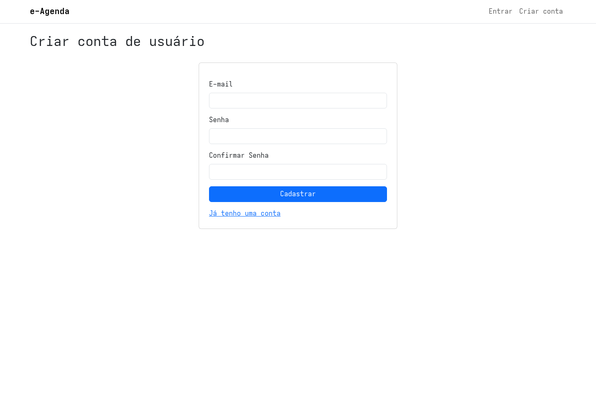
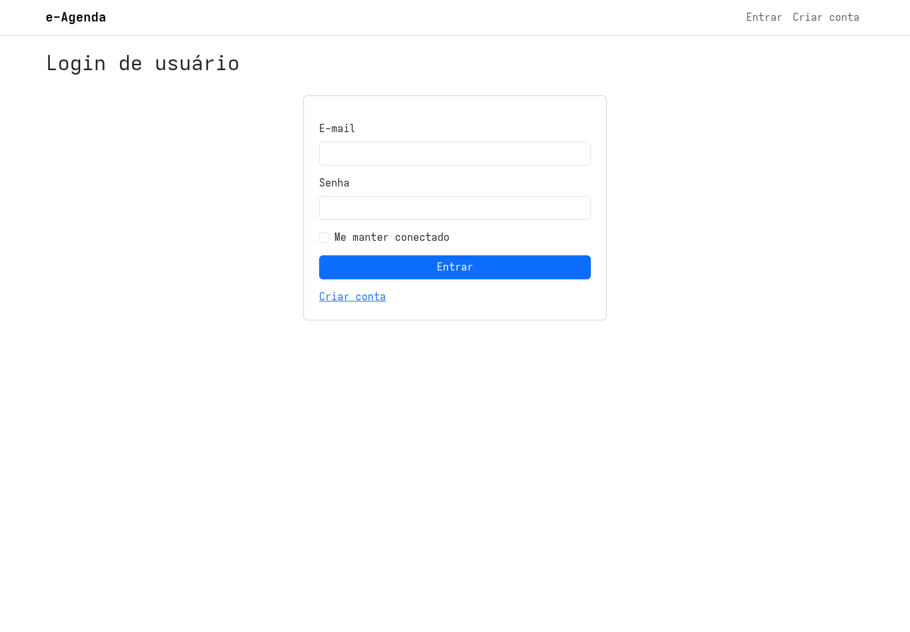

## Introdução à Autenticação e Autorização com ASP.NET Core Identity

Até agora, as telas do e-Agenda podiam ser acessadas sem uma conta de usuário.

Com a entrada do ASP.NET Core Identity, a aplicação passa a permitir cadastro, login e logout.

Também passa a exigir um usuário autenticado para acessar as rotas protegidas.

Antes de acompanhar a configuração, vamos separar dois conceitos:

- **autenticação** verifica quem está acessando a aplicação;
- **autorização** verifica se essa pessoa pode acessar determinado recurso.

Na `v6`, a política global exige que a pessoa esteja autenticada.

O código ainda não define regras por perfil, cargo ou dono do registro.

> Estar autenticado confirma a identidade da conta. Isso não significa, por si só, que exista uma regra de acesso específica para cada recurso.

## Como o Identity participa da aplicação

O ASP.NET Core Identity fornece os serviços para criar contas, validar senhas, autenticar usuários e manter os dados da conta.

O e-Agenda usa o Entity Framework Core para armazenar esses dados no SQL Server.

O fluxo básico é:



No cadastro, o Identity cria uma conta e armazena o hash da senha.

No login, valida as credenciais e emite um cookie de autenticação.

Nas requisições seguintes, o middleware lê esse cookie para identificar o usuário.

## Criando o tipo de usuário

O projeto define `UsuarioIdentity` como uma especialização de `IdentityUser<Guid>`:

```csharp
public sealed class UsuarioIdentity : IdentityUser<Guid>
{
}
```

`IdentityUser` já contém propriedades usuais da conta, como identificador, nome de usuário, e-mail, hash da senha e estado de bloqueio.

O tipo `Guid` define o identificador usado para as contas.

## Integrando Identity ao DbContext

Antes, o contexto herdava diretamente de `DbContext`.

Para que o Identity possa usar o mesmo banco e contexto das entidades do e-Agenda, ele passa a herdar de `IdentityDbContext`:

```csharp
public sealed class EAgendaDbContext(
    DbContextOptions<EAgendaDbContext> options
) : IdentityDbContext<UsuarioIdentity, IdentityRole<Guid>, Guid>(options)
{
    public DbSet<Categoria> Categorias => Set<Categoria>();
    public DbSet<Contato> Contatos => Set<Contato>();
    public DbSet<Compromisso> Compromissos => Set<Compromisso>();
}
```

O contexto continua mapeando as entidades do e-Agenda.

Também passa a fornecer ao Identity os conjuntos necessários para usuários, funções e demais dados de autenticação.

Uma migration cria as tabelas padrão, como `AspNetUsers`, `AspNetRoles`, `AspNetUserClaims`, `AspNetUserLogins` e `AspNetUserTokens`.

As chaves dos usuários e das funções são `Guid`.

Na inicialização em ambiente de desenvolvimento, o projeto aplica as migrations automaticamente.

## Registrando os serviços do Identity

No `Program.cs`, o projeto configura os serviços do Identity e o armazenamento com Entity Framework Core:

```csharp
builder.Services.AddIdentity<UsuarioIdentity, IdentityRole<Guid>>(options =>
{
    options.User.RequireUniqueEmail = true;
    options.Password.RequiredLength = 8;
    options.Password.RequireDigit = true;
    options.Password.RequireUppercase = true;
    options.Password.RequireNonAlphanumeric = true;
    options.Lockout.AllowedForNewUsers = true;
})
.AddEntityFrameworkStores<EAgendaDbContext>()
.AddDefaultTokenProviders();
```

Essa configuração estabelece que:

- cada conta deve usar um e-mail único;
- a senha deve ter pelo menos oito caracteres;
- a senha deve conter número, letra maiúscula e caractere não alfanumérico;
- o armazenamento das contas usa `EAgendaDbContext`.

O projeto não substitui todos os requisitos de senha padrão do Identity.

As opções mostradas são os requisitos adicionais configurados explicitamente nesta versão.

`AddDefaultTokenProviders()` também registra provedores de token do Identity.

Apesar disso, a `v6` ainda não implementa fluxos de confirmação de e-mail ou redefinição de senha.

## Cadastro de uma conta

As rotas de cadastro usam `AutenticacaoController`.

O `CadastroUsuarioViewModel` valida o formato do e-mail, sua presença e a confirmação de senha.

No envio do formulário, o Controller cria um `UsuarioIdentity` e chama `UserManager.CreateAsync`:

```csharp
UsuarioIdentity usuario = new()
{
    UserName = viewModel.Email.ToLower().Trim(),
    Email = viewModel.Email.ToLower().Trim(),
};

IdentityResult resultado = await userManager.CreateAsync(
    usuario,
    viewModel.Senha
);
```

O Identity valida e cria a conta.

Se houver erros, o Controller adiciona as mensagens ao `ModelState` para a View apresentá-las.

Se o cadastro for concluído, a pessoa é encaminhada à tela de login.

Nesta versão, o cadastro não autentica a pessoa automaticamente.



## Login e cookie de autenticação

Para entrar, o Controller usa `SignInManager.PasswordSignInAsync`:

```csharp
var resultado = await signInManager.PasswordSignInAsync(
    viewModel.Email.Trim(),
    viewModel.Senha,
    viewModel.LembrarMe,
    lockoutOnFailure: true
);
```

O e-mail é usado como nome de usuário, pois o cadastro grava o e-mail normalizado em `UserName`.

O parâmetro `LembrarMe` é enviado ao Identity para definir a persistência do cookie.

Com `lockoutOnFailure: true`, uma tentativa inválida pode contribuir para o bloqueio da conta, conforme a configuração de lockout do Identity.

Quando o login funciona, o Controller redireciona para a URL de retorno se ela for local.

Caso contrário, redireciona para a página inicial.

Essa verificação evita redirecionar a pessoa para um endereço externo informado na requisição.



## Rotas de Autenticação

O projeto usa o roteamento convencional do MVC com `MapDefaultControllerRoute()`.

Por isso, as ações do `AutenticacaoController` ficam disponíveis em:

| Método HTTP | Rota | Ação |
| --- | --- | --- |
| GET | `/Autenticacao/Cadastro` | Exibe o formulário de cadastro |
| POST | `/Autenticacao/Cadastro` | Valida e cria a conta |
| GET | `/Autenticacao/Login` | Exibe o formulário de login |
| POST | `/Autenticacao/Login` | Valida as credenciais e inicia a sessão |
| POST | `/Autenticacao/Logout` | Encerra a sessão |

O formulário de login também pode receber `returnUrl`.

O Identity pode usar esse endereço para registrar para onde a pessoa deve voltar após entrar.

O Controller só redireciona se a URL for local.

Se uma pessoa já autenticada abrir as telas de login ou cadastro, o Controller a redireciona para a página inicial.

> **Observação sobre esta versão:** a ação GET recebe `returnUrl` e a ação POST sabe validá-lo, mas a View de login não envia esse valor em um campo oculto. Portanto, o fluxo atual não preserva a URL original do desafio ao enviar o formulário e acaba usando o redirecionamento para a página inicial.

## Permitindo o acesso anônimo às telas públicas

Na `v6`, o projeto configura uma política de fallback que exige um usuário autenticado:

```csharp
builder.Services.AddAuthorization(options =>
{
    options.FallbackPolicy = new AuthorizationPolicyBuilder()
        .RequireAuthenticatedUser()
        .Build();
});
```

Uma política de fallback é aplicada quando uma rota não define uma política de autorização própria.

Por isso, as ações de cadastro e login recebem `[AllowAnonymous]`.

Sem esse atributo, uma pessoa sem sessão seria redirecionada para o login antes de conseguir abrir esses formulários.

Já a ação de logout recebe `[Authorize]` e também usa `HttpPost`:

```csharp
[HttpPost]
[Authorize]
public async Task<ActionResult> Logout()
{
    await signInManager.SignOutAsync();
    return RedirectToAction(nameof(Login));
}
```

O pipeline registra a autenticação antes da autorização:

```csharp
app.UseRouting();
app.UseAuthentication();
app.UseAuthorization();

app.MapDefaultControllerRoute();
```

`UseAuthentication` identifica a conta a partir do cookie.

`UseAuthorization` aplica a política de acesso às rotas.

## Configurando os caminhos do cookie

Quando uma pessoa sem autenticação tenta acessar uma rota protegida, o cookie redireciona para o login.

O projeto configura estes caminhos:

```csharp
builder.Services.ConfigureApplicationCookie(options =>
{
    options.LoginPath = "/Autenticacao/Login";
    options.AccessDeniedPath = "/Autenticacao/Login";
});
```

Nesta versão, `LoginPath` e `AccessDeniedPath` apontam para a mesma ação.

Como a política aplicada verifica apenas se existe uma sessão autenticada, ainda não há uma página ou regra separada para permissões por função.

## Autenticação não é autorização por usuário

A política global protege as rotas contra acessos anônimos.

Porém, o código da `v6` não associa os registros de Despesas, Tarefas, Contatos e Compromissos a uma conta específica.

Também não cria regras por função, mesmo que o esquema do Identity inclua tabelas relacionadas a roles.

Assim, autenticação global não deve ser confundida com isolamento dos dados de cada usuário.

Uma evolução do projeto precisaria associar os registros às contas e verificar essa relação nos casos de uso.

## Encerrando a sessão

O logout chama `SignInManager.SignOutAsync`, que remove o cookie de autenticação do navegador.

Depois, o Controller redireciona para a tela de login.

O layout mostra links diferentes conforme o estado da sessão:

- sem autenticação: **Entrar** e **Criar conta**;
- com autenticação: navegação do e-Agenda, nome da conta e **Sair**.

## Testando os fluxos

1. Abra `/Autenticacao/Cadastro` sem estar autenticado.
2. Crie uma conta com e-mail válido e senha que atenda aos requisitos.
3. Confira que o sistema retorna à tela de login.
4. Tente abrir uma rota protegida sem sessão e observe o redirecionamento.
5. Entre com a conta criada.
6. Confira que a aplicação retorna à rota original quando houver uma URL local de retorno.
7. Use **Sair** e confirme que a navegação volta a exibir as opções públicas.

## Conclusão

O ASP.NET Core Identity acrescenta ao e-Agenda o cadastro e o gerenciamento básico de contas.

O `UserManager` cria usuários, enquanto o `SignInManager` executa login e logout.

O Entity Framework Core persiste os dados de Identity junto às demais entidades no contexto da aplicação.

A política de fallback protege as rotas por padrão, e `[AllowAnonymous]` mantém acessíveis as páginas necessárias para iniciar uma sessão.

Nesta versão, a regra de autorização é global e não separa os dados por usuário nem por função.
