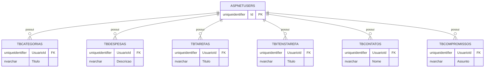
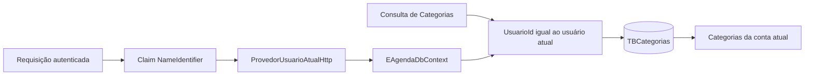

## Relacionamento de Usuários com Entidades no EF Core

Na aula anterior, o e-Agenda passou a permitir o cadastro e o login de usuários.

Com mais de uma conta, surge uma nova necessidade:

> cada registro precisa indicar a qual usuário pertence.

Nesta aula, vamos acompanhar como o projeto adiciona essa relação às entidades e como um filtro global limita as consultas de Categorias ao usuário autenticado.

## Adicionando o identificador do usuário às entidades

As entidades do e-Agenda herdam de `EntidadeBase<T>`.

Essa classe declara a propriedade `UsuarioId`:

```csharp
public abstract class EntidadeBase<T>
{
    public Guid Id { get; set; } = Guid.CreateVersion7();
    public Guid UsuarioId { get; set; } = Guid.Empty;
}
```

Assim, Categorias, Despesas, Tarefas, Itens de Tarefa, Contatos e Compromissos passam a ter uma coluna que pode apontar para o usuário responsável.

O tipo `Guid` é o mesmo usado como chave primária por `UsuarioIdentity`.

## Mapeando a chave estrangeira para o Identity

Cada configuração do EF Core relaciona `UsuarioId` com `UsuarioIdentity`:

```csharp
builder.HasOne<UsuarioIdentity>()
    .WithMany()
    .HasForeignKey(entidade => entidade.UsuarioId)
    .OnDelete(DeleteBehavior.Restrict);
```

Essa configuração informa que:

- cada entidade pertence a um usuário;
- um usuário pode ter várias entidades;
- a coluna `UsuarioId` é a chave estrangeira;
- o banco não deve excluir os registros relacionados em cascata quando um usuário for removido.

O relacionamento fica representado no banco por chaves estrangeiras para `AspNetUsers`:



O diagrama representa os relacionamentos definidos nas configurações do EF Core.

## Migration e índices por usuário

A migration `Update_UsuarioId` adiciona a coluna `UsuarioId` às seis tabelas e cria as chaves estrangeiras para `AspNetUsers`.

Ela também altera alguns índices únicos para considerar o usuário:

- Categorias: combinação de `UsuarioId` e `Titulo`;
- Contatos: combinação de `UsuarioId` e `Email`;
- Contatos: combinação de `UsuarioId` e `Telefone`.

Assim, duas contas podem cadastrar o mesmo título de Categoria ou os mesmos dados de Contato sem violar esses índices.

Dentro da mesma conta, a duplicidade continua impedida.

## Obtendo o usuário da requisição HTTP

Para preencher `UsuarioId`, o Controller precisa saber quem está autenticado.

O Domínio define a interface `IProvedorUsuarioAtual`:

```csharp
public interface IProvedorUsuarioAtual
{
    Guid Id { get; }
}
```

Essa interface descreve o dado necessário sem depender diretamente do ASP.NET Core.

Na Apresentação, `ProvedorUsuarioAtualHttp` lê a claim `NameIdentifier` do usuário da requisição e tenta convertê-la para `Guid`:

```csharp
string? contextId = httpContextAccessor.HttpContext?
    .User
    .FindFirstValue(ClaimTypes.NameIdentifier);

bool conseguiuConverter = Guid.TryParse(contextId, out Guid usuarioId);

return conseguiuConverter ? usuarioId : Guid.Empty;
```

O `IHttpContextAccessor` permite acessar o `HttpContext` atual.

O serviço é registrado como `Scoped`, ou seja, uma instância é utilizada dentro do escopo da requisição:

```csharp
builder.Services.AddHttpContextAccessor();
builder.Services.AddScoped<IProvedorUsuarioAtual, ProvedorUsuarioAtualHttp>();
```

## Associando uma Categoria ao usuário

O fluxo de cadastro de Categorias recebe o identificador do usuário atual.

O Controller obtém o valor pelo provedor e o inclui no DTO:

```csharp
CadastrarCategoriaDto dto = new(
    usuarioAtual.Id,
    viewModel.Titulo ?? string.Empty
);
```

O serviço de Aplicação usa esse valor para criar a Categoria:

```csharp
Categoria categoria = new(dto.UsuarioId, dto.Titulo);
```

O construtor da entidade atribui o usuário:

```csharp
public Categoria(Guid usuarioId, string titulo)
{
    UsuarioId = usuarioId;
    Titulo = titulo;
}
```

O repositório salva a entidade normalmente.

Como a Categoria já contém o identificador do usuário, o banco consegue validar a chave estrangeira.

## Aplicando um QueryFilter global

Um filtro global de consulta é uma condição que o EF Core acrescenta às consultas de uma entidade.

O `EAgendaDbContext` configura um filtro para Categorias:

```csharp
modelBuilder.Entity<Categoria>()
    .HasQueryFilter(c => c.UsuarioId == usuarioAtual.Id);
```

O EF Core aplica essa condição às consultas de `Categoria` feitas pelo contexto.

Por exemplo, o repositório pode executar uma consulta simples:

```csharp
return registros
    .OrderBy(c => c.Titulo)
    .ToList();
```

Mesmo sem adicionar manualmente um `Where`, o filtro global limita os resultados ao identificador devolvido pelo provedor de usuário atual.

O fluxo é:



O filtro é aplicado a consultas que passam pelo contexto, como listagens e buscas por identificador.

Ele não altera as regras de validação do Domínio nem substitui a chave estrangeira no banco.

O filtro também não preenche `UsuarioId` durante um cadastro.

Essa associação precisa ser feita pelo fluxo que cria a entidade, como acontece com Categorias.

O EF Core permite desativar os filtros de uma consulta com `IgnoreQueryFilters()`.

Esse recurso deve ser usado somente quando a aplicação realmente precisa consultar registros de outros usuários.

## Atualizando uma base com dados existentes

A migration adiciona `UsuarioId` obrigatório com `Guid.Empty` como valor padrão e cria as chaves estrangeiras para `AspNetUsers`.

Ela não cria um usuário padrão nem associa os registros existentes a uma conta.

Em uma base que já contém registros, a criação das chaves estrangeiras pode falhar porque não existe um usuário com o identificador vazio.

Antes de aplicar essa alteração em uma base com dados, é necessário definir como os registros existentes serão associados a usuários válidos.

## Testando o filtro de Categorias

Para observar o comportamento pretendido do filtro:

1. Entre com uma conta e cadastre algumas Categorias.
2. Registre o identificador do usuário associado a essas Categorias.
3. Entre com outra conta.
4. Abra a listagem e confirme que as Categorias da primeira conta não aparecem.
5. Tente abrir uma Categoria de outra conta pelo identificador e verifique que a consulta filtrada não a retorna.
6. Confira no banco os valores de `UsuarioId` e a chave estrangeira para `AspNetUsers`.

O teste deve usar duas contas distintas.

Testar com uma única conta não demonstra que o isolamento entre usuários está funcionando.

## Conclusão

O projeto adiciona `UsuarioId` às entidades e cria relacionamentos entre os registros e `AspNetUsers`.

O provedor da requisição traduz a claim de identidade para um `Guid` que o fluxo de Categorias pode utilizar.

O `HasQueryFilter` aplica automaticamente o critério de usuário às consultas de Categorias.

A migration também acrescenta a relação com `AspNetUsers` às tabelas das entidades do e-Agenda.
