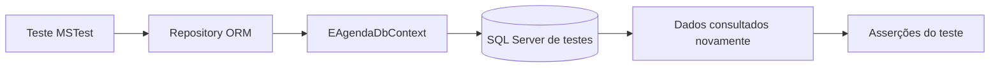

## Testes de Integração com MSTest e EF Core

Na aula anterior, verificamos as regras de `Tarefa` criando objetos na memória.

Esses testes confirmam o cálculo de progresso, mas não respondem a outras perguntas:

- a tarefa e seus itens são gravados corretamente?
- a consulta recupera os relacionamentos?
- a edição atualiza os dados persistidos?
- a exclusão também remove os itens da tarefa?

Para responder, precisamos testar a colaboração entre Repository, Entity Framework Core e banco de dados.

Nesta aula, utilizaremos MSTest com o SQL Server real para verificar a persistência do e-Agenda.

## O que muda em um teste de integração?

Um teste de integração verifica componentes trabalhando em conjunto.

Nos nossos exemplos, o fluxo será:



O teste chama o repositório real, que utiliza o `EAgendaDbContext` para executar comandos no SQL Server.

Depois, consulta os dados novamente e verifica o resultado.

Não precisamos iniciar a aplicação web ou abrir o navegador.

O foco é a persistência, não o fluxo completo da interface.

> Um teste unitário verifica uma regra isolada. Aqui, o teste de integração verifica se a infraestrutura consegue persistir e recuperar os dados esperados.

## Por que utilizar SQL Server nos testes?

O e-Agenda utiliza o provedor SQL Server do EF Core.

Testar com o mesmo mecanismo permite exercitar:

- mapeamentos de propriedades;
- chaves estrangeiras;
- carregamento de relacionamentos com `Include`;
- exclusões em cascata;
- tradução das consultas para SQL.

O provedor `InMemory` não reproduz o comportamento de um banco relacional.

SQLite também possui diferenças em relação ao SQL Server.

Essas alternativas podem servir a outros cenários, mas não substituem as verificações que faremos aqui.

O custo é que os testes precisam de um SQL Server disponível e tendem a ser mais lentos que os testes unitários.

## Preparando um banco exclusivo para testes

> **Atenção:** a preparação utilizada nesta aula executa `EnsureDeleted()`. Isso apaga o banco indicado na conexão, incluindo suas tabelas e dados.

Utilize um banco descartável chamado `EAgendaBackendTestDB`.

Nunca aponte esses testes para o banco de desenvolvimento com dados importantes, para um banco compartilhado ou para produção.

Antes de executar:

1. Disponibilize uma instância local de SQL Server, instalada ou executada em um container.
2. Reserve o nome `EAgendaBackendTestDB` exclusivamente para estes testes.
3. Confira servidor, porta e nome do banco na conexão.
4. Utilize uma conta de testes com permissão para criar e excluir esse banco no ambiente descartável.
5. Garanta que nenhuma outra execução esteja utilizando o mesmo banco.

Não é necessário criar as tabelas manualmente. A preparação dos testes criará a estrutura.

A proteção de nome que adicionaremos ajuda a evitar enganos, mas não substitui a conferência do servidor e da conexão.

## Organizando o projeto de integração

Os testes de integração ficam separados dos unitários:

```text
eAgenda.slnx
src/
  Dominio/
  Infraestrutura/
    eAgenda.Infraestrutura.csproj
tests/
  Unidade/
  Integracao/
    eAgenda.Testes.Integracao.csproj
    appsettings.json
    MSTestSettings.cs
    Compartilhado/
      ProvedorUsuarioAtualFake.cs
      RepositorioEmOrmTestsBase.cs
    Modulos/
      Tarefas/
        RepositorioTarefaEmOrmTests.cs
      Compromissos/
        RepositorioCompromissoEmOrmTests.cs
```

Se `tests/Integracao` já existe, utilize esse projeto e atualize os arquivos correspondentes, sem criar cópias das classes.

Se ainda não existe, execute na pasta de `eAgenda.slnx`:

```bash
dotnet new classlib -n eAgenda.Testes.Integracao -o tests/Integracao -f net10.0
dotnet sln eAgenda.slnx add tests/Integracao/eAgenda.Testes.Integracao.csproj
```

O arquivo `Class1.cs` gerado pelo template não será utilizado e pode ser removido.

Configure `eAgenda.Testes.Integracao.csproj`:

```xml
<Project Sdk="Microsoft.NET.Sdk">
  <PropertyGroup>
    <TargetFramework>net10.0</TargetFramework>
    <LangVersion>latest</LangVersion>
    <ImplicitUsings>enable</ImplicitUsings>
    <Nullable>enable</Nullable>
    <UserSecretsId>adac42fa-e092-4ba9-8660-66e04d303b3c</UserSecretsId>
  </PropertyGroup>

  <ItemGroup>
    <PackageReference Include="Microsoft.Extensions.Configuration.Json" Version="10.0.13" />
    <PackageReference Include="Microsoft.Extensions.Configuration.UserSecrets" Version="10.0.13" />
    <PackageReference Include="MSTest" Version="4.0.1" />
  </ItemGroup>

  <ItemGroup>
    <ProjectReference Include="../../src/Infraestrutura/eAgenda.Infraestrutura.csproj" />
  </ItemGroup>

  <ItemGroup>
    <Using Include="Microsoft.VisualStudio.TestTools.UnitTesting" />
  </ItemGroup>

  <ItemGroup>
    <None Update="appsettings.json" CopyToOutputDirectory="PreserveNewest" />
  </ItemGroup>
</Project>
```

A referência à Infraestrutura permite utilizar os repositórios reais e o contexto.

O Domínio também fica disponível pela referência que a Infraestrutura já possui.

As versões acima acompanham os pacotes utilizados pelo projeto.

O `UserSecretsId` identifica o conjunto de configurações locais; ele não é uma senha.

## Configurando a conexão sem versionar a senha

Em `tests/Integracao/appsettings.json`, mantenha somente a estrutura:

```json
{
  "ConnectionStrings": {
    "SqlServer": ""
  }
}
```

O arquivo será copiado para a pasta de saída durante o build.

Armazene a conexão real com **User Secrets**, o recurso do .NET para configurações locais fora do repositório.

Substitua os marcadores antes de executar:

```bash
dotnet user-secrets set "ConnectionStrings:SqlServer" "Server=localhost,1433;Database=EAgendaBackendTestDB;User Id=USUARIO_DE_TESTES;Password=SENHA_LOCAL;TrustServerCertificate=True" --project tests/Integracao/eAgenda.Testes.Integracao.csproj
```

Não publique a conexão preenchida no código, em capturas de tela ou em commits.

`TrustServerCertificate=True` é utilizado aqui para um ambiente local de testes. Não deve ser copiado automaticamente para configurações de produção.

Os User Secrets não são um cofre criptografado. Servem para evitar o armazenamento dessas configurações no repositório durante o desenvolvimento.

## Simulando o usuário atual

O `EAgendaDbContext` recebe um `IProvedorUsuarioAtual`.

Ele utiliza o identificador para filtrar os registros do usuário.

Nos testes, não existe uma requisição HTTP com usuário autenticado.

Em `Compartilhado/ProvedorUsuarioAtualFake.cs`, fornecemos esse dado diretamente:

```csharp
using eAgenda.Dominio.Compartilhado;

namespace eAgenda.Testes.Integracao.Compartilhado;

public sealed class ProvedorUsuarioAtualFake(Guid id) : IProvedorUsuarioAtual
{
    public Guid Id => id;
}
```

Um **fake** é uma implementação simples utilizada no lugar de uma dependência real durante o teste.

Substituímos somente a obtenção do usuário atual. O Repository, o EF Core e o SQL Server continuam reais.

Isso não testa o login ou a autorização do usuário.

Também precisaremos cadastrar um `UsuarioIdentity`, pois as entidades possuem chaves estrangeiras para a tabela de usuários.

## Centralizando a preparação dos testes

Crie ou atualize `Compartilhado/RepositorioEmOrmTestsBase.cs`.

A classe base concentra a leitura da conexão, a criação do contexto e o cadastro do usuário.

O exemplo mantém a estratégia do projeto e acrescenta duas proteções: conferir o nome do banco antes de apagá-lo e liberar o contexto após cada teste.

```csharp
using eAgenda.Infraestrutura.Compartilhado.Identity;
using eAgenda.Infraestrutura.Compartilhado.Orm;
using eAgenda.Testes.Integracao.Compartilhado;
using Microsoft.Data.SqlClient;
using Microsoft.EntityFrameworkCore;
using Microsoft.Extensions.Configuration;
using Microsoft.VisualStudio.TestTools.UnitTesting;

[TestClass]
public abstract class RepositorioEmOrmTestsBase
{
    private static string connectionString = string.Empty;
    protected Guid usuarioId = Guid.Empty;
    protected EAgendaDbContext dbContext = null!;

    [AssemblyInitialize]
    public static void InicializarAssembly(TestContext testContext)
    {
        IConfiguration configuration = new ConfigurationBuilder()
            .SetBasePath(AppContext.BaseDirectory)
            .AddJsonFile("appsettings.json", optional: false)
            .AddUserSecrets("adac42fa-e092-4ba9-8660-66e04d303b3c")
            .Build();

        connectionString = configuration.GetConnectionString("SqlServer")
            ?? string.Empty;

        if (string.IsNullOrWhiteSpace(connectionString))
            throw new InvalidOperationException(
                "A ConnectionStrings:SqlServer não foi configurada."
            );

        SqlConnectionStringBuilder conexao = new(connectionString);

        if (!string.Equals(
            conexao.InitialCatalog,
            "EAgendaBackendTestDB",
            StringComparison.OrdinalIgnoreCase))
        {
            throw new InvalidOperationException(
                "Os testes exigem o banco exclusivo EAgendaBackendTestDB."
            );
        }
    }

    [TestInitialize]
    public void InicializarTeste()
    {
        usuarioId = Guid.CreateVersion7();
        dbContext = CriarContexto(usuarioId);

        dbContext.Database.EnsureDeleted();
        dbContext.Database.EnsureCreated();

        CriarUsuario(dbContext, usuarioId);
    }

    private static EAgendaDbContext CriarContexto(Guid usuarioId)
    {
        DbContextOptions<EAgendaDbContext> options =
            new DbContextOptionsBuilder<EAgendaDbContext>()
                .UseSqlServer(connectionString)
                .Options;

        return new EAgendaDbContext(
            options,
            new ProvedorUsuarioAtualFake(usuarioId)
        );
    }

    private static void CriarUsuario(EAgendaDbContext contexto, Guid id)
    {
        contexto.Users.Add(new UsuarioIdentity
        {
            Id = id,
            UserName = $"integracao-{id:N}",
            NormalizedUserName = $"INTEGRACAO-{id:N}",
            Email = $"{id:N}@test.local",
            NormalizedEmail = $"{id:N}@TEST.LOCAL",
            EmailConfirmed = true,
            SecurityStamp = Guid.NewGuid().ToString()
        });

        contexto.SaveChanges();
    }

    [TestCleanup]
    public void FinalizarTeste()
    {
        dbContext?.Dispose();
    }
}
```

`[AssemblyInitialize]` executa a configuração uma vez antes dos testes desse projeto.

`[TestInitialize]` prepara o ambiente antes de cada teste, inclusive para as classes que herdam dessa base.

`[TestCleanup]` libera o contexto após cada teste. `Dispose()` libera seus recursos; não apaga o banco.

O usuário é inserido diretamente no contexto para preparar a persistência. Não estamos executando um cadastro pelo `UserManager`.

Não adicione outro método com `[AssemblyInitialize]` em uma segunda classe do mesmo projeto. Centralize essa configuração na base apresentada.

## Recriando o banco e controlando o paralelismo

Antes de cada teste, `EnsureDeleted()` apaga o banco e `EnsureCreated()` cria sua estrutura a partir do modelo atual.

Isso evita que um teste dependa dos registros deixados pelo anterior.

Porém, dois testes simultâneos poderiam apagar o banco enquanto o outro ainda está utilizando suas tabelas.

Em `MSTestSettings.cs`, desative o paralelismo desse projeto:

```csharp
using Microsoft.VisualStudio.TestTools.UnitTesting;

[assembly: DoNotParallelize]
```

Essa configuração não impede que outra execução, em outro processo, acesse o mesmo banco. Não execute duas suítes contra ele ao mesmo tempo.

> `EnsureCreated()` não aplica migrations. Esses testes verificam o modelo atual e a persistência, não o histórico de evolução do banco.

Não misture `EnsureCreated()` e `Migrate()` nessa preparação.

Em projetos maiores, podemos estudar outras estratégias de isolamento. Por enquanto, recriar um banco descartável facilita o entendimento.

## Testando o cadastro de uma tarefa com itens

Crie ou atualize `Modulos/Tarefas/RepositorioTarefaEmOrmTests.cs`.

Observe o padrão AAA: preparamos os dados, chamamos o repositório e verificamos o que foi recuperado.

```csharp
using eAgenda.Dominio.Modulos.Tarefas;
using eAgenda.Infraestrutura.Modulos.Tarefas;
using Microsoft.EntityFrameworkCore;
using Microsoft.VisualStudio.TestTools.UnitTesting;

namespace eAgenda.Testes.Integracao.Modulos.Tarefas;

[TestClass]
public sealed class RepositorioTarefaEmOrmTests : RepositorioEmOrmTestsBase
{
    [TestMethod]
    public void Cadastrar_DevePersistirTarefaEItensNoBanco()
    {
        // Arranjo
        Tarefa tarefa = new("Preparar apresentação", PrioridadeTarefa.Alta)
        {
            UsuarioId = usuarioId,
            DataCriacao = new DateOnly(2026, 11, 3)
        };

        tarefa.AdicionarItem(new ItemTarefa(tarefa, "Revisar conteúdo")
        {
            UsuarioId = usuarioId
        });

        tarefa.AdicionarItem(new ItemTarefa(tarefa, "Montar slides")
        {
            UsuarioId = usuarioId,
            Concluido = true
        });

        RepositorioTarefaEmOrm repositorio = new(dbContext);

        // Ação
        repositorio.Cadastrar(tarefa);
        dbContext.ChangeTracker.Clear();

        Tarefa? selecionada = repositorio.SelecionarPorId(tarefa.Id);

        // Asserção
        Assert.IsNotNull(selecionada);
        Assert.AreEqual(tarefa.Id, selecionada.Id);
        Assert.AreEqual(usuarioId, selecionada.UsuarioId);
        Assert.AreEqual("Preparar apresentação", selecionada.Titulo);
        Assert.AreEqual(PrioridadeTarefa.Alta, selecionada.Prioridade);
        Assert.AreEqual(new DateOnly(2026, 11, 3), selecionada.DataCriacao);
        Assert.AreEqual(50, selecionada.PercentualConcluido);
        Assert.HasCount(2, selecionada.Itens);
        Assert.IsTrue(selecionada.Itens.All(i => i.UsuarioId == usuarioId));

        CollectionAssert.AreEqual(
            new[] { "Montar slides", "Revisar conteúdo" },
            selecionada.Itens.Select(i => i.Titulo).ToArray()
        );
    }
}
```

O repositório chama `SaveChanges()` dentro de `Cadastrar()`.

Por isso, os dados devem existir no banco quando fazemos a consulta seguinte.

`UsuarioId` precisa ser preenchido tanto na tarefa quanto nos itens.

O contexto possui filtros globais para essas entidades. Um identificador diferente pode fazer o registro não aparecer na consulta, mesmo que tenha sido gravado.

`CollectionAssert.AreEqual` verifica os títulos e sua ordem. O repositório ordena os itens por título após carregá-los.

## Por que limpar o ChangeTracker?

O EF Core mantém um rastreamento dos objetos carregados ou adicionados no contexto.

Se utilizarmos os mesmos objetos rastreados na verificação, podemos deixar de perceber um problema na recuperação dos dados.

Por exemplo, a coleção de itens já pode estar preenchida na memória antes da consulta.

Com:

```csharp
dbContext.ChangeTracker.Clear();
```

removemos o rastreamento e fazemos a consulta seguinte recuperar novas instâncias dos dados persistidos.

O comando não apaga registros e não salva alterações pendentes. Utilize-o depois de salvar o que deseja verificar.

Outra possibilidade é consultar com um novo contexto.

No `RepositorioTarefaEmOrm`, a consulta utiliza:

```csharp
Tarefa? tarefa = registros
    .Include(t => t.Itens)
    .SingleOrDefault(t => t.Id == idSelecionado);
```

O teste de cadastro também ajuda a verificar esse carregamento dos itens.

## Testando a edição da tarefa e de seus itens

Adicione os próximos métodos dentro de `RepositorioTarefaEmOrmTests`.

O cadastro inicial pertence ao arranjo. A operação que queremos testar agora é `Editar()`.

```csharp
[TestMethod]
public void Editar_DeveAtualizarTarefaEItensNoBanco()
{
    // Arranjo
    Tarefa original = new("Preparar apresentação", PrioridadeTarefa.Alta)
    {
        UsuarioId = usuarioId
    };

    ItemTarefa itemAntigo = new(original, "Revisar conteúdo")
    {
        UsuarioId = usuarioId
    };
    original.AdicionarItem(itemAntigo);

    RepositorioTarefaEmOrm repositorio = new(dbContext);
    repositorio.Cadastrar(original);
    dbContext.ChangeTracker.Clear();

    Tarefa atualizada = new("Versão final", PrioridadeTarefa.Normal)
    {
        Id = original.Id,
        UsuarioId = usuarioId,
        DataCriacao = new DateOnly(2026, 11, 5)
    };
    atualizada.AdicionarItem(new ItemTarefa(atualizada, "Item novo")
    {
        UsuarioId = usuarioId,
        Concluido = true
    });

    // Ação
    bool editou = repositorio.Editar(original.Id, atualizada);
    dbContext.ChangeTracker.Clear();

    Tarefa? selecionada = repositorio.SelecionarPorId(original.Id);

    // Asserção
    Assert.IsTrue(editou);
    Assert.IsNotNull(selecionada);
    Assert.AreEqual("Versão final", selecionada.Titulo);
    Assert.AreEqual(PrioridadeTarefa.Normal, selecionada.Prioridade);
    Assert.AreEqual(new DateOnly(2026, 11, 5), selecionada.DataCriacao);
    Assert.HasCount(1, selecionada.Itens);
    Assert.AreEqual("Item novo", selecionada.Itens[0].Titulo);
    Assert.AreEqual(100, selecionada.PercentualConcluido);
    Assert.IsTrue(selecionada.Concluida);
    Assert.IsNotNull(selecionada.DataConclusao);
    Assert.IsFalse(dbContext.ItensTarefa.Any(i => i.Id == itemAntigo.Id));
}
```

A entidade atualizada preserva o identificador da tarefa original.

O teste verifica as novas propriedades, a substituição dos itens e a ausência do item antigo no banco.

Isso exercita a combinação entre `Atualizar()`, o rastreamento do EF Core e o relacionamento persistido.

## Testando a exclusão em cascata

Ao excluir uma tarefa, seus itens também devem ser removidos.

```csharp
[TestMethod]
public void Excluir_DeveApagarTarefaEItensNoBanco()
{
    // Arranjo
    Tarefa tarefa = new("Preparar apresentação", PrioridadeTarefa.Alta)
    {
        UsuarioId = usuarioId
    };
    tarefa.AdicionarItem(new ItemTarefa(tarefa, "Revisar conteúdo")
    {
        UsuarioId = usuarioId
    });

    RepositorioTarefaEmOrm repositorio = new(dbContext);
    repositorio.Cadastrar(tarefa);
    dbContext.ChangeTracker.Clear();

    // Ação
    bool excluiu = repositorio.Excluir(tarefa.Id);
    dbContext.ChangeTracker.Clear();

    Tarefa? selecionada = repositorio.SelecionarPorId(tarefa.Id);
    int quantidadeItens = dbContext.ItensTarefa.Count(
        i => i.TarefaId == tarefa.Id
    );

    // Asserção
    Assert.IsTrue(excluiu);
    Assert.IsNull(selecionada);
    Assert.AreEqual(0, quantidadeItens);
}
```

Verificar somente o retorno `true` seria insuficiente.

Também consultamos a tarefa e contamos seus itens após a exclusão.

Esse cenário confirma o resultado da exclusão pelo repositório e pelo mapeamento do relacionamento. Não isola, sozinho, se a remoção dos dependentes foi executada pelo EF Core ou pelo banco.

No projeto, o relacionamento utiliza:

```csharp
builder.HasMany(t => t.Itens)
    .WithOne(i => i.Tarefa)
    .HasForeignKey(i => i.TarefaId)
    .OnDelete(DeleteBehavior.ClientCascade);
```

Com `ClientCascade`, o EF Core coordena a remoção dos itens carregados e rastreados. Não se trata de um `ON DELETE CASCADE` executado pelo SQL Server.

O repositório carrega a tarefa com seus itens antes de excluí-la. Esse carregamento é importante para que a exclusão funcione com esse mapeamento.

## Verificando o relacionamento entre Compromisso e Contato

Outra integração importante é recuperar um compromisso com seu contato.

Em `Modulos/Compromissos/RepositorioCompromissoEmOrmTests.cs`, utilize:

```csharp
using eAgenda.Dominio.Modulos.Compromissos;
using eAgenda.Dominio.Modulos.Contatos;
using eAgenda.Infraestrutura.Modulos.Compromissos;
using Microsoft.VisualStudio.TestTools.UnitTesting;

namespace eAgenda.Testes.Integracao.Modulos.Compromissos;

[TestClass]
public sealed class RepositorioCompromissoEmOrmTests : RepositorioEmOrmTestsBase
{
    [TestMethod]
    public void Cadastrar_ComContato_DeveRecuperarRelacionamento()
    {
        // Arranjo
        Contato contato = new(
            "Contato de teste",
            "contato@test.local",
            "(49) 99999-0000",
            "Desenvolvedor",
            "Empresa de teste"
        )
        {
            UsuarioId = usuarioId
        };

        Compromisso compromisso = new(
            "Reunião presencial",
            new DateOnly(2026, 11, 6),
            new TimeSpan(11, 0, 0),
            new TimeSpan(12, 0, 0),
            TipoCompromisso.Presencial,
            "Sala de reuniões",
            null,
            contato
        )
        {
            UsuarioId = usuarioId
        };

        RepositorioCompromissoEmOrm repositorio = new(dbContext);

        // Ação
        repositorio.Cadastrar(compromisso);
        dbContext.ChangeTracker.Clear();

        Compromisso? selecionado =
            repositorio.SelecionarPorId(compromisso.Id);

        // Asserção
        Assert.IsNotNull(selecionado);
        Assert.AreEqual("Reunião presencial", selecionado.Assunto);
        Assert.AreEqual(TipoCompromisso.Presencial, selecionado.Tipo);
        Assert.AreEqual("Sala de reuniões", selecionado.Local);
        Assert.IsNull(selecionado.Link);
        Assert.IsNotNull(selecionado.Contato);
        Assert.AreEqual(contato.Id, selecionado.Contato.Id);
        Assert.AreEqual("Contato de teste", selecionado.Contato.Nome);
    }
}
```

O contato é novo e está associado ao compromisso. Ao cadastrar esse conjunto, o EF Core também persiste o contato.

O repositório consulta o compromisso com `Include(c => c.Contato)`.

Comparamos identificadores e propriedades, não a referência original em memória: depois de limpar o rastreamento, o objeto consultado é outra instância.

Um compromisso remoto sem contato também é um cenário de cadastro importante: o link deve ser recuperado, enquanto `Local` e `Contato` permanecem nulos.

## Executando os testes com segurança

Depois de conferir a conexão e o banco descartável, execute:

```bash
dotnet test tests/Integracao/eAgenda.Testes.Integracao.csproj
```

Para executar somente os cenários de Tarefas:

```bash
dotnet test tests/Integracao/eAgenda.Testes.Integracao.csproj --filter "FullyQualifiedName~RepositorioTarefaEmOrmTests"
```

Os exemplos completos desta aula possuem quatro métodos de teste: três de Tarefas e um de Compromissos.

A quantidade exibida pode ser maior se o projeto já contiver outros testes.

Para executar apenas os unitários, sem precisar do SQL Server:

```bash
dotnet test tests/Unidade/eAgenda.Testes.Unidade.csproj
```

Executar `dotnet test` na solução inteira inclui os projetos de teste presentes nela. Portanto, também pode recriar o banco dos testes de integração.

O banco permanece com os dados do último teste. Na próxima execução, será recriado novamente.

## Identificando problemas de configuração

Nem toda falha indica um erro no Repository.

Se a falha ocorrer na inicialização, confira:

- **conexão vazia:** configure `ConnectionStrings:SqlServer` nos User Secrets do projeto de integração;
- **banco rejeitado:** confira o nome exclusivo antes de alterar a configuração;
- **servidor indisponível:** verifique a instância, a porta e o container, se utilizado;
- **login ou permissão negados:** confira a conta de testes e as permissões no ambiente descartável;
- **arquivo ausente:** confira a cópia de `appsettings.json` para a pasta de saída.

Se um registro não aparecer, confira `UsuarioId`, o usuário criado na preparação e os filtros globais.

Se um relacionamento não vier preenchido, confira o mapeamento e o `Include` utilizado na consulta.

> Não remova as asserções nem desative filtros apenas para deixar a execução verde. Primeiro identifique se o problema está na preparação, na consulta ou no comportamento persistido.

## Exercícios para ampliar a cobertura

O projeto possui cenários iniciais de cadastro, edição e exclusão de Tarefas, além de cadastros de Compromissos.

Os métodos de edição e exclusão de Compromissos ainda aparecem apenas com os comentários do padrão AAA.

Um teste vazio pode aparecer como aprovado sem verificar qualquer comportamento.

Complete esses métodos e amplie a cobertura:

1. Edite um compromisso e confirme as alterações após limpar o rastreamento e consultar novamente.
2. Exclua um compromisso e confirme que ele não pode mais ser encontrado.
3. Cadastre um compromisso remoto sem contato e verifique o link e os campos nulos.
4. Consulte um identificador inexistente e espere `null`.
5. Cadastre tarefas com prioridades e datas diferentes e verifique a ordenação de `SelecionarTodos()`.
6. Cadastre dois usuários e registros de ambos; consulte usando um contexto para cada usuário e verifique o isolamento.

No último exercício, os dois usuários precisam existir no banco para satisfazer as chaves estrangeiras. Cada contexto deve receber seu próprio `ProvedorUsuarioAtualFake`.

## O que esses testes garantem?

Os testes exercitam os repositórios, o contexto, os mapeamentos e o SQL Server em conjunto.

Eles complementam os testes unitários, mas não os substituem.

Também não verificam o login, as telas, o histórico de migrations ou todos os cenários de isolamento entre usuários.

Com um banco descartável e uma preparação controlada, conseguimos transformar a persistência em uma verificação repetível, sem depender de conferências manuais pela interface.
