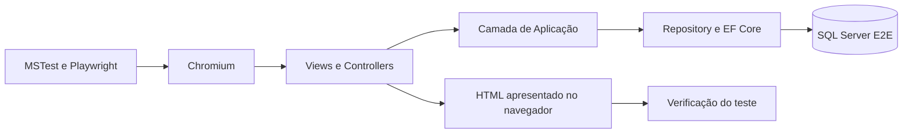

## Testes E2E com MSTest e Playwright

Até agora, testamos as regras do Domínio e a persistência pelos repositórios.

Porém, esses testes não preenchem formulários nem verificam o resultado apresentado nas telas.

Um Repository pode funcionar corretamente enquanto um formulário envia um campo errado ou um link aponta para outra ação.

> Como verificar um fluxo da aplicação pela mesma interface utilizada pela pessoa usuária?

Vamos utilizar testes **E2E**, abreviação de *end-to-end*, ou testes de ponta a ponta.

Começaremos pelo cadastro, edição e exclusão de Tarefas. Depois, aplicaremos a mesma estrutura ao módulo de Contatos.

## O que um teste E2E verifica?

O teste abre um navegador, acessa a aplicação, interage com a página e verifica o resultado.

No e-Agenda, isso envolve:



O navegador envia requisições HTTP reais para a aplicação.

O teste não chama diretamente o Controller ou o Repository para realizar o cadastro.

Também passaremos pelo cadastro de usuário e pelo login, utilizando o Identity e o cookie de autenticação reais.

Esses testes complementam os anteriores:

- **unitários:** verificam regras isoladas;
- **integração:** verificam componentes como Repository, contexto e banco;
- **E2E:** verificam fluxos completos pela interface.

E2E também é uma forma de teste de integração, mas com um alcance maior.

Como envolve mais componentes, sua execução costuma ser mais lenta e uma falha exige investigar mais etapas.

## Quais ferramentas utilizaremos?

O **MSTest** descobre e executa os métodos de teste.

O **Playwright** controla o navegador e fornece verificações que aguardam o estado esperado da página.

O **WebApplicationFactory** inicia a aplicação ASP.NET Core dentro do processo de testes.

Utilizaremos o **Kestrel**, servidor HTTP do ASP.NET Core, para que o navegador consiga acessar a aplicação.

O `TestServer` em memória, normalmente utilizado pela factory, não oferece um endereço de rede acessível ao Chromium.

> Iniciar a aplicação no processo de testes não significa substituir seus serviços por fakes. Aqui, o MVC, o Identity, o EF Core e o SQL Server continuam reais.

## Reservando um banco exclusivo para E2E

> **Atenção:** a preparação remove os registros das entidades e dos usuários, ignorando os filtros por usuário. Nunca execute estes testes contra um banco com dados importantes.

Reserve o banco descartável `EAgendaBackendE2ETestDB`.

Ele deve ser diferente do banco da aplicação e do banco utilizado pelos testes de integração.

Antes de executar:

1. Disponibilize uma instância de SQL Server para testes.
2. Confira o servidor e o banco na conexão.
3. Utilize uma conta com permissões para aplicar migrations e manipular os dados nesse ambiente descartável.
4. Não execute duas suítes contra o mesmo banco ao mesmo tempo.

Nesta aula, passaremos a conexão por uma variável de ambiente exclusiva, sem versionar senha.

Também verificaremos o nome do banco **antes de iniciar a aplicação**, pois a inicialização pode aplicar migrations.

A proteção de nome ajuda a evitar erros, mas não substitui a conferência do servidor.

## Preparando o projeto de testes

A estrutura acompanha a separação utilizada nas aulas anteriores:

```text
eAgenda.slnx
src/
  Apresentacao/
    eAgenda.WebApp.csproj
tests/
  Unidade/
  Integracao/
  e2e/
    eAgenda.Testes.e2e.csproj
    MSTestSettings.cs
    Compartilhado/
      TestApplicationFactory.cs
      E2ETestsBase.cs
    Modulos/
      Tarefas/
        TarefaE2ETests.cs
      Contatos/
        ContatoE2ETests.cs
```

Se o projeto já existe, atualize os arquivos correspondentes. Não crie classes duplicadas.

Caso ainda não exista, execute na pasta de `eAgenda.slnx`:

```bash
dotnet new classlib -n eAgenda.Testes.e2e -o tests/e2e -f net10.0
dotnet sln eAgenda.slnx add tests/e2e/eAgenda.Testes.e2e.csproj
```

O arquivo `Class1.cs` criado pelo template não será utilizado e pode ser removido.

Configure `eAgenda.Testes.e2e.csproj`:

```xml
<Project Sdk="Microsoft.NET.Sdk">
  <PropertyGroup>
    <TargetFramework>net10.0</TargetFramework>
    <LangVersion>latest</LangVersion>
    <ImplicitUsings>enable</ImplicitUsings>
    <Nullable>enable</Nullable>
  </PropertyGroup>

  <ItemGroup>
    <PackageReference Include="Microsoft.AspNetCore.Mvc.Testing" Version="10.0.14" />
    <PackageReference Include="Microsoft.Playwright.MSTest.v4" Version="1.64.1" />
    <PackageReference Include="MSTest" Version="4.0.1" />
  </ItemGroup>

  <ItemGroup>
    <ProjectReference Include="../../src/Apresentacao/eAgenda.WebApp.csproj" />
  </ItemGroup>

  <ItemGroup>
    <Using Include="Microsoft.VisualStudio.TestTools.UnitTesting" />
  </ItemGroup>
</Project>
```

A referência à Apresentação permite iniciar a aplicação inteira.

As versões acima acompanham as dependências do projeto.

Embora o pacote ofereça classes prontas de integração com MSTest, nesta aula controlaremos explicitamente a criação e a liberação do navegador, como na estrutura do e-Agenda.

## Instalando o Chromium do Playwright

Primeiro, compile o projeto para gerar o script de instalação:

```bash
dotnet build tests/e2e/eAgenda.Testes.e2e.csproj
```

Depois, na mesma pasta da solução:

```bash
pwsh tests/e2e/bin/Debug/net10.0/playwright.ps1 install chromium
```

`pwsh` é o executável do PowerShell, necessário para esse comando.

O pacote .NET e o navegador são instalações diferentes. Adicionar o pacote não baixa automaticamente o Chromium.

Em distribuições Linux suportadas, pode ser necessário instalar bibliotecas do sistema:

```bash
pwsh tests/e2e/bin/Debug/net10.0/playwright.ps1 install --with-deps chromium
```

Essa opção pode exigir permissões administrativas. Execute-a apenas no ambiente destinado aos testes.

Se compilar em `Release`, ajuste o caminho de `Debug` para `Release`.

## Configurando a conexão da execução

No terminal que executará os testes, defina a variável com a conexão do banco descartável.

Exemplo para Bash, substituindo os marcadores:

```bash
export EAGENDA_E2E_CONNECTION_STRING='Server=localhost,1433;Database=EAgendaBackendE2ETestDB;User Id=USUARIO_DE_TESTES;Password=SENHA_LOCAL;TrustServerCertificate=True'
```

No PowerShell:

```powershell
$env:EAGENDA_E2E_CONNECTION_STRING = "Server=localhost,1433;Database=EAgendaBackendE2ETestDB;User Id=USUARIO_DE_TESTES;Password=SENHA_LOCAL;TrustServerCertificate=True"
```

Não publique a conexão preenchida em scripts versionados ou capturas de tela.

Considere também o histórico do terminal ao utilizar credenciais locais.

`TrustServerCertificate=True` é uma configuração para este ambiente local, não uma recomendação para produção.

O ambiente ASP.NET Core `Testing` não carrega User Secrets automaticamente como `Development`.

Por isso, não basta configurar os secrets do projeto de integração. A factory abaixo lê explicitamente nossa variável e fornece a conexão à aplicação.

## Preparando a aplicação para o ambiente Testing

O e-Agenda aplica migrations em desenvolvimento e no ambiente de testes.

No `Program.cs`, antes dos middlewares e de `app.Run()`, a configuração é:

```csharp
if (app.Environment.IsDevelopment() ||
    app.Environment.IsEnvironment("Testing"))
{
    using var scope = app.Services.CreateScope();
    var dbContext = scope.ServiceProvider
        .GetRequiredService<EAgendaDbContext>();

    if (dbContext.Database.IsSqlServer())
        dbContext.Database.Migrate();
}
```

Esse trecho utiliza os namespaces de injeção de dependência, hospedagem, Entity Framework Core e do `EAgendaDbContext`.

Se o projeto já utiliza a extensão `IsTesting()`, mantenha-a. Ela verifica esse mesmo nome de ambiente.

Diferentemente da aula de integração, aqui não usamos `EnsureCreated()`.

O esquema é preparado pelas migrations da aplicação e os dados são removidos antes de cada cenário.

## Criando a factory de testes

Crie ou atualize `Compartilhado/TestApplicationFactory.cs`.

O exemplo mantém o Kestrel e a limpeza utilizados no projeto, acrescentando a conexão explícita e a validação do banco antes da inicialização.

Utilizaremos `HomeController` como referência para localizar o assembly da aplicação web. Ele pertence à mesma aplicação que contém o `Program`.

```csharp
using eAgenda.Infraestrutura.Compartilhado.Orm;
using eAgenda.WebApp.Compartilhado;
using Microsoft.AspNetCore.Hosting;
using Microsoft.AspNetCore.Hosting.Server;
using Microsoft.AspNetCore.Hosting.Server.Features;
using Microsoft.AspNetCore.Mvc.Testing;
using Microsoft.Data.SqlClient;
using Microsoft.EntityFrameworkCore;
using Microsoft.Extensions.Configuration;
using Microsoft.Extensions.DependencyInjection;

namespace eAgenda.Testes.e2e.Compartilhado;

public sealed class TestApplicationFactory : WebApplicationFactory<HomeController>
{
    public string BaseUrl { get; private set; } = string.Empty;
    private string connectionString = string.Empty;

    public async Task StartAsync()
    {
        connectionString = Environment.GetEnvironmentVariable(
            "EAGENDA_E2E_CONNECTION_STRING"
        ) ?? string.Empty;

        if (string.IsNullOrWhiteSpace(connectionString))
            throw new InvalidOperationException(
                "Configure EAGENDA_E2E_CONNECTION_STRING."
            );

        SqlConnectionStringBuilder conexao = new(connectionString);

        if (!string.Equals(
            conexao.InitialCatalog,
            "EAgendaBackendE2ETestDB",
            StringComparison.OrdinalIgnoreCase))
        {
            throw new InvalidOperationException(
                "Os testes exigem o banco exclusivo EAgendaBackendE2ETestDB."
            );
        }

        UseKestrel(0);
        StartServer();

        IServer server = Services.GetRequiredService<IServer>();
        IServerAddressesFeature? enderecos =
            server.Features.Get<IServerAddressesFeature>();

        BaseUrl = enderecos?.Addresses.Single()
            ?? throw new InvalidOperationException(
                "Não foi possível obter a URL do servidor."
            );

        await LimparBancoAsync();
    }

    protected override void ConfigureWebHost(IWebHostBuilder builder)
    {
        builder.UseEnvironment("Testing");

        builder.ConfigureAppConfiguration((_, configuration) =>
        {
            configuration.AddInMemoryCollection(
                new Dictionary<string, string?>
                {
                    ["ConnectionStrings:SqlServer"] = connectionString
                }
            );
        });
    }

    private async Task LimparBancoAsync()
    {
        using IServiceScope scope = Services.CreateScope();
        EAgendaDbContext contexto =
            scope.ServiceProvider.GetRequiredService<EAgendaDbContext>();

        contexto.Despesas.RemoveRange(
            contexto.Despesas.IgnoreQueryFilters());
        contexto.Categorias.RemoveRange(
            contexto.Categorias.IgnoreQueryFilters());
        contexto.ItensTarefa.RemoveRange(
            contexto.ItensTarefa.IgnoreQueryFilters());
        contexto.Tarefas.RemoveRange(
            contexto.Tarefas.IgnoreQueryFilters());
        contexto.Compromissos.RemoveRange(
            contexto.Compromissos.IgnoreQueryFilters());
        contexto.Contatos.RemoveRange(
            contexto.Contatos.IgnoreQueryFilters());
        contexto.Users.RemoveRange(
            contexto.Users.IgnoreQueryFilters());

        await contexto.SaveChangesAsync();
    }
}
```

`UseKestrel(0)` solicita uma porta disponível ao sistema operacional.

Depois de iniciar o servidor, consultamos o endereço efetivamente utilizado.

Não devemos fixar a porta `5013` nos testes: eles utilizarão `BaseUrl`.

`AddInMemoryCollection` adiciona valores à **configuração da aplicação**. Isso não troca o SQL Server por um banco em memória.

`IgnoreQueryFilters()` permite limpar registros de todos os usuários, mesmo sem uma sessão autenticada.

> Essa remoção é infraestrutura de preparação. Não copie `IgnoreQueryFilters()` para consultas normais da aplicação apenas para contornar o isolamento de usuários.

As tabelas permanecem no banco; são os registros que essa preparação remove.

## Preparando o navegador antes de cada teste

Crie ou atualize `Compartilhado/E2ETestsBase.cs`:

```csharp
using Microsoft.Playwright;
using Microsoft.VisualStudio.TestTools.UnitTesting;

namespace eAgenda.Testes.e2e.Compartilhado;

public abstract class E2ETestsBase
{
    private TestApplicationFactory applicationFactory = null!;
    private IPlaywright playwright = null!;
    private IBrowser browser = null!;
    private IBrowserContext browserContext = null!;
    protected IPage page = null!;
    protected string baseUrl = string.Empty;

    [TestInitialize]
    public async Task InicializarTeste()
    {
        applicationFactory = new TestApplicationFactory();
        await applicationFactory.StartAsync();
        baseUrl = applicationFactory.BaseUrl;

        playwright = await Playwright.CreateAsync();
        browser = await playwright.Chromium.LaunchAsync(new()
        {
            Headless = true
        });

        browserContext = await browser.NewContextAsync();
        page = await browserContext.NewPageAsync();
    }

    [TestCleanup]
    public async Task FinalizarTeste()
    {
        try
        {
            if (browserContext is not null)
                await browserContext.DisposeAsync();
        }
        finally
        {
            try
            {
                if (browser is not null)
                    await browser.DisposeAsync();
            }
            finally
            {
                playwright?.Dispose();

                if (applicationFactory is not null)
                    await applicationFactory.DisposeAsync();
            }
        }
    }

    protected async Task CadastrarUsuarioAsync()
    {
        const string email = "usuario.e2e@test.local";
        const string senha = "Teste@123";

        await page.GotoAsync($"{baseUrl}/Autenticacao/Cadastro");
        await page.GetByLabel("E-mail").FillAsync(email);
        await page.GetByLabel("Senha", new() { Exact = true }).FillAsync(senha);
        await page.GetByLabel("Confirmar Senha", new() { Exact = true })
            .FillAsync(senha);
        await page.GetByRole(AriaRole.Button, new() { Name = "Cadastrar" })
            .ClickAsync();

        await Assertions.Expect(page).ToHaveURLAsync(
            $"{baseUrl}/Autenticacao/Login"
        );

        await page.GetByLabel("E-mail").FillAsync(email);
        await page.GetByLabel("Senha", new() { Exact = true }).FillAsync(senha);
        await page.GetByRole(AriaRole.Button, new() { Name = "Entrar" })
            .ClickAsync();

        await Assertions.Expect(
            page.GetByRole(AriaRole.Button, new() { Name = "Sair", Exact = true })
        ).ToBeVisibleAsync();
    }
}
```

`IPlaywright` oferece acesso aos navegadores.

`IBrowser` representa o navegador iniciado.

`IBrowserContext` isola cookies e armazenamento da sessão.

`IPage` representa a página na qual faremos as interações.

`Headless = true` executa sem abrir uma janela. Para acompanhar visualmente em uma máquina com interface gráfica, altere para `false`.

A estrutura original abre a janela; o modo sem janela facilita executar os mesmos cenários em ambientes automatizados.

Cada teste recebe uma nova sessão e um banco limpo. Um novo contexto de navegador, sozinho, não limpa os registros do SQL Server.

A limpeza libera os recursos mesmo se uma parte da inicialização não tiver sido concluída.

A senha acima é somente um dado fictício de uma conta descartável criada pelo teste. Não utilize credenciais reais.

## Por que cadastrar e autenticar pela interface?

As rotas de Tarefas e Contatos exigem autenticação.

O helper `CadastrarUsuarioAsync()` cria uma conta pelo formulário e realiza o login.

Depois, o mesmo contexto de navegador mantém o cookie nas próximas requisições.

Diferentemente dos testes de integração, não utilizamos um provedor de usuário fake.

O identificador vem do usuário autenticado e é preenchido pelo fluxo real da aplicação.

`async Task` permite aguardar navegações, preenchimentos e cliques com `await`.

Não use `async void` nos métodos de teste.

## Desativando o paralelismo da suíte

Em `tests/e2e/MSTestSettings.cs`, utilize:

```csharp
using Microsoft.VisualStudio.TestTools.UnitTesting;

[assembly: DoNotParallelize]
```

Um teste não pode limpar os registros enquanto outro está utilizando o mesmo banco.

A porta dinâmica evita conflito entre servidores, mas não isola os dados.

Essa configuração também não impede outra execução em outro processo. Mantenha somente uma suíte utilizando esse banco.

## Encontrando elementos com locators

Um **locator** descreve como encontrar um elemento na página.

Os exemplos utilizam:

```csharp
page.GetByLabel("Título");
page.GetByRole(AriaRole.Button, new() { Name = "Confirmar" });
page.Locator(".card").Filter(new() { HasText = "Lavar o cachorro" });
```

`GetByLabel` utiliza o rótulo associado ao campo.

`GetByRole` utiliza o papel de acessibilidade e o nome do elemento.

`Locator(".card")` encontra os cartões da listagem pelo seletor CSS. O filtro restringe a busca ao cartão esperado.

Prefira rótulos e papéis para os controles. Utilize CSS quando precisar delimitar uma estrutura da tela.

`Exact = true` exige correspondência exata. No cadastro de usuário, isso diferencia `Senha` de `Confirmar Senha`.

Um locator não guarda uma captura do elemento: ele volta a localizar o elemento quando uma ação ou verificação é executada.

## Testando o cadastro de uma tarefa

Crie ou atualize `Modulos/Tarefas/TarefaE2ETests.cs`:

```csharp
using eAgenda.Testes.e2e.Compartilhado;
using Microsoft.Playwright;
using Microsoft.VisualStudio.TestTools.UnitTesting;

namespace eAgenda.Testes.e2e.Modulos.Tarefas;

[TestClass]
public sealed class TarefaE2ETests : E2ETestsBase
{
    [TestMethod]
    public async Task DeveCadastrarTarefaCorretamente()
    {
        // Arranjo
        await CadastrarUsuarioAsync();
        await page.GotoAsync($"{baseUrl}/Tarefa/Cadastrar");

        // Ação
        await page.GetByLabel("Título").FillAsync("Lavar o cachorro");
        await page.GetByLabel("Prioridade").SelectOptionAsync("Alta");
        await page.GetByRole(AriaRole.Button, new() { Name = "Confirmar" })
            .ClickAsync();

        // Asserção
        await Assertions.Expect(page).ToHaveURLAsync(
            $"{baseUrl}/Tarefa/Listar"
        );

        ILocator card = page.Locator(".card").Filter(new()
        {
            HasText = "Lavar o cachorro"
        });

        await Assertions.Expect(card).ToBeVisibleAsync();
        await Assertions.Expect(card.Locator(".card-title"))
            .ToHaveTextAsync("Lavar o cachorro");
        await Assertions.Expect(card.GetByText("Alta", new() { Exact = true }))
            .ToBeVisibleAsync();
    }
}
```

`FillAsync()` preenche o campo e `SelectOptionAsync()` seleciona uma opção do elemento `select`.

O botão envia o formulário. A aplicação cadastra a tarefa e redireciona para a listagem.

Verificamos o endereço e os dados apresentados, não apenas se o clique foi realizado.

## Reutilizando o arranjo sem depender de outro teste

Edição e exclusão precisam de uma tarefa cadastrada.

Adicione este helper dentro de `TarefaE2ETests`:

```csharp
private async Task<ILocator> CadastrarTarefaAsync()
{
    await CadastrarUsuarioAsync();
    await page.GotoAsync($"{baseUrl}/Tarefa/Cadastrar");
    await page.GetByLabel("Título").FillAsync("Lavar o cachorro");
    await page.GetByLabel("Prioridade").SelectOptionAsync("Alta");
    await page.GetByRole(AriaRole.Button, new() { Name = "Confirmar" })
        .ClickAsync();

    await Assertions.Expect(page).ToHaveURLAsync($"{baseUrl}/Tarefa/Listar");

    ILocator card = page.Locator(".card").Filter(new()
    {
        HasText = "Lavar o cachorro"
    });
    await Assertions.Expect(card).ToBeVisibleAsync();

    return card;
}
```

O helper prepara os dados do próprio teste. Ele não depende da execução anterior do teste de cadastro.

Não chame um método marcado com `[TestMethod]` para preparar outro teste.

## Testando a edição da tarefa

Ainda dentro de `TarefaE2ETests`, adicione:

```csharp
[TestMethod]
public async Task DeveEditarTarefaCorretamente()
{
    // Arranjo
    ILocator card = await CadastrarTarefaAsync();
    await card.GetByRole(AriaRole.Link, new()
    {
        Name = "Editar",
        Exact = true
    }).ClickAsync();

    // Ação
    await page.GetByLabel("Título").FillAsync("Passear com o cachorro");
    await page.GetByLabel("Prioridade").SelectOptionAsync("Baixa");
    await page.GetByRole(AriaRole.Button, new() { Name = "Confirmar" })
        .ClickAsync();

    // Asserção
    await Assertions.Expect(page).ToHaveURLAsync($"{baseUrl}/Tarefa/Listar");

    ILocator cardEditado = page.Locator(".card").Filter(new()
    {
        HasText = "Passear com o cachorro"
    });

    await Assertions.Expect(cardEditado).ToHaveCountAsync(1);
    await Assertions.Expect(cardEditado.Locator(".card-title"))
        .ToHaveTextAsync("Passear com o cachorro");
    await Assertions.Expect(
        cardEditado.GetByText("Baixa", new() { Exact = true })
    ).ToBeVisibleAsync();
    await Assertions.Expect(card).ToHaveCountAsync(0);
}
```

O link `Editar` é procurado dentro do cartão correto.

Isso evita clicar no botão de outro registro quando a página possui vários cartões.

Ao final, o locator original não deve encontrar nenhum cartão com o título antigo.

## Testando a exclusão da tarefa

Adicione o terceiro cenário à mesma classe:

```csharp
[TestMethod]
public async Task DeveExcluirTarefaCorretamente()
{
    // Arranjo
    ILocator card = await CadastrarTarefaAsync();
    await card.GetByRole(AriaRole.Link, new()
    {
        Name = "Excluir",
        Exact = true
    }).ClickAsync();

    // Ação
    await page.GetByRole(AriaRole.Button, new() { Name = "Confirmar" })
        .ClickAsync();

    // Asserção
    await Assertions.Expect(page).ToHaveURLAsync($"{baseUrl}/Tarefa/Listar");
    await Assertions.Expect(card).ToHaveCountAsync(0);
    await Assertions.Expect(page.GetByRole(AriaRole.Alert))
        .ToHaveTextAsync("Nenhuma tarefa cadastrada.");
}
```

Verificamos primeiro o retorno à listagem.

Sem essa conferência, a ausência do cartão na própria página de confirmação poderia ser confundida com uma exclusão bem-sucedida.

O alerta confirma o estado vazio da listagem.

## Evoluindo os testes para o módulo de Contatos

A mesma base também atende outro módulo.

Em `Modulos/Contatos/ContatoE2ETests.cs`, crie:

```csharp
using eAgenda.Testes.e2e.Compartilhado;
using Microsoft.Playwright;
using Microsoft.VisualStudio.TestTools.UnitTesting;

namespace eAgenda.Testes.e2e.Modulos.Contatos;

[TestClass]
public sealed class ContatoE2ETests : E2ETestsBase
{
    [TestMethod]
    public async Task DeveCadastrarContatoCorretamente()
    {
        // Arranjo
        await CadastrarUsuarioAsync();
        await page.GotoAsync($"{baseUrl}/Contato/Cadastrar");

        // Ação
        await PreencherContatoAsync(
            "João Silva", "joao@test.local", "(48) 99999-8888", "Testador"
        );
        await page.GetByRole(AriaRole.Button, new() { Name = "Confirmar" })
            .ClickAsync();

        // Asserção
        await Assertions.Expect(page).ToHaveURLAsync($"{baseUrl}/Contato/Listar");
        ILocator card = LocalizarContato("João Silva");

        await Assertions.Expect(card).ToBeVisibleAsync();
        await Assertions.Expect(card.Locator(".card-title"))
            .ToHaveTextAsync("João Silva");
        await Assertions.Expect(card.GetByText("joao@test.local", new()
        {
            Exact = true
        })).ToBeVisibleAsync();
        await Assertions.Expect(card.GetByText("(48) 99999-8888", new()
        {
            Exact = true
        })).ToBeVisibleAsync();
        await Assertions.Expect(card.GetByText("Testador", new()
        {
            Exact = true
        })).ToBeVisibleAsync();
        await Assertions.Expect(card.GetByText("Empresa de teste", new()
        {
            Exact = true
        })).ToBeVisibleAsync();
    }

    private ILocator LocalizarContato(string nome)
    {
        return page.Locator(".card").Filter(new() { HasText = nome });
    }

    private async Task PreencherContatoAsync(
        string nome, string email, string telefone, string cargo)
    {
        await page.GetByLabel("Nome").FillAsync(nome);
        await page.GetByLabel("E-mail").FillAsync(email);
        await page.GetByLabel("Telefone").FillAsync(telefone);
        await page.GetByLabel("Cargo").FillAsync(cargo);
        await page.GetByLabel("Empresa").FillAsync("Empresa de teste");
    }

    private async Task<ILocator> CadastrarContatoAsync()
    {
        await CadastrarUsuarioAsync();
        await page.GotoAsync($"{baseUrl}/Contato/Cadastrar");
        await PreencherContatoAsync(
            "João Silva", "joao@test.local", "(48) 99999-8888", "Testador"
        );
        await page.GetByRole(AriaRole.Button, new() { Name = "Confirmar" })
            .ClickAsync();
        await Assertions.Expect(page).ToHaveURLAsync($"{baseUrl}/Contato/Listar");

        ILocator card = LocalizarContato("João Silva");
        await Assertions.Expect(card).ToBeVisibleAsync();
        return card;
    }
}
```

Os helpers evitam repetir o preenchimento dos cinco campos em cada cenário.

Os valores são fictícios e pertencem ao banco descartável.

Agora, adicione os dois métodos seguintes dentro dessa mesma classe.

## Testando a edição do contato

```csharp
[TestMethod]
public async Task DeveEditarContatoCorretamente()
{
    // Arranjo
    ILocator card = await CadastrarContatoAsync();
    await card.GetByRole(AriaRole.Link, new()
    {
        Name = "Editar",
        Exact = true
    }).ClickAsync();

    // Ação
    await PreencherContatoAsync(
        "Maria Souza", "maria@test.local", "(48) 98888-9999", "Desenvolvedora"
    );
    await page.GetByRole(AriaRole.Button, new() { Name = "Confirmar" })
        .ClickAsync();

    // Asserção
    await Assertions.Expect(page).ToHaveURLAsync($"{baseUrl}/Contato/Listar");
    ILocator cardEditado = LocalizarContato("Maria Souza");

    await Assertions.Expect(cardEditado).ToHaveCountAsync(1);
    await Assertions.Expect(cardEditado.Locator(".card-title"))
        .ToHaveTextAsync("Maria Souza");
    await Assertions.Expect(cardEditado.GetByText("maria@test.local", new()
    {
        Exact = true
    })).ToBeVisibleAsync();
    await Assertions.Expect(cardEditado.GetByText("(48) 98888-9999", new()
    {
        Exact = true
    })).ToBeVisibleAsync();
    await Assertions.Expect(cardEditado.GetByText("Desenvolvedora", new()
    {
        Exact = true
    })).ToBeVisibleAsync();
    await Assertions.Expect(card).ToHaveCountAsync(0);
}
```

O teste verifica os valores alterados e a ausência do cartão com o nome antigo.

## Testando a exclusão do contato

```csharp
[TestMethod]
public async Task DeveExcluirContatoCorretamente()
{
    // Arranjo
    ILocator card = await CadastrarContatoAsync();
    await card.GetByRole(AriaRole.Link, new()
    {
        Name = "Excluir",
        Exact = true
    }).ClickAsync();

    // Ação
    await page.GetByRole(AriaRole.Button, new()
    {
        Name = "Confirmar",
        Exact = true
    }).ClickAsync();

    // Asserção
    await Assertions.Expect(page).ToHaveURLAsync($"{baseUrl}/Contato/Listar");
    await Assertions.Expect(card).ToHaveCountAsync(0);
    await Assertions.Expect(page.GetByRole(AriaRole.Alert))
        .ToHaveTextAsync("Nenhum contato cadastrado.");
}
```

Mesmo com a estrutura compartilhada, os cenários de Tarefas e Contatos continuam independentes.

## Aguardando o estado certo sem pausas fixas

O Playwright aguarda condições necessárias para ações, como um botão estar visível e habilitado.

As verificações com `Assertions.Expect` também repetem a consulta até a condição ser atendida ou o tempo limite terminar.

Por isso, prefira:

```csharp
await Assertions.Expect(card).ToBeVisibleAsync();
```

Evite pausas como `Thread.Sleep` ou `Task.Delay` para tentar esperar o cadastro.

Uma pausa pode ser longa demais em uma máquina rápida e insuficiente em uma máquina lenta.

As esperas automáticas não adivinham o fluxo da aplicação. Continue verificando a URL e o resultado esperado para não aceitar o estado de uma página errada.

## Executando os cenários

Com SQL Server disponível, conexão configurada e Chromium instalado:

```bash
dotnet test tests/e2e/eAgenda.Testes.e2e.csproj
```

Somente Tarefas:

```bash
dotnet test tests/e2e/eAgenda.Testes.e2e.csproj --filter "FullyQualifiedName~TarefaE2ETests"
```

Somente Contatos:

```bash
dotnet test tests/e2e/eAgenda.Testes.e2e.csproj --filter "FullyQualifiedName~ContatoE2ETests"
```

Os exemplos completos possuem seis testes: cadastro, edição e exclusão em cada módulo.

Não é necessário executar `dotnet run` em outro terminal. A factory inicia e encerra a aplicação para cada teste.

O navegador e a aplicação são encerrados na limpeza. Os registros do último cenário permanecem no banco até a próxima preparação.

Executar `dotnet test` na solução inteira também pode incluir as suítes de integração e E2E. Confira seus bancos antes de executar.

## Investigando uma falha E2E

Comece identificando em qual etapa o teste parou:

- **conexão não configurada ou banco rejeitado:** confira a variável no terminal da execução;
- **erro de migration:** confira as permissões e o estado do banco descartável;
- **navegador ausente:** execute o script de instalação após o build;
- **erro ao abrir janela no servidor:** utilize `Headless = true`;
- **locator ambíguo:** restrinja ao cartão correto ou utilize correspondência exata;
- **redirecionamento para login:** confira se o cadastro e a autenticação terminaram;
- **tempo limite:** investigue a resposta da aplicação, o HTML e o estado esperado.

Um layout que depende de recursos de CDN também pode sofrer com indisponibilidade de rede. Diferencie essa dependência externa de um erro de regra de negócio.

Para investigar visualmente, execute apenas o cenário com falha e utilize `Headless = false` em um ambiente com interface gráfica.

Não aumente tempos de espera ou remova asserções sem entender o problema.

## Exercícios para ampliar a cobertura

Adicione cenários para:

1. Enviar um formulário de Tarefa sem título e verificar a mensagem de validação.
2. Tentar login com senha inválida e verificar a mensagem apresentada.
3. Acessar uma rota protegida sem autenticação e verificar o redirecionamento.
4. Cadastrar duas tarefas e editar somente a escolhida pelo seu cartão.
5. Cancelar uma exclusão e verificar que o registro permanece na listagem.
6. Recarregar a listagem após uma edição e confirmar os novos valores.

Observe as mensagens e os controles reais das Views antes de escrever os locators.

Mais adiante, podemos organizar as interações de cada página em classes próprias, utilizando o padrão Page Object.

## O que esses testes garantem?

Os testes percorrem cadastro de usuário, login, formulários, Controllers, serviços, persistência e apresentação dos resultados.

Isso ajuda a detectar problemas que não aparecem quando verificamos somente o Domínio ou o Repository.

Porém, seis cenários aprovados não comprovam todos os fluxos, navegadores, permissões ou comportamentos da aplicação.

Mantenha os testes unitários para as regras, os de integração para a persistência e os E2E para os fluxos mais importantes da interface.
