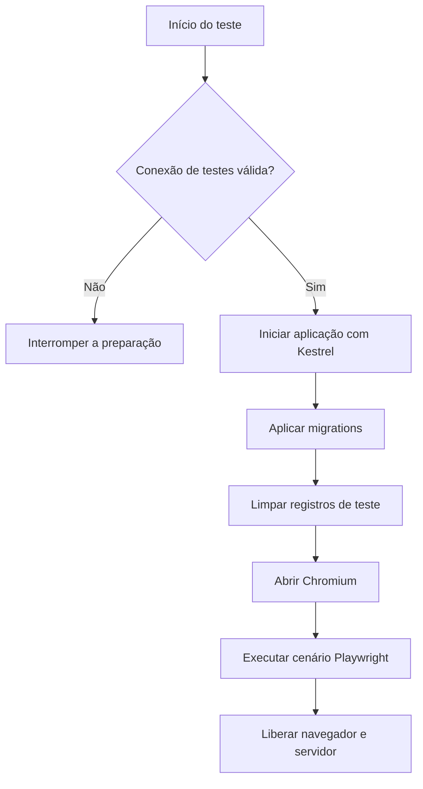

## Automatizando a Infraestrutura dos Testes E2E

Na aula anterior, utilizamos Playwright para cadastrar, editar e excluir Tarefas e Contatos pela interface.

Antes de executar, precisávamos iniciar a aplicação em outro terminal e conferir seu endereço.

Os testes criavam usuários diferentes, mas os dados permaneciam no banco.

Isso funciona para aprender as interações, porém exige preparação manual a cada execução.

> Como executar os mesmos testes sem iniciar a aplicação manualmente?

Agora, vamos automatizar o servidor e a preparação dos dados, mantendo os testes e seus locators.

## O que será automatizado?

A preparação de cada cenário passará a:

1. Validar a conexão do banco descartável.
2. Iniciar a aplicação em uma porta disponível.
3. Aplicar as migrations pelo fluxo de inicialização da aplicação.
4. Limpar os registros do banco de testes.
5. Abrir o navegador e executar o cenário.
6. Encerrar o navegador e o servidor.

O fluxo fica assim:



O SQL Server ainda precisa estar disponível, instalado ou em um container iniciado previamente.

Esta aula automatiza a aplicação, o esquema e os dados. Não cria a instância de SQL Server nem instala o Chromium durante os testes.

## Por que utilizar WebApplicationFactory e Kestrel?

`WebApplicationFactory` permite iniciar a aplicação ASP.NET Core no processo de testes.

Por padrão, ela utiliza um `TestServer` em memória, acessível por clientes HTTP preparados para esse servidor.

O Chromium é outro processo e precisa de um endereço HTTP acessível pela rede local.

Por isso, utilizaremos o Kestrel com uma porta escolhida pelo sistema operacional.

Não precisamos fixar a porta `5013` nem executar `dotnet run`.

O MVC, o Identity, os serviços, os repositórios e o SQL Server continuam reais. Não estamos substituindo a aplicação por fakes.

## Evoluindo o projeto existente

Continue no projeto `tests/e2e` da aula anterior.

Adicione a dependência de hospedagem e a referência à aplicação:

```bash
dotnet add tests/e2e/eAgenda.Testes.e2e.csproj package Microsoft.AspNetCore.Mvc.Testing --version 10.0.14
dotnet add tests/e2e/eAgenda.Testes.e2e.csproj reference src/Apresentacao/eAgenda.WebApp.csproj
```

Mantenha os pacotes Playwright e MSTest já configurados.

A nova estrutura acrescenta a factory:

```text
tests/e2e/
  eAgenda.Testes.e2e.csproj
  MSTestSettings.cs
  Compartilhado/
    E2ETestsBase.cs
    TestApplicationFactory.cs
  Modulos/
    Tarefas/
      TarefaE2ETests.cs
    Contatos/
      ContatoE2ETests.cs
```

Não crie outra cópia das classes de teste.

## Configurando um banco descartável com segurança

> **Atenção:** a preparação remove os dados de todos os usuários do banco configurado, incluindo as contas. Não utilize um banco compartilhado ou com informações importantes.

Reserve `EAgendaBackendE2ETestDB` exclusivamente para esta suíte.

Interrompa o servidor manual da aula anterior e não deixe outra execução utilizando esse banco.

No terminal dos testes, configure a conexão. Em Bash:

```bash
export EAGENDA_E2E_CONNECTION_STRING='Server=localhost,1433;Database=EAgendaBackendE2ETestDB;User Id=USUARIO_DE_TESTES;Password=SENHA_LOCAL;TrustServerCertificate=True'
```

No PowerShell:

```powershell
$env:EAGENDA_E2E_CONNECTION_STRING = "Server=localhost,1433;Database=EAgendaBackendE2ETestDB;User Id=USUARIO_DE_TESTES;Password=SENHA_LOCAL;TrustServerCertificate=True"
```

Substitua os marcadores pela conexão local descartável.

Não versione a senha e considere o histórico do terminal ao configurar credenciais.

`TrustServerCertificate=True` destina-se ao ambiente local deste exemplo.

Essa variável será lida explicitamente pela factory. Ela não é a configuração padrão `ConnectionStrings__SqlServer` usada para iniciar o servidor manualmente.

Não utilizaremos mais `EAGENDA_E2E_BASE_URL`: o endereço virá do servidor iniciado no teste.

## Conferindo as migrations no ambiente Testing

O e-Agenda prepara seu esquema ao iniciar em desenvolvimento ou em testes.

No `Program.cs`, antes dos middlewares e de `app.Run()`, o trecho é:

```csharp
if (app.Environment.IsDevelopment() ||
    app.Environment.IsEnvironment("Testing"))
{
    using var scope = app.Services.CreateScope();
    var dbContext = scope.ServiceProvider
        .GetRequiredService<EAgendaDbContext>();

    if (dbContext.Database.IsSqlServer())
        dbContext.Database.Migrate();
}
```

Esse trecho utiliza os namespaces de hospedagem, injeção de dependência, Entity Framework Core e do `EAgendaDbContext`.

Se o projeto já utiliza a extensão `IsTesting()`, mantenha-a: ela verifica esse mesmo ambiente.

`Migrate()` aplica as migrations pendentes e pode criar o banco se ele ainda não existir.

A conta de testes precisa das permissões necessárias nesse ambiente descartável.

Não utilize `EnsureCreated()` junto dessa estratégia. Ele cria o esquema sem registrar as migrations.

## Criando a factory e validando a conexão

Crie `Compartilhado/TestApplicationFactory.cs`:

```csharp
using eAgenda.Infraestrutura.Compartilhado.Orm;
using eAgenda.WebApp.Compartilhado;
using Microsoft.AspNetCore.Hosting;
using Microsoft.AspNetCore.Hosting.Server;
using Microsoft.AspNetCore.Hosting.Server.Features;
using Microsoft.AspNetCore.Mvc.Testing;
using Microsoft.Data.SqlClient;
using Microsoft.EntityFrameworkCore;
using Microsoft.Extensions.Configuration;
using Microsoft.Extensions.DependencyInjection;

namespace eAgenda.Testes.e2e.Compartilhado;

public sealed class TestApplicationFactory : WebApplicationFactory<HomeController>
{
    public string BaseUrl { get; private set; } = string.Empty;
    private string connectionString = string.Empty;

    public async Task StartAsync()
    {
        connectionString = Environment.GetEnvironmentVariable(
            "EAGENDA_E2E_CONNECTION_STRING"
        ) ?? string.Empty;

        if (string.IsNullOrWhiteSpace(connectionString))
            throw new InvalidOperationException(
                "Configure EAGENDA_E2E_CONNECTION_STRING."
            );

        SqlConnectionStringBuilder conexao = new(connectionString);

        if (!string.Equals(
            conexao.InitialCatalog,
            "EAgendaBackendE2ETestDB",
            StringComparison.OrdinalIgnoreCase))
        {
            throw new InvalidOperationException(
                "Os testes exigem o banco exclusivo EAgendaBackendE2ETestDB."
            );
        }

        UseKestrel(0);
        StartServer();

        IServer server = Services.GetRequiredService<IServer>();
        IServerAddressesFeature? enderecos =
            server.Features.Get<IServerAddressesFeature>();

        BaseUrl = enderecos?.Addresses.Single()
            ?? throw new InvalidOperationException(
                "Não foi possível obter a URL do servidor."
            );

        await LimparBancoAsync();
    }

    protected override void ConfigureWebHost(IWebHostBuilder builder)
    {
        builder.UseEnvironment("Testing");

        builder.ConfigureAppConfiguration((_, configuration) =>
        {
            configuration.AddInMemoryCollection(
                new Dictionary<string, string?>
                {
                    ["ConnectionStrings:SqlServer"] = connectionString
                }
            );
        });
    }

    private async Task LimparBancoAsync()
    {
        using IServiceScope scope = Services.CreateScope();
        EAgendaDbContext contexto =
            scope.ServiceProvider.GetRequiredService<EAgendaDbContext>();

        contexto.Despesas.RemoveRange(
            contexto.Despesas.IgnoreQueryFilters());
        contexto.Categorias.RemoveRange(
            contexto.Categorias.IgnoreQueryFilters());
        contexto.ItensTarefa.RemoveRange(
            contexto.ItensTarefa.IgnoreQueryFilters());
        contexto.Tarefas.RemoveRange(
            contexto.Tarefas.IgnoreQueryFilters());
        contexto.Compromissos.RemoveRange(
            contexto.Compromissos.IgnoreQueryFilters());
        contexto.Contatos.RemoveRange(
            contexto.Contatos.IgnoreQueryFilters());
        contexto.Users.RemoveRange(
            contexto.Users.IgnoreQueryFilters());

        await contexto.SaveChangesAsync();
    }
}
```

`HomeController` identifica o assembly da aplicação web que a factory deve iniciar. Não significa que os testes chamarão esse Controller diretamente.

A validação ocorre **antes de `StartServer()`**, pois as migrations podem alterar o banco durante a inicialização.

Conferir o nome não garante que o servidor seja o correto. Revise a conexão completa antes de executar.

`UseKestrel(0)` pede uma porta disponível. Depois de iniciar o servidor, `IServerAddressesFeature` informa o endereço efetivamente utilizado.

`AddInMemoryCollection` fornece a conexão à configuração da aplicação, sem gravá-la em `appsettings.json`.

Isso não troca o SQL Server por um banco em memória.

O ambiente `Testing` não carrega User Secrets automaticamente como `Development`. A conexão deste exemplo vem da variável lida pela factory.

## Por que ignorar os filtros durante a limpeza?

O contexto utiliza filtros globais para separar os registros por usuário.

Na preparação, ainda não existe uma sessão autenticada.

Além disso, precisamos remover os dados de todos os cenários anteriores, não somente os de uma conta.

`IgnoreQueryFilters()` permite consultar esses registros para removê-los.

> Ignore os filtros somente nesta preparação controlada. Não copie essa estratégia para consultas normais da aplicação para contornar o isolamento de usuários.

`RemoveRange()` marca as entidades para exclusão e `SaveChangesAsync()` persiste a remoção.

As tabelas e o histórico de migrations permanecem no banco.

## Substituindo a inicialização da classe base

Em `Compartilhado/E2ETestsBase.cs`, mantenha os campos do Playwright, `page`, `baseUrl` e o helper `CadastrarUsuarioAsync()`.

Adicione este campo dentro da classe:

```csharp
private TestApplicationFactory applicationFactory = null!;
```

Substitua o método `InicializarTeste()` pelo seguinte. Não adicione um segundo método com a mesma responsabilidade:

```csharp
[TestInitialize]
public async Task InicializarTeste()
{
    applicationFactory = new TestApplicationFactory();
    await applicationFactory.StartAsync();
    baseUrl = applicationFactory.BaseUrl;

    playwright = await Playwright.CreateAsync();
    browser = await playwright.Chromium.LaunchAsync(new()
    {
        Headless = true
    });

    browserContext = await browser.NewContextAsync();
    page = await browserContext.NewPageAsync();
}
```

Antes de abrir o navegador, a factory inicia a aplicação e limpa os registros.

`baseUrl` recebe a porta dinâmica e os testes continuam utilizando as mesmas rotas relativas.

O helper de autenticação continua criando uma conta e realizando login pela interface. O e-mail único pode ser mantido, mesmo com a limpeza automática.

Não é necessário modificar os seis cenários de Tarefas e Contatos.

## Encerrando também o servidor

Substitua `FinalizarTeste()` na mesma classe base:

```csharp
[TestCleanup]
public async Task FinalizarTeste()
{
    try
    {
        if (browserContext is not null)
            await browserContext.DisposeAsync();
    }
    finally
    {
        try
        {
            if (browser is not null)
                await browser.DisposeAsync();
        }
        finally
        {
            try
            {
                playwright?.Dispose();
            }
            finally
            {
                if (applicationFactory is not null)
                    await applicationFactory.DisposeAsync();
            }
        }
    }
}
```

A limpeza encerra a sessão, o navegador, o Playwright e a aplicação.

Os blocos `finally` permitem tentar liberar os recursos restantes mesmo se uma etapa anterior da limpeza falhar.

As verificações de `null` também permitem limpar os recursos já criados quando a inicialização falha parcialmente.

Encerrar a factory não apaga o banco. Os registros do último cenário permanecem até a próxima preparação.

## Mantendo a execução em sequência

Mantenha em `MSTestSettings.cs`:

```csharp
using Microsoft.VisualStudio.TestTools.UnitTesting;

[assembly: DoNotParallelize]
```

Agora, esse cuidado é essencial: um teste poderia apagar os dados utilizados por outro.

Portas diferentes isolam os servidores, não os dados.

A configuração não impede outra suíte em outro processo. Nunca execute duas suítes contra esse mesmo banco simultaneamente.

## Executando sem o servidor manual

Com o SQL Server disponível e o Chromium já instalado, execute:

```bash
dotnet test tests/e2e/eAgenda.Testes.e2e.csproj
```

Para executar somente os cenários de Tarefas:

```bash
dotnet test tests/e2e/eAgenda.Testes.e2e.csproj --filter "FullyQualifiedName~TarefaE2ETests"
```

Não execute `dotnet run` em outro terminal.

Confira que os mesmos seis cenários continuam aprovados.

Agora, cada teste é responsável por iniciar sua aplicação e encerrar o servidor ao terminar.

Se ocorrer um erro:

- **variável ausente ou banco rejeitado:** confira `EAGENDA_E2E_CONNECTION_STRING` no terminal dos testes;
- **migration ou conexão:** confira o SQL Server, as permissões e o banco descartável;
- **porta ou endereço:** confira se os cenários utilizam `baseUrl`, sem endereço fixo;
- **dados desaparecendo durante o teste:** confira se existe outra execução utilizando o banco;
- **navegador ausente:** execute o script de instalação do Chromium da aula anterior.

## Comparando as duas etapas

Na execução manual:

- a pessoa inicia e encerra o servidor;
- os testes recebem um endereço conhecido;
- os dados permanecem entre execuções;
- o projeto de testes precisa somente do Playwright e do MSTest.

Na execução automatizada:

- a factory inicia e encerra a aplicação;
- o sistema operacional escolhe a porta;
- a preparação limpa os registros antes de cada teste;
- o projeto de testes referencia a aplicação web.

As interações e as asserções continuam iguais.

## Exercícios sobre a preparação

1. Execute um cenário com a variável de conexão ausente e observe a mensagem de erro.
2. Configure um nome de banco diferente e confirme que a preparação é interrompida antes da inicialização.
3. Execute a suíte duas vezes seguidas e confirme que os registros anteriores não interferem.
4. Verifique se algum cenário ainda contém a porta fixa `5013` e substitua pelo uso de `baseUrl`.

Nunca utilize uma conexão real de produção para experimentar a validação. Uma string local fictícia com nome diferente já permite testar a rejeição.

## Separando cenários e infraestrutura

O objetivo do cenário continua sendo descrever o comportamento da pessoa usuária.

A factory concentra a hospedagem e a preparação do banco.

A classe base concentra o navegador e seu ciclo de vida.

Com essa separação, conseguimos evoluir a preparação sem reescrever os testes de cadastro, edição e exclusão.
