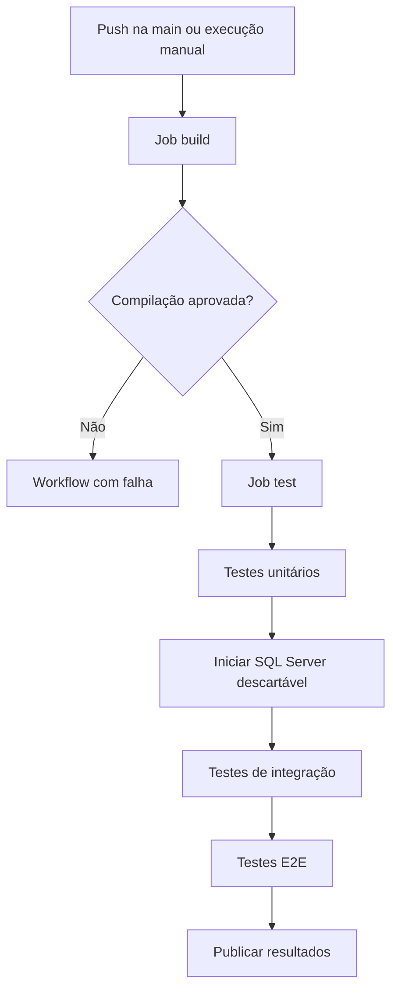

## Workflows YAML de CI com GitHub Actions

Nas aulas anteriores, executamos os testes do e-Agenda pelo terminal.

Porém, depender de uma execução manual antes de cada alteração pode gerar problemas.

Uma pessoa pode esquecer de compilar a solução ou enviar código que quebra um teste existente.

> Como verificar as alterações automaticamente quando elas chegam ao repositório?

Vamos configurar uma rotina de **integração contínua**, ou **CI**, utilizando GitHub Actions.

Começaremos pela estrutura de um arquivo YAML e avançaremos até um workflow com compilação, testes, banco descartável e relatórios.

## O que é integração contínua?

Integração contínua é a prática de integrar alterações com frequência e executar verificações automáticas sobre elas.

No nosso caso, o GitHub receberá o código e executará comandos como:

```bash
dotnet restore eAgenda.slnx
dotnet build eAgenda.slnx --configuration Release --no-restore
dotnet test tests/Unidade/eAgenda.Testes.Unidade.csproj --configuration Release
```

Se uma etapa falhar, a execução sinalizará o problema.

Isso não corrige o código automaticamente. A equipe precisa ler o erro e ajustar a alteração.

Também não significa publicar a aplicação.

> CI verifica a alteração. Deploy coloca uma versão da aplicação em um ambiente. O workflow desta aula não faz deploy.

## Entendendo workflow, job, step e runner

No GitHub Actions:

- **workflow:** arquivo que descreve a automação;
- **evento:** acontecimento que inicia a execução;
- **job:** conjunto de etapas executado em um ambiente;
- **step:** uma etapa desse job;
- **runner:** máquina que executa o job.

No e-Agenda, utilizaremos dois jobs:



Os relatórios e a limpeza serão configurados para serem tentados também quando uma etapa anterior falhar.

Os testes E2E já fazem parte da automação do projeto. Seu código e a preparação do navegador foram apresentados na Semana 37.

Nesta aula, precisamos entender apenas onde essa suíte entra no workflow e quais recursos exige.

## Passo 1: criar o arquivo no local correto

O GitHub procura workflows na pasta `.github/workflows`, na raiz do repositório:

```text
e-agenda/
  .github/
    workflows/
      ci.yml
  compose.yml
  eAgenda.slnx
  src/
  tests/
```

Crie ou atualize `.github/workflows/ci.yml`.

O arquivo pode utilizar a extensão `.yml` ou `.yaml`.

Não crie um segundo workflow igual se o arquivo já existir, pois os dois podem executar as mesmas verificações.

## Passo 2: reconhecer a estrutura do YAML

YAML representa configurações por meio de chaves, valores e indentação.

Observe um exemplo pequeno:

```yaml
jobs:
  build:
    runs-on: ubuntu-latest
    steps:
      - name: Compilar solução
        run: dotnet build eAgenda.slnx
```

`build` está dentro de `jobs`.

`steps` contém uma lista, representada pelo hífen antes de cada etapa.

`name` e `run` pertencem ao mesmo item dessa lista.

Utilize espaços, não tabulações, e mantenha a indentação consistente. Nos exemplos, cada nível utiliza dois espaços.

Comentários começam com `#`.

Para comandos em várias linhas:

```yaml
run: |
  echo "Primeiro comando"
  echo "Segundo comando"
```

O símbolo `|` preserva as quebras de linha.

Já `>` reúne as linhas comuns em um único texto:

```yaml
run: >
  dotnet test tests/Unidade/eAgenda.Testes.Unidade.csproj
  --configuration Release
  --results-directory TestResults
```

Nesse caso, queremos um único comando com seus argumentos.

## Passo 3: definir nome e eventos

O início do workflow será:

```yaml
name: Integração Contínua

on:
  push:
    branches:
      - main
  workflow_dispatch:
```

`name` é o nome apresentado na aba **Actions**.

`push` executa o workflow quando um envio de commits atinge a branch `main`.

Um merge que atualiza essa branch também pode disparar esse evento.

`workflow_dispatch` permite iniciar uma execução manual pela interface do GitHub.

Para essa opção estar disponível, o workflow precisa existir na branch padrão do repositório.

Essa configuração **não** executa em qualquer branch nem em todo pull request.

Se a equipe quiser verificar pull requests antes do merge, pode acrescentar:

```yaml
on:
  push:
    branches:
      - main
  pull_request:
    branches:
      - main
  workflow_dispatch:
```

Esse é um exemplo de evolução, não a configuração utilizada no workflow completo abaixo.

> Pull requests de forks normalmente não recebem os secrets do repositório. Não adicione esse evento sem revisar as etapas que precisam de credenciais, e não utilize `pull_request_target` como atalho para executar código não confiável com secrets.

## Passo 4: controlar concorrência e permissões

Adicione:

```yaml
concurrency:
  group: ${{ github.workflow }}-${{ github.ref }}
  cancel-in-progress: true

permissions:
  contents: read
```

As expressões `${{ ... }}` são avaliadas pelo GitHub Actions.

`github.workflow` identifica o workflow e `github.ref` identifica a referência, como a branch.

Com essa combinação, um novo envio para a mesma branch pode cancelar uma execução anterior ainda em andamento.

Isso evita gastar recursos verificando uma versão que já foi substituída.

`contents: read` limita a permissão de acesso ao conteúdo do repositório à leitura.

Permissões devem acompanhar a necessidade da automação, sem conceder escrita apenas por conveniência.

## Passo 5: compartilhar configurações entre os jobs

No nível principal, configure:

```yaml
env:
  DOTNET_VERSION: "10.0.x"
  DOTNET_NOLOGO: "true"
  DOTNET_CLI_TELEMETRY_OPTOUT: "true"
  DOTNET_SKIP_FIRST_TIME_EXPERIENCE: "true"
```

`DOTNET_VERSION` será lida pela etapa que instala o SDK.

`10.0.x` permite utilizar uma versão de manutenção da linha .NET 10.

As demais variáveis controlam aspectos da execução do CLI, como a exibição do logotipo e o envio de telemetria.

Usamos aspas para manter esses valores como texto no YAML.

Variáveis em `env` podem ser definidas para todo o workflow, para um job ou para uma etapa.

Não confunda as duas formas de leitura:

- `${{ env.DOTNET_VERSION }}` é uma expressão do GitHub;
- `$MSSQL_SA_PASSWORD` será uma variável lida pelo shell Bash durante um comando.

## Passo 6: preparar o job de compilação

A estrutura será:

```yaml
jobs:
  build:
    name: Build
    runs-on: ubuntu-latest
    timeout-minutes: 10
    steps:
      - name: Checkout do código
        uses: actions/checkout@v7

      - name: Configurar .NET SDK
        uses: actions/setup-dotnet@v6
        with:
          dotnet-version: ${{ env.DOTNET_VERSION }}
```

`build` é o identificador do job.

`runs-on: ubuntu-latest` solicita um runner Linux hospedado pelo GitHub.

`timeout-minutes` limita o tempo de execução.

`uses` executa uma **action**, um componente reutilizável da automação.

`checkout` disponibiliza o código no runner. Sem essa etapa, os arquivos do repositório não estarão prontos para os comandos.

`setup-dotnet` configura o SDK, recebendo sua versão por `with`.

As referências `@v7` e `@v6` acompanham o workflow estudado; cada action possui seu próprio versionamento.

## Passo 7: restaurar pacotes e compilar

Antes do restore, o projeto utiliza cache dos pacotes NuGet:

```yaml
- name: Restaurar o cache de pacotes NuGet
  uses: actions/cache@v6
  with:
    path: ~/.nuget/packages
    key: ${{ runner.os }}-nuget-${{ hashFiles('**/*.csproj', 'eAgenda.slnx') }}
    restore-keys: |
      ${{ runner.os }}-nuget-
```

Esse trecho pertence à lista `steps`.

`path` indica a pasta dos pacotes.

`key` combina o sistema operacional com um hash dos arquivos de projeto e da solução.

Se esses arquivos mudarem, a chave também poderá mudar.

`restore-keys` permite tentar um cache mais amplo quando a chave exata não existir.

O cache é uma otimização. A execução precisa continuar correta mesmo sem ele.

Depois, execute:

```yaml
- name: Restaurar dependências
  run: dotnet restore eAgenda.slnx

- name: Compilar solução
  run: dotnet build eAgenda.slnx --configuration Release --no-restore
```

O restore obtém os pacotes necessários.

O build verifica se a solução compila em `Release`.

`--no-restore` evita repetir uma restauração que já foi feita nesse mesmo job.

Isso ainda não executa os testes.

## Passo 8: encadear o job de testes

O segundo job utiliza:

```yaml
test:
  name: Testes
  needs: build
  runs-on: ubuntu-latest
  timeout-minutes: 20
```

`needs: build` faz os testes aguardarem o sucesso da compilação.

> Cada job hospedado recebe seu próprio ambiente. `needs` estabelece uma dependência, mas não transfere automaticamente os arquivos de `bin` e `obj`.

Por isso, o job de testes repete checkout, configuração do SDK e restauração do cache.

Os comandos `dotnet test` utilizados inicialmente podem restaurar e compilar seus projetos.

Não utilize `--no-build` nesse ponto supondo que o build do outro job já esteja disponível.

Cache de pacotes não é a mesma coisa que compartilhar os binários compilados.

## Passo 9: preparar a senha e a conexão dos testes

O exemplo completo mantém o fluxo do projeto, mas troca a senha fixa por um **secret** do repositório.

No GitHub:

1. Abra **Settings** do repositório.
2. Acesse **Secrets and variables → Actions**.
3. Selecione **New repository secret**.
4. Cadastre `SQL_SERVER_TEST_PASSWORD` com uma senha forte destinada somente ao SQL Server descartável da CI.

Para acompanhar as strings de conexão simples desta aula, utilize uma senha longa com letras, números e símbolos, sem aspas ou ponto e vírgula.

Não utilize a senha de um banco real.

O job receberá:

```yaml
env:
  MSSQL_SA_PASSWORD: ${{ secrets.SQL_SERVER_TEST_PASSWORD }}
  PLAYWRIGHT_HEADLESS: "true"
  ConnectionStrings__SqlServer: "Server=localhost,1433;Database=EAgendaBackendE2ETestDB;User Id=sa;Password=${{ secrets.SQL_SERVER_TEST_PASSWORD }};TrustServerCertificate=True"
  EAGENDA_E2E_CONNECTION_STRING: "Server=localhost,1433;Database=EAgendaBackendE2ETestDB;User Id=sa;Password=${{ secrets.SQL_SERVER_TEST_PASSWORD }};TrustServerCertificate=True"
```

`MSSQL_SA_PASSWORD` configura o container SQL Server.

`ConnectionStrings__SqlServer` sobrescreve a conexão da aplicação iniciada pelos testes E2E.

`EAGENDA_E2E_CONNECTION_STRING` fornece a mesma conexão à factory com validação explícita apresentada na Semana 37. A factory original do projeto utiliza a configuração da aplicação.

Manter as duas variáveis permite utilizar os exemplos das duas estruturas sem apontar para bancos diferentes por engano.

O banco E2E é separado de `EAgendaBackendTestDB`, utilizado na integração.

`PLAYWRIGHT_HEADLESS` permite que a base de testes do projeto abra o navegador sem janela. A variável precisa ser lida pelo código; ela não é uma configuração automática do Playwright.

No código, essa leitura pode ser expressa assim:

```csharp
private static bool ModoHeadless =>
    bool.TryParse(
        Environment.GetEnvironmentVariable("PLAYWRIGHT_HEADLESS"),
        out bool headless
    ) && headless;
```

O valor deve ser repassado para `Headless` ao iniciar o navegador. Se a base já utiliza `Headless = true`, ela também atende à CI.

Os testes de integração possuem uma particularidade: sua classe base lê JSON e User Secrets, mas não adiciona variáveis de ambiente à configuração.

Por isso, apenas definir `ConnectionStrings__SqlServer` não configura essa suíte.

No runner, utilizaremos:

```yaml
- name: Configurar conexão dos testes de integração
  run: >
    dotnet user-secrets set
    "ConnectionStrings:SqlServer"
    "Server=localhost,1433;Database=EAgendaBackendTestDB;User Id=sa;Password=$MSSQL_SA_PASSWORD;TrustServerCertificate=True"
    --project tests/Integracao/eAgenda.Testes.Integracao.csproj
```

O projeto de integração já possui `UserSecretsId`.

A configuração é criada no runner descartável, não em um arquivo versionado.

Não imprima a senha ou a conexão nos logs. A ocultação de secrets pelo GitHub ajuda, mas não substitui esse cuidado.

## Passo 10: executar os testes unitários primeiro

```yaml
- name: Executar testes de unidade
  run: >
    dotnet test tests/Unidade/eAgenda.Testes.Unidade.csproj
    --configuration Release
    --logger "trx;LogFileName=testes-unidade.trx"
    --results-directory TestResults
```

Esses testes não precisam de SQL Server.

Executá-los antes da infraestrutura permite detectar rapidamente erros nas regras do Domínio.

`--logger` gera um relatório no formato TRX.

`--results-directory` escolhe a pasta de saída.

Se um teste falhar, `dotnet test` retorna um código de erro e a etapa é marcada como falha.

## Passo 11: iniciar o SQL Server e aguardar sua prontidão

O projeto mantém `compose.yml` na raiz:

```yaml
services:
  sqlserver:
    image: mcr.microsoft.com/mssql/server:2022-latest
    restart: unless-stopped
    environment:
      ACCEPT_EULA: "Y"
      MSSQL_PID: "Developer"
      MSSQL_SA_PASSWORD: ${MSSQL_SA_PASSWORD:?Password required}
    ports:
      - "1433:1433"
    volumes:
      - sqlserver_data:/var/opt/mssql

volumes:
  sqlserver_data:
```

Esse é um arquivo do Docker Compose, não outro workflow.

A expressão `${MSSQL_SA_PASSWORD:?...}` é interpretada pelo Compose e exige que a variável esteja preenchida.

Não é a mesma sintaxe `${{ ... }}` do GitHub.

Como os testes executam diretamente no runner e a porta foi publicada, eles acessam `localhost,1433`.

Na lista de etapas:

```yaml
- name: Subir infraestrutura SQL Server
  run: |
    docker compose up -d

    for tentativa in $(seq 1 30); do
      if docker compose logs sqlserver 2>&1 | grep -q "SQL Server is now ready for client connections"; then
        echo "SQL Server pronto para receber conexões."
        exit 0
      fi
      sleep 3
    done

    echo "::error::O SQL Server não ficou pronto a tempo."
    docker compose logs sqlserver
    exit 1
```

`up -d` inicia o serviço em segundo plano, mas não garante que ele já esteja aceitando conexões.

O laço consulta o log e aguarda a mensagem de prontidão.

O exemplo amplia o número de tentativas do workflow inicial para acomodar máquinas mais lentas.

`2>&1` reúne a saída de erro com a saída normal. `grep -q` procura o texto sem imprimi-lo.

`exit 0` indica sucesso. `exit 1` indica falha.

O prefixo `::error::` cria uma anotação de erro nos logs do GitHub.

Essa estratégia acompanha a estrutura do projeto. Em uma evolução, podemos utilizar um healthcheck ou executar uma consulta de verificação.

## Passo 12: executar integração e preparar E2E

Depois de configurar a conexão e iniciar o SQL Server:

```yaml
- name: Executar testes de integração
  run: >
    dotnet test tests/Integracao/eAgenda.Testes.Integracao.csproj
    --configuration Release
    --logger "trx;LogFileName=testes-integracao.trx"
    --results-directory TestResults
```

Os testes recriam seu banco. Essa execução deve apontar somente para o SQL Server descartável iniciado no job.

A próxima parte prepara a suíte E2E:

```yaml
- name: Compilar projetos de testes E2E
  run: dotnet build tests/e2e/eAgenda.Testes.e2e.csproj --configuration Release

- name: Instalar navegador do Playwright
  run: pwsh tests/e2e/bin/Release/net10.0/playwright.ps1 install --with-deps chromium

- name: Executar testes E2E
  run: >
    dotnet test tests/e2e/eAgenda.Testes.e2e.csproj
    --configuration Release
    --no-build
    --logger "trx;LogFileName=testes-e2e.trx"
    --results-directory TestResults
```

O build gera o script de instalação do Playwright.

`--with-deps` instala também as dependências do navegador no runner Linux.

O caminho contém `Release`, acompanhando a configuração utilizada no build.

Agora, `--no-build` é adequado: esse projeto foi compilado no mesmo job.

A suíte utilizada aqui precisa iniciar automaticamente a aplicação. Uma suíte que depende de servidor manual exigiria uma etapa adicional de hospedagem.

## Passo 13: publicar relatórios e liberar a infraestrutura

As últimas etapas são:

```yaml
- name: Publicar resultados dos testes
  if: always()
  uses: actions/upload-artifact@v7
  with:
    name: resultados-testes
    path: TestResults
    if-no-files-found: ignore

- name: Encerrar infraestrutura SQL Server
  if: always()
  run: docker compose down -v
```

Um **artifact**, ou artefato, é um conjunto de arquivos armazenado junto à execução.

Ele permite baixar os relatórios TRX depois que o runner for descartado.

O artifact não é o cache:

- o cache tenta acelerar execuções futuras;
- o artifact preserva arquivos para consulta ou uso posterior.

`if: always()` tenta executar a etapa mesmo se uma etapa anterior falhou.

Isso não faz os testes ignorados por uma falha anterior serem executados.

`if-no-files-found: ignore` permite que a publicação termine sem erro quando nenhum relatório tiver sido gerado.

`docker compose down -v` encerra a infraestrutura e remove seus volumes.

> **Atenção:** `-v` remove os dados persistidos no volume do Compose. Utilize essa limpeza somente na infraestrutura descartável dos testes, nunca em um Compose com dados importantes.

Em cancelamentos ou encerramentos forçados, a limpeza não deve ser considerada uma garantia absoluta. O runner hospedado também será descartado.

## Workflow completo

Reúna os blocos em `.github/workflows/ci.yml`.

Este exemplo acompanha os dois jobs do projeto e acrescenta a configuração segura das conexões e uma espera maior pelo SQL Server:

```yaml
name: Integração Contínua

on:
  push:
    branches:
      - main
  workflow_dispatch:

concurrency:
  group: ${{ github.workflow }}-${{ github.ref }}
  cancel-in-progress: true

permissions:
  contents: read

env:
  DOTNET_VERSION: "10.0.x"
  DOTNET_NOLOGO: "true"
  DOTNET_CLI_TELEMETRY_OPTOUT: "true"
  DOTNET_SKIP_FIRST_TIME_EXPERIENCE: "true"

jobs:
  build:
    name: Build
    runs-on: ubuntu-latest
    timeout-minutes: 10
    steps:
      - name: Checkout do código
        uses: actions/checkout@v7

      - name: Configurar .NET SDK
        uses: actions/setup-dotnet@v6
        with:
          dotnet-version: ${{ env.DOTNET_VERSION }}

      - name: Restaurar o cache de pacotes NuGet
        uses: actions/cache@v6
        with:
          path: ~/.nuget/packages
          key: ${{ runner.os }}-nuget-${{ hashFiles('**/*.csproj', 'eAgenda.slnx') }}
          restore-keys: |
            ${{ runner.os }}-nuget-

      - name: Restaurar dependências
        run: dotnet restore eAgenda.slnx

      - name: Compilar solução
        run: dotnet build eAgenda.slnx --configuration Release --no-restore

  test:
    name: Testes
    needs: build
    runs-on: ubuntu-latest
    timeout-minutes: 20
    env:
      MSSQL_SA_PASSWORD: ${{ secrets.SQL_SERVER_TEST_PASSWORD }}
      PLAYWRIGHT_HEADLESS: "true"
      ConnectionStrings__SqlServer: "Server=localhost,1433;Database=EAgendaBackendE2ETestDB;User Id=sa;Password=${{ secrets.SQL_SERVER_TEST_PASSWORD }};TrustServerCertificate=True"
      EAGENDA_E2E_CONNECTION_STRING: "Server=localhost,1433;Database=EAgendaBackendE2ETestDB;User Id=sa;Password=${{ secrets.SQL_SERVER_TEST_PASSWORD }};TrustServerCertificate=True"
    steps:
      - name: Checkout do código
        uses: actions/checkout@v7

      - name: Configurar .NET SDK
        uses: actions/setup-dotnet@v6
        with:
          dotnet-version: ${{ env.DOTNET_VERSION }}

      - name: Restaurar o cache de pacotes NuGet
        uses: actions/cache@v6
        with:
          path: ~/.nuget/packages
          key: ${{ runner.os }}-nuget-${{ hashFiles('**/*.csproj', 'eAgenda.slnx') }}
          restore-keys: |
            ${{ runner.os }}-nuget-

      - name: Executar testes de unidade
        run: >
          dotnet test tests/Unidade/eAgenda.Testes.Unidade.csproj
          --configuration Release
          --logger "trx;LogFileName=testes-unidade.trx"
          --results-directory TestResults

      - name: Configurar conexão dos testes de integração
        run: >
          dotnet user-secrets set
          "ConnectionStrings:SqlServer"
          "Server=localhost,1433;Database=EAgendaBackendTestDB;User Id=sa;Password=$MSSQL_SA_PASSWORD;TrustServerCertificate=True"
          --project tests/Integracao/eAgenda.Testes.Integracao.csproj

      - name: Subir infraestrutura SQL Server
        run: |
          docker compose up -d

          for tentativa in $(seq 1 30); do
            if docker compose logs sqlserver 2>&1 | grep -q "SQL Server is now ready for client connections"; then
              echo "SQL Server pronto para receber conexões."
              exit 0
            fi
            sleep 3
          done

          echo "::error::O SQL Server não ficou pronto a tempo."
          docker compose logs sqlserver
          exit 1

      - name: Executar testes de integração
        run: >
          dotnet test tests/Integracao/eAgenda.Testes.Integracao.csproj
          --configuration Release
          --logger "trx;LogFileName=testes-integracao.trx"
          --results-directory TestResults

      - name: Compilar projetos de testes E2E
        run: dotnet build tests/e2e/eAgenda.Testes.e2e.csproj --configuration Release

      - name: Instalar navegador do Playwright
        run: pwsh tests/e2e/bin/Release/net10.0/playwright.ps1 install --with-deps chromium

      - name: Executar testes E2E
        run: >
          dotnet test tests/e2e/eAgenda.Testes.e2e.csproj
          --configuration Release
          --no-build
          --logger "trx;LogFileName=testes-e2e.trx"
          --results-directory TestResults

      - name: Publicar resultados dos testes
        if: always()
        uses: actions/upload-artifact@v7
        with:
          name: resultados-testes
          path: TestResults
          if-no-files-found: ignore

      - name: Encerrar infraestrutura SQL Server
        if: always()
        run: docker compose down -v
```

## Passo 14: acompanhar a primeira execução

Depois de cadastrar o secret e salvar o workflow:

1. Envie a alteração para `main`, conforme o processo de revisão da equipe.
2. Abra a aba **Actions**.
3. Selecione **Integração Contínua**.
4. Abra a execução e observe os jobs **Build** e **Testes**.
5. Expanda cada etapa para acompanhar seus logs.
6. Ao final, baixe o artifact `resultados-testes`, se ele tiver sido gerado.

Também é possível utilizar **Run workflow** para uma execução manual.

Se a compilação falhar, o job de testes normalmente aparecerá como ignorado por depender de `build`.

Se os testes unitários falharem, as etapas seguintes normalmente serão ignoradas, exceto as configuradas com `always()`.

Leia a primeira falha relevante, em vez de começar por etapas que nem chegaram a executar.

## Problemas comuns na primeira configuração

- **Workflow não aparece:** confira a pasta, a extensão, o YAML e sua presença na branch padrão.
- **SDK incompatível:** confira `DOTNET_VERSION` e o `TargetFramework` dos projetos.
- **Arquivo não encontrado:** confira caminhos e diferenças entre maiúsculas e minúsculas no Linux.
- **SQL Server não inicia:** confira o secret, a política de senha e os logs do container.
- **Login no banco falha:** confira se container e testes receberam a mesma senha.
- **Testes de integração ignoram a conexão:** confira a fonte de configuração; nesta estrutura, ela é JSON e User Secrets.
- **Navegador tenta abrir uma janela:** confira o valor de `Headless` na classe base E2E.
- **Artifact vazio:** confira se o comando de teste chegou a gerar relatórios.

Não utilize `continue-on-error: true` apenas para fazer a execução terminar verde. Isso pode esconder uma verificação que deveria bloquear a alteração.

## Exercícios para consolidar o workflow

1. Identifique quais etapas usam `uses` e quais usam `run`.
2. Explique por que o job de testes repete o checkout.
3. Altere temporariamente uma expectativa de teste e observe qual etapa falha. Depois, restaure a expectativa correta.
4. Baixe um relatório TRX e localize o nome do teste com falha.
5. Explique por que a instalação do navegador ocorre depois do build E2E.
6. Planeje como habilitar a verificação de pull requests sem expor secrets a código não confiável.

## O que a CI acrescenta ao projeto?

O workflow transforma comandos já conhecidos em uma rotina executada em um ambiente novo.

Cada execução ajuda a detectar erros de compilação, regressões e problemas de preparação que poderiam passar despercebidos na máquina de desenvolvimento.

Uma execução aprovada confirma somente as verificações configuradas.

Ela não substitui revisão de código nem garante que todos os comportamentos da aplicação foram testados.
